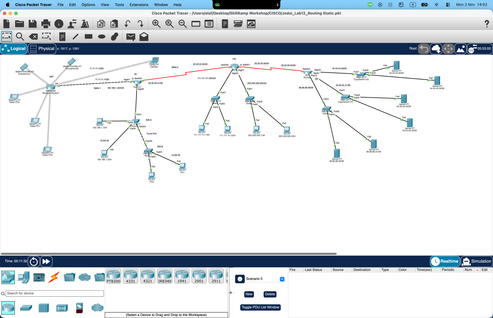

# SkillKamp Cybersecurity Bootcamp

**Cybersecurity | Networking | Infrastructure Security**

This repository documents my learning journey throughout the SkillKamp Cybersecurity Bootcamp, including weekly workshops, hands-on labs, technical configurations, and key takeaways.

The purpose of this repository is to demonstrate my practical technical skills, document my learning progress, and build a foundation for a career in cybersecurity, with a particular interest in Security Operations, Network Security, and Cloud Security.

---

## Bootcamp Progress

| Week | Date | Topics | Status |
|---|---|---|---|
| 01 | October 31, 2026 | Network Fundamentals & Security Configuration | Completed |
| 02 | Upcoming | To Be Updated | Upcoming |
| 03 | Upcoming | To Be Updated | Upcoming |

---

## Week 01 — Network Fundamentals & Security Configuration

**Date:** October 31, 2026  
**Platform:** Cisco Packet Tracer 9.0.1  
**Workshop:** Hands-on Networking and Security Lab

### Overview

The first workshop focused on networking fundamentals and practical network configuration using Cisco Packet Tracer.

The session involved configuring a simulated enterprise network consisting of routers, switches, PCs, wireless devices, and servers.

The workshop covered IP addressing, LAN and WAN connectivity, VLAN segmentation, network services, wireless security, WAN authentication, static routing, and Access Control Lists (ACLs).

### Topics Covered

#### 1. Network Fundamentals

- OSI 7-Layer Model
- LAN and WAN architecture
- IPv4 addressing and subnet masks
- Default gateways
- TCP, UDP, and ICMP
- Network connectivity testing

#### 2. Router and Switch Configuration

- Cisco IOS Command Line Interface (CLI)
- Router interface configuration
- IP address assignment
- Interface status verification
- MAC address table inspection

Example configuration:

```bash
enable
configure terminal
interface g0/0
ip address 192.168.2.254 255.255.255.0
no shutdown
```

#### 3. Network Services

Configured and tested networking services within a simulated environment.

| Service | Description |
|---|---|
| DHCP | Automatic IP address assignment |
| DNS | Domain name resolution |
| HTTP | Web communication |
| HTTPS | Encrypted web communication |
| FTP | File transfer services |

#### 4. VLAN and Network Segmentation

Practiced creating VLANs to logically separate devices within a network.

- VLAN 20 — Internet
- VLAN 30 — User
- Access Port configuration
- Trunk Port configuration
- VLAN verification

Example configuration:

```bash
vlan 20
name Internet

vlan 30
name User

interface f0/24
switchport mode trunk
```

#### 5. Wireless Network Security

Explored wireless networking and security configurations.

- SSID configuration
- WPA2 Personal
- WPA2 Enterprise
- AES encryption
- MAC address filtering
- Wireless client connectivity

#### 6. WAN Authentication

Practiced configuring Point-to-Point Protocol (PPP) with Password Authentication Protocol (PAP).

```bash
interface s0/0/0
encapsulation ppp
ppp authentication pap
```

#### 7. Static Routing

Configured static routes to enable communication between branch networks, headquarters, and an ISP-simulated network.

Example configuration:

```bash
ip route 0.0.0.0 0.0.0.0 22.22.22.22
```

Practiced inspecting routing tables and understanding how next-hop addresses determine packet forwarding.

#### 8. Access Control Lists (ACLs)

Implemented an Extended ACL to control network traffic based on protocol and port.

```bash
ip access-list extended ACL1
deny tcp any any eq 80
deny icmp any any
permit ip any any
```

### Security Testing Results

| Traffic Type | Result |
|---|---|
| HTTP (TCP 80) | Blocked |
| ICMP (Ping) | Blocked |
| HTTPS (TCP 443) | Allowed |
| FTP | Allowed |

The exercise demonstrated how ACL rules can restrict specific network traffic while permitting other services.

---

### Hands-on Lab: Enterprise Network Simulation

The network topology represented communication between a branch office, headquarters, and an ISP environment.

The lab included the following activities:

- Configuring router interfaces and IPv4 addresses.
- Establishing connectivity between multiple networks.
- Creating and assigning VLANs.
- Configuring WAN authentication.
- Implementing static and default routes.
- Applying ACL rules for traffic filtering.
- Verifying connectivity using diagnostic commands.

### Network Topology



*Network topology simulated using Cisco Packet Tracer during the first workshop.*

---

## Key Takeaways

The first workshop provided a practical understanding of how fundamental networking concepts relate to cybersecurity.

**Network Segmentation**

VLANs help establish logical network boundaries and support the separation of devices into different network groups.

**Authentication**

PPP/PAP and wireless authentication introduced methods of controlling network access and verifying connectivity.

**Routing and Connectivity**

Static routing demonstrated how network traffic is forwarded between different networks through configured paths.

**Traffic Filtering**

Access Control Lists demonstrated how network administrators can restrict or permit traffic based on defined rules.

**Network Troubleshooting**

Commands such as `ping`, `ipconfig`, `show ip route`, and `show ip interface brief` provided practical experience in verifying connectivity and inspecting network configurations.

---

## Tools and Technologies

| Category | Tools and Technologies |
|---|---|
| Network Simulation | Cisco Packet Tracer |
| Network Devices | Cisco Routers and Switches |
| Networking | IPv4, LAN, WAN, VLAN, Static Routing |
| Network Services | DHCP, DNS, HTTP, HTTPS, FTP |
| Authentication | PPP, PAP, WPA2 |
| Network Security | Extended ACL, Network Segmentation |
| Troubleshooting | Ping, ipconfig, Cisco IOS CLI |

---

## Learning Objectives

Throughout this bootcamp, my objectives are to:

- Strengthen my understanding of networking and cybersecurity fundamentals.
- Gain practical experience in network configuration and troubleshooting.
- Develop foundational skills in network security and access control.
- Understand how security concepts apply to enterprise and cloud infrastructure.
- Document my technical progress through structured hands-on exercises.

---

## Disclaimer

This repository is intended for educational and portfolio purposes only.

All network configurations and simulations documented here are based on exercises performed in a controlled learning environment. Third-party workshop materials remain the property of their respective owners.
