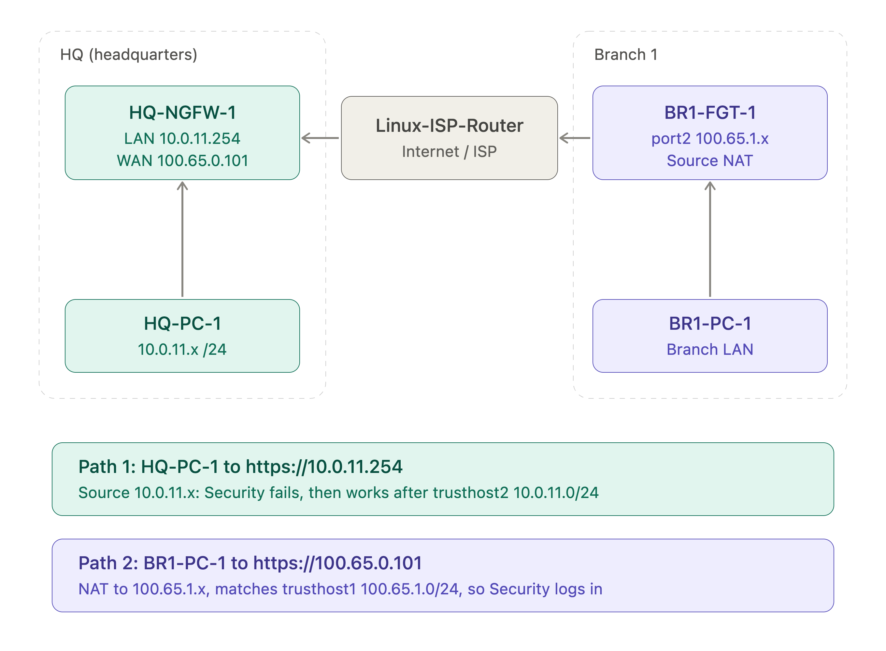

## Week 02 — FortiGate Firewall Administration

**Date:** November 7, 2026  
**Platform:** Fortinet FortiOS 7.6 Administrator Virtual Lab  
**Workshop:** EP.5 Enterprise Infrastructure Build-up Workshop (Virtual Lab FortiGate Administrator)

### Overview

The second workshop moved from simulated Cisco devices to a real Next-Generation Firewall (NGFW) running FortiOS 7.6.

The session involved configuring a FortiGate firewall (HQ-NGFW-1) in a virtual enterprise lab consisting of a headquarters network, a branch office, an ISP router, and FortiAnalyzer for centralized logging.

The workshop covered administrator access control, firewall policies, policy ordering, traffic logging, Destination NAT (Virtual IP), Source NAT (IP Pool), redundant routing, failover, and Equal-Cost Multi-Path (ECMP) routing.

### Topics Covered

#### 1. Administrator Access Control

- Admin Profiles (role-based permissions)
- Trusted Hosts (login source restriction)
- Principle of Least Privilege
- Effect of NAT on trusted host checks

Example configuration:

```bash
config system admin
edit Security
set trusthost1 100.65.1.0 255.255.255.0
set trusthost2 10.0.11.0 255.255.255.0
set accprofile "Security_Admin_Profile"
end
```

#### 2. Firewall Policies

- Address objects (`HQ_SUBNET` 10.0.11.0/24)
- Allow and Deny policies
- Implicit Deny
- Stateful inspection

#### 3. Policy Ordering (First Match)

FortiGate evaluates policies from top to bottom and applies the first match.

Moving a Deny policy above an Allow policy immediately blocked ICMP traffic. The policy ID did not change, which showed that policy ID is not policy order.

```bash
config firewall policy
move 5 before 4
end
```

#### 4. Logging and Monitoring

- Log Allowed Traffic: All Sessions
- Log Violation Traffic for Deny policies
- Forward Traffic logs on FortiGate
- Centralized logging with FortiAnalyzer

#### 5. Destination NAT (Virtual IP)

Published an internal web server to the outside network using a static NAT Virtual IP.

| External IP | Mapped IP | Service |
|---|---|---|
| 100.65.0.200 | 10.0.11.50 | HTTP |

```bash
curl http://100.65.0.200
```

#### 6. Source NAT (IP Pool)

Configured an Overload IP Pool so internal users access the Internet using a dedicated public IP address.

```bash
diagnose sys session filter src 10.0.11.50
get system session list | grep 10.0.11.50
```

Verified that outbound sessions from 10.0.11.50 were translated to 100.65.0.100.

#### 7. Redundant Routing and Failover

Configured primary and backup default routes using Administrative Distance.

| Route | Gateway | Interface | Distance |
|---|---|---|---|
| Primary | 100.65.0.254 | port2 | 10 |
| Backup | 100.66.0.254 | port3 | 20 |

When port2 was disabled, the backup route on port3 became active automatically.

```bash
get router info routing-table all
get router info routing-table database
```

#### 8. ECMP Load Balancing

Set both routes to equal Distance and Priority so traffic could use both Internet links at the same time.

```bash
config system settings
set v4-ecmp-mode source-dest-ip-based
end
```

Verified traffic distribution with the built-in packet sniffer:

```bash
diagnose sniffer packet any 'tcp[tcpflags] & tcp-syn != 0 and tcp[tcpflags] & tcp-ack == 0 and port 80' 4
```

### Security Testing Results

| Test | Result |
|---|---|
| Restricted admin login from HQ (before trusted host fix) | Blocked |
| Restricted admin login from HQ (after trusted host fix) | Allowed |
| ICMP with Deny policy below Allow policy | Allowed |
| ICMP with Deny policy moved to top | Blocked |
| External HTTP access via VIP (100.65.0.200) | Allowed |
| Outbound traffic translated to IP Pool (100.65.0.100) | Verified |
| Primary link failure → backup route | Failover successful |
| Equal routes on two links | ECMP active |

The exercises demonstrated how firewall policies, NAT, and routing work together to control and protect network traffic.

---

### Hands-on Lab: FortiGate Enterprise Firewall

The lab environment represented a headquarters network protected by a FortiGate NGFW, connected to a branch office through an ISP network.

The lab included the following activities:

- Restricting administrator permissions and login sources.
- Creating firewall policies and address objects.
- Reordering policies and observing first-match behavior.
- Sending traffic logs to FortiAnalyzer.
- Publishing an internal web server with a Virtual IP.
- Translating outbound traffic with an IP Pool.
- Building a backup Internet link with automatic failover.
- Load-balancing traffic across two links with ECMP.
- Verifying results using session tables, routing tables, logs, and packet capture.

### Lab Topology



*Simplified lab topology used during the second workshop.*

---

## Self-Paced Virtual Labs — Cloud Track (Group A)

Alongside the live EP.5 workshop above, I completed six hands-on labs from the FortiOS 7.6 Administrator virtual lab. These are the "Group A" track — the foundations that map most directly to cloud and infrastructure security (and carry over to FortiGate-VM in the cloud). Each lab was built end-to-end in the virtual lab and verified from the CLI. Full step-by-step write-ups with annotated screenshots are in [`labs/`](labs/) (click each lab title below).

**[Lab 01 — System & Network Settings](labs/LAB-01.md)** ([English](labs/LAB-01-EN.md))
Configured FortiGate interfaces (manual / DHCP / PPPoE, interface roles) through both GUI and CLI; created role-based admin profiles and admin users with trusted-host restrictions; practiced configuration backup and restore.
Skills: NGFW initial bring-up, least-privilege administration, trusted hosts.

**[Lab 03 — Firewall Policies & NAT](labs/LAB-03.md)** ([English](labs/LAB-03-EN.md))
Built and ordered firewall policies (first-match evaluation) and used Show Matching Logs to verify hits; configured Source NAT with an outgoing interface and an IP Pool, and published an internal server externally with a Virtual IP (static DNAT and port forwarding).
Skills: stateful policy design, SNAT and DNAT, VIP publishing.

**[Lab 04 — Routing](labs/LAB-04.md)** ([English](labs/LAB-04-EN.md))
Created multiple static and default routes, then tuned administrative distance and priority to achieve failover and ECMP; validated with the routing monitor, Route Lookup, and get router info routing-table all.
Skills: static routing, redundant links, ECMP load balancing.

**[Lab 11 — IPsec VPN](labs/LAB-11.md)** ([English](labs/LAB-11-EN.md))
Configured a site-to-site route-based IPsec VPN between two FortiGates (phase 1 / phase 2, static route, firewall policy), including a backup tunnel on a higher administrative distance; verified with the IPsec widget, VPN event logs, and diagnose vpn tunnel list.
Skills: route-based IPsec, VPN redundancy, tunnel troubleshooting.

**[Lab 12 — SD-WAN](labs/LAB-12.md)** ([English](labs/LAB-12-EN.md))
Built SD-WAN zones and members, zone static routes, Performance SLA health checks, and SD-WAN rules using different load-balancing strategies; confirmed traffic steering with Forward Traffic logs, the SD-WAN monitor, and diagnose firewall proute list.
Skills: SD-WAN design, performance SLA, application-aware steering.

**[Lab 13 — High Availability](labs/LAB-13.md)** ([English](labs/LAB-13-EN.md))
Set up two FortiGates as an HA cluster (group ID / name, password, heartbeat, priority / override); verified with get system ha status and diagnose sys ha checksum cluster, triggered a manual failover, and managed the secondary unit with execute ha manage.
Skills: FGCP HA clustering, failover testing, reserved management interface.

*Labs 01, 03 and 04 cover the same foundations reinforced in the live EP.5 workshop above; Labs 11-13 extend into secure connectivity, SD-WAN, and high availability.*
