# 🔬 LAB 01 Summary: System and Network Settings (Administrator Accounts)

> 🇹🇭 ภาษาไทย: [LAB-01.md](LAB-01.md)
> Note: screenshots live in `images/lab01/`

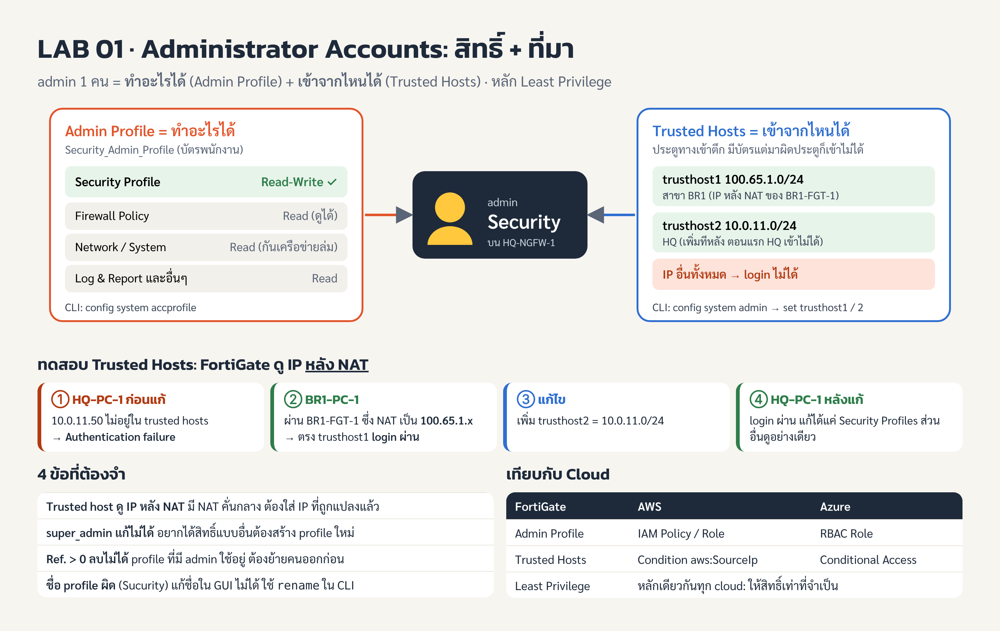

## Overview

LAB 01 is about creating an admin named `Security` that can edit only the Security Profile and can log in only from specific IPs (Internet Protocol addresses). Finished in about 25 of the 40 minutes the lab allows (the task estimates 20 minutes).

Course: FortiOS 7.6 Administrator (FTAO), CIPAT (Cyber Innovation Promotion Association of Technology) Cyber Bootcamp Batch 2 · FortiOS v7.6.0 build3401 · Study Guide Chapter 1, pages 5-31

**Objectives**

1. Create a new administrator user
2. Restrict that administrator's access
3. Test the administrator's access

**Machines and passwords** (every machine uses `Fortinet1!`)

| VM (Virtual Machine) | Username | Role in this lab |
| --- | --- | --- |
| HQ-PC-1 (Ubuntu) | Administrator | Open Firefox to the GUI (Graphical User Interface) of HQ-NGFW-1 at https://10.0.11.254 |
| BR1-PC-1 (Ubuntu) | Administrator | Test login from the branch, to https://100.65.0.101 |
| HQ-NGFW-1 | admin | The main FortiGate being configured (GUI and Console) |
| BR1-FGT-1 | admin | Don't touch — it performs NAT (Network Address Translation) for BR1-PC-1 |
| HQ-FAZ-1 | admin | FortiAnalyzer — not used in this lab |

Machine names: HQ = Headquarters, BR1 = Branch 1, PC = Personal Computer, NGFW = Next-Generation Firewall, FGT = FortiGate, FAZ = FortiAnalyzer

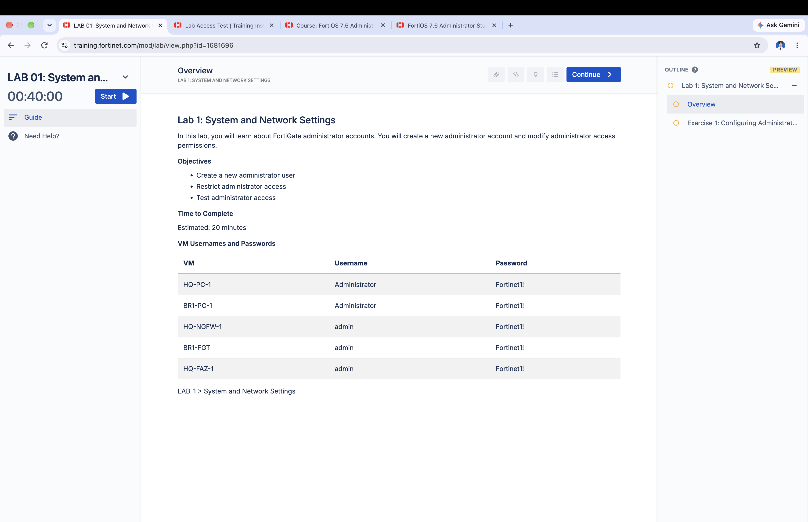

Good to know about the lab: after pressing Start, provisioning takes ~9-10 minutes before the timer begins; you can't pause, and you can't reopen it after pressing Stop. The Overview and Exercise pages can be read ahead of time in PREVIEW mode before pressing Start.

## Topology

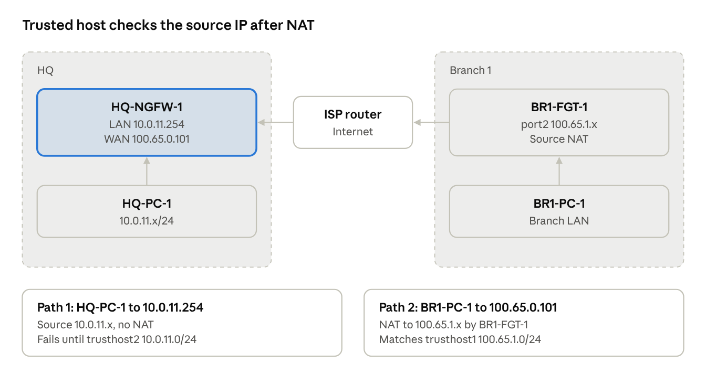

HQ-PC-1 connects directly to the LAN (Local Area Network) side, so it uses the real IP 10.0.11.x. BR1-PC-1 is NAT'd by BR1-FGT-1, which changes its source IP to 100.65.1.x before it passes through the ISP (Internet Service Provider) router to the WAN (Wide Area Network) side of HQ-NGFW-1. The branch LAN range and the ISP router's legs aren't given in the task; the real diagram is in the file Network_Topology.jpg on HQ-PC-1's desktop.

## Step 0: Enter the lab machine and log into the GUI

Everything in sections A-D is done in Firefox on HQ-PC-1, not the browser on your own machine.

1. Once the lab is ready, click HQ-PC-1 in the left bar, then click the icon next to **Display** (this machine has no RDP (Remote Desktop Protocol)); the Ubuntu screen opens in a new tab.
2. Open Firefox and go to `https://10.0.11.254` (HTTPS = Hypertext Transfer Protocol Secure), or use the HQ-NGFW-1 bookmark.
3. On the "Warning: Potential Security Risk Ahead" page, click **Advanced... > Accept the Risk and Continue**, because FortiGate uses a self-signed certificate (that's LAB 07's topic).
4. Log in as `admin` / `Fortinet1!`

On the Dashboard you'll see things that match Chapter 1: Mode = **NAT** (default), the Administrators widget shows `admin` using profile **super_admin**, and Licenses shows each FortiGuard status.

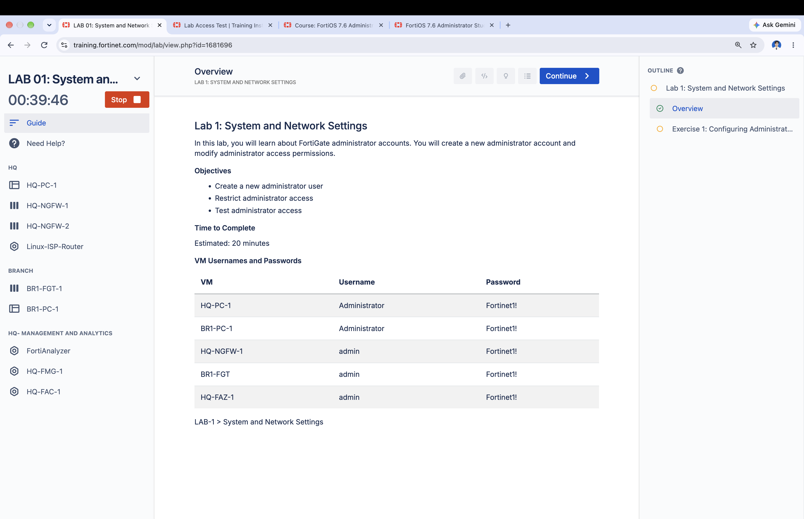

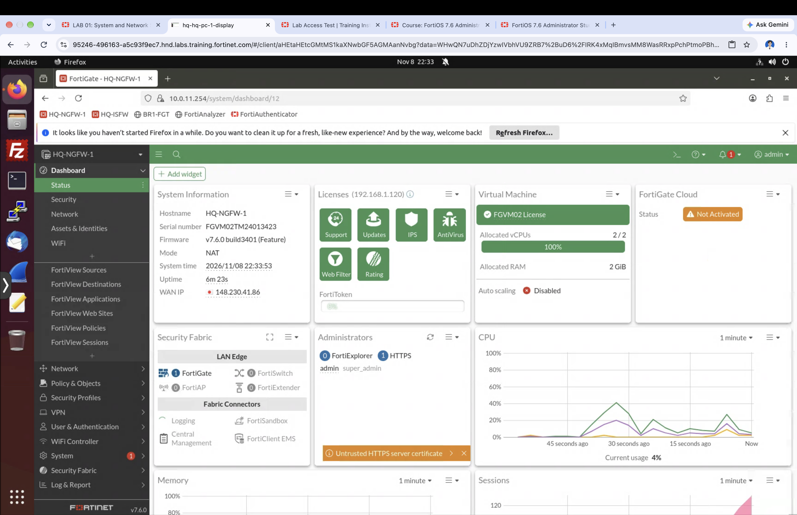

## Section A: Create the Admin Profile

Goal: a profile `Security_Admin_Profile` where every category is **Read** except **Security Profile**, which is **Read/Write**, following least privilege.

1. **System > Admin Profiles > Create New**
2. Name: `Security_Admin_Profile`
3. In the Permissions column header, click **Set All > Read**
4. On the **Security Profile** row, click **Read/Write**
5. Click **OK**

Before creating, there are 2 profiles: `super_admin` (Ref. 2, used by user admin, not editable) and `prof_admin` (Ref. 0), where Ref. (Reference count) is how many places this object is used.

### Mistake encountered and how it was fixed

The first time, the name was typed wrong as `Sucurity_Admin_Profile` and OK was pressed while every category was still Read/Write (the default for a new profile). Lessons learned:

- An object's name **cannot be edited** in the GUI — the Edit page shows the name as plain text; you must use `rename` in the CLI (Command Line Interface), or delete and recreate.
- The **Edit in CLI** button drops you inside the object itself (prompt `(Sucurity_Admin_P~ile) #`). There you can't issue `config ...` (it returns `command parse error`), but `set` works directly.
- `next` leaves the object back to the `(accprofile) #` level (accprofile = access profile) where `rename` works; `end` saves and returns to the main prompt.
- After fixing via CLI, the GUI may still show the old values — refresh, and don't press OK on a stale Edit window left open.

Commands used to fix (typed after the Edit-in-CLI prompt):

```txt
set secfabgrp read
set ftviewgrp read
set authgrp read
set sysgrp read
set netgrp read
set loggrp read
set fwgrp read
set vpngrp read
set utmgrp read-write
set wanoptgrp read
set wifi read
next
rename Sucurity_Admin_Profile to Security_Admin_Profile
end
show system accprofile Security_Admin_Profile
```

The idea behind this profile: give Read to every category so you can see the context needed to work, but give Write only to the task you're responsible for (least privilege). If this account is compromised, the attacker can only edit security profiles — not policies, networks, or create more admins.

| CLI name (full name) | GUI menu | What it covers | Set to | Why |
| --- | --- | --- | --- | --- |
| utmgrp (Unified Threat Management group) | Security Profile | AntiVirus, Web Filter, IPS, Application Control, DNS Filter, SSL inspection | Read/Write | This is the account's main job, so it's the only writable category |
| fwgrp (Firewall group) | Firewall | Firewall policy, address/service object, NAT, schedule | Read | Policy decides whether traffic passes; a wrong edit can open a hole or break the net, but it must be visible to know which policy the profile binds to |
| sysgrp (System group) | System | admin, admin profile, firmware, HA, settings, backup | Read | If writable, one could create new admins or escalate privileges (privilege escalation) |
| netgrp (Network group) | Network | interface, routing, DNS, DHCP | Read | A wrong edit brings the network down instantly |
| loggrp (Log group) | Log & Report | log, report, log-storage settings | Read | Logs must be readable to see block results, but shouldn't be edited or disabled, since logs are audit evidence |
| authgrp (Authentication group) | User & Device | user, user group, authentication, detected devices | Read | Editing users/groups affects everyone's rights org-wide — not this account's job |
| vpngrp (VPN group) | VPN | IPsec and SSL VPN tunnels | Read | A wrong edit disconnects branches or remote users |
| secfabgrp (Security Fabric group) | Security Fabric | Linking FortiGate to other Fortinet devices (Fabric connector, topology) | Read | Can view the big picture, but connections affect many devices |
| ftviewgrp (FortiView group) | FortiView | Traffic views by source, destination, application | Read | It's a view page anyway, used to check whether security profiles work |
| wanoptgrp (WAN Optimization group) | WAN Opt & Cache | WAN acceleration and web cache | Read | Not related to the security-profile job |
| wifi (WiFi & Switch) | WiFi & Switch | FortiAP, FortiSwitch, SSID | Read | Not related to this job, and a wrong edit affects wireless users |

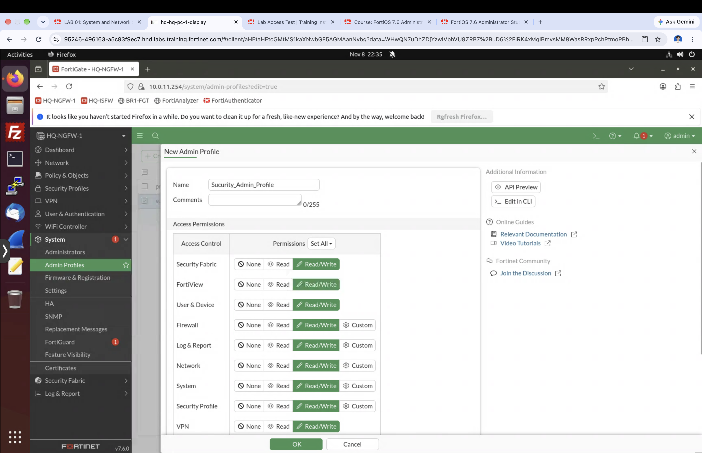

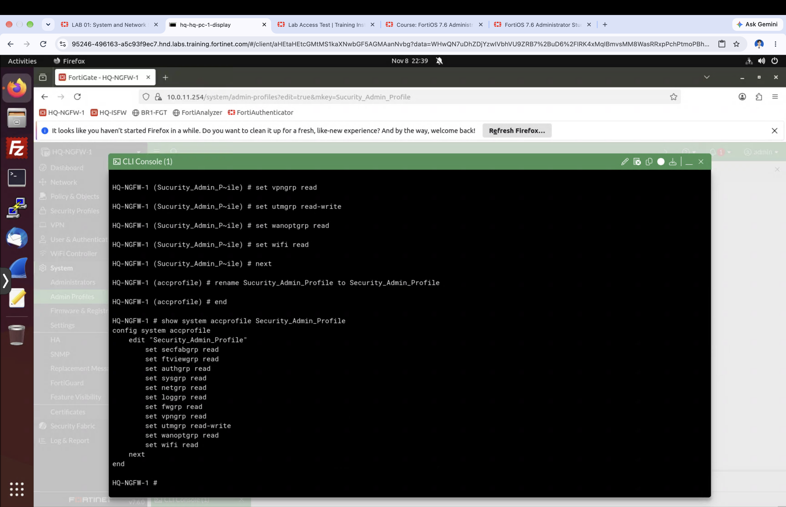

## Section B: Create the Admin Account

Goal: an admin named `Security` bound to `Security_Admin_Profile`.

1. **System > Administrators > Create New > Administrator**
2. Fill in the values below, then click **OK**. Don't enable "Restrict login to trusted hosts" at this stage.

| Field | Value |
| --- | --- |
| Username | Security |
| Type | Local User |
| Password / Confirm Password | Fortinet1! |
| Administrator profile | Security_Admin_Profile |

The admin name and password are case-sensitive, and the characters `< > ( ) # "` can't be used in an admin name. If you accidentally pick `super_admin`, the tests in section C won't behave as the task expects.

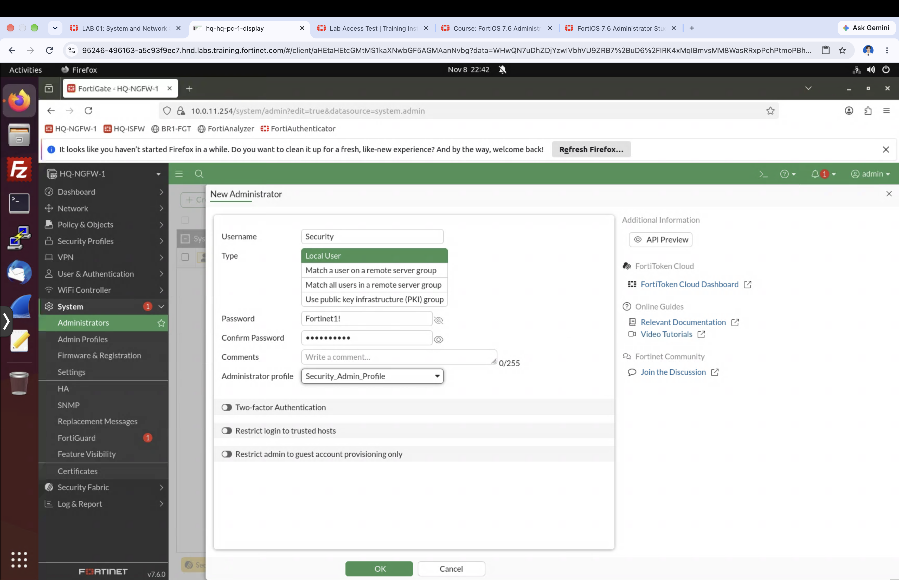

## Section C: Test the Security account's rights

Result: you can log in as `Security`, edit Security Profiles, and only view other categories.

1. Click **admin > Logout**, then log in as `Security` / `Fortinet1!`
2. On the FortiGate Setup window click **Later**, and on the FortiOS tour window tick **Don't show again** then **OK** (the URL contains `viewOnly=`, showing the system knows the rights are limited)
3. **Security Profiles > AntiVirus** has a **Create new** button and the Edit page is editable with an OK button (Read/Write works). Click **Cancel** because the `default` and `wifi-default` profiles are used in later labs.
4. Other menus like Network or Policy & Objects are view-only, with no save button.
5. **Logout**

Extra observation: the **Delete** button for `wifi-default` is grey because Ref. = 1 (it's in use) — FortiGate won't delete a referenced object (unlike the misspelled profile with Ref. = 0, which was deletable).

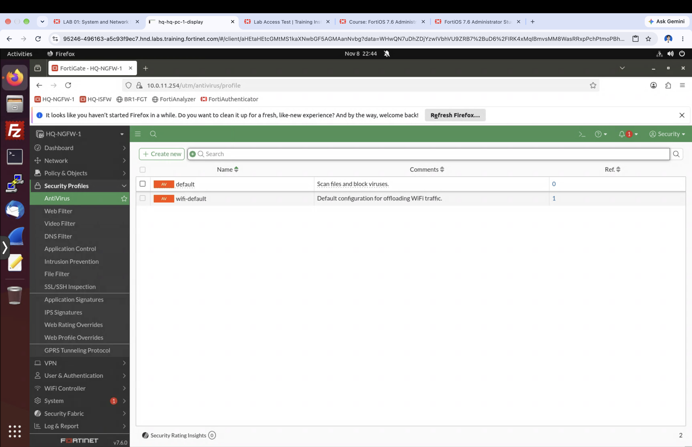

## Sections D-E: Trusted Host and testing

Result: `Security` can log in only from IPs listed in the trusted hosts, with FortiGate checking the source IP that actually reaches it, after NAT.

### D: Set Trusted Host 1

1. Log in as `admin`, go to **System > Administrators**, double-click **Security**
2. Enable **Restrict login to trusted hosts**
3. Trusted Host 1: `100.65.1.0/24` (don't add host 2 in the GUI yet)
4. Click **OK**

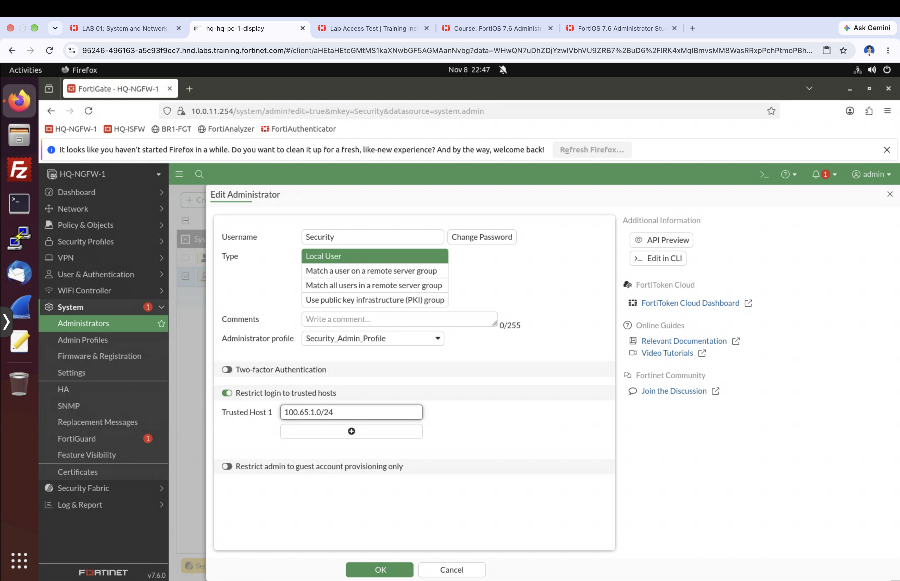

### E: Test three times

| # | From machine | To | IP FortiGate sees | Result |
| --- | --- | --- | --- | --- |
| 1 | HQ-PC-1 | https://10.0.11.254 | 10.0.11.x (no NAT) | Authentication failure |
| 2 | BR1-PC-1 | https://100.65.0.101 | 100.65.1.x (NAT by BR1-FGT-1) | Allowed |
| 3 (after adding trusthost2) | HQ-PC-1 | https://10.0.11.254 | 10.0.11.x | Allowed |

In test 1 you still see the login page because `admin` is still trusted host 0.0.0.0/0. If every admin were restricted and the IP matched no one, you wouldn't see the login page at all.

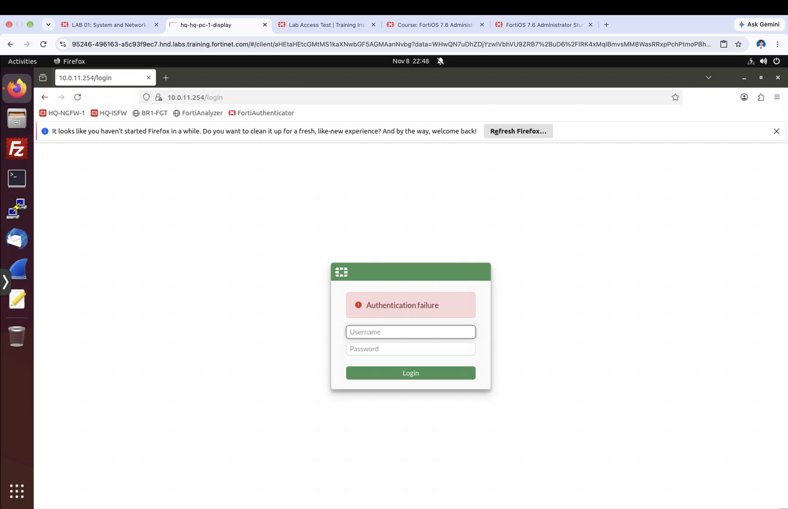

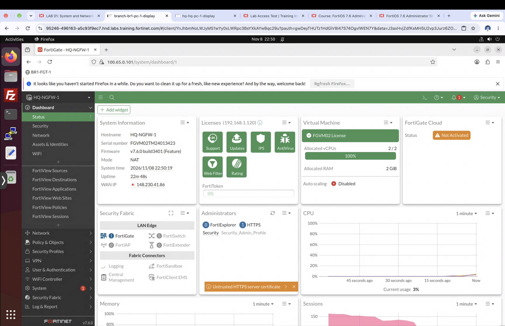

### Add Trusted Host 2 via CLI

In the lab tab, click **HQ-NGFW-1 > Console**, press Enter to get the login prompt, then log in as `admin` / `Fortinet1!` (the password isn't shown on screen).

```txt
config system admin
edit Security
set trusthost2 10.0.11.0/24
end
show system admin Security
```

FortiOS converts `/24` (CIDR = Classless Inter-Domain Routing notation) to `255.255.255.0` automatically, and stores the password as an encrypted `ENC ...` value.

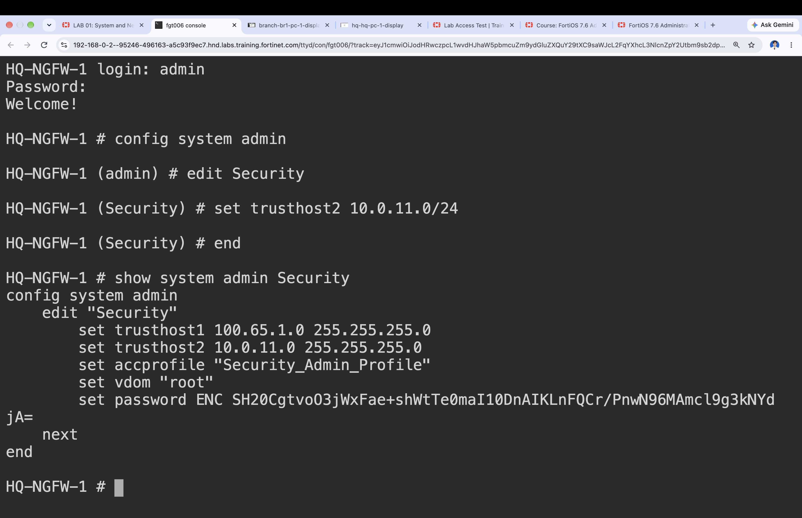

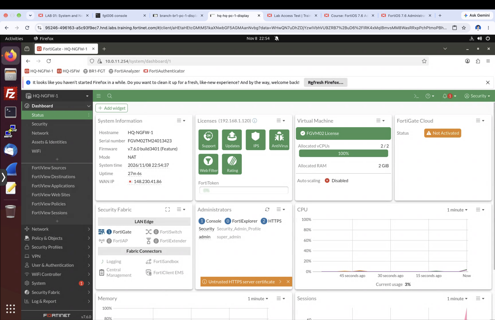

## Lessons and exam points

An admin profile decides what an admin can do; a trusted host decides where they can log in from. Use them together for least privilege.

- `super_admin` is user `admin`'s profile, is not editable, and has full rights
- Each category's rights are None / Read / Read-Write; some categories also have Custom
- The default trusted host is 0.0.0.0/0 (reachable from anywhere); you can set multiple ranges, from `trusthost1` to `trusthost10`
- Trusted host checks the source IP after NAT; if there's NAT between the machine and FortiGate, enter the post-NAT IP
- Logging in from an IP not in the trusted hosts shows Authentication failure, but if every admin is restricted and none matches, you won't see the login page
- An object can be deleted only when Ref. = 0
- An object's name can't be edited in the GUI; use `rename <old> to <new>` in the CLI
- Idle timeout defaults to 5 minutes (`config system global` > `set admintimeout`); it can be overridden per profile

### CLI cheat sheet

```txt
config system accprofile
    edit <profile>
        set utmgrp read-write
    next
    rename <old> to <new>
end
show system accprofile <profile>

config system admin
    edit <user>
        set accprofile <profile>
        set trusthost1 100.65.1.0/24
        set trusthost2 10.0.11.0/24
    next
end
show system admin <user>
```

The CLI can be opened three ways: the `>_` icon in the GUI, the Edit-in-CLI button on an Edit page (drops you inside the object), and a VM's Console on the lab page.

## All abbreviations in this document

| Abbr. | Full name | Meaning in this lab |
| --- | --- | --- |
| accprofile | access profile | admin profile in the CLI |
| AV | AntiVirus | virus-scanning security profile |
| BR1 | Branch 1 | branch site 1 |
| CIDR | Classless Inter-Domain Routing | writing subnets like /24 |
| CLI | Command Line Interface | the command-typing screen |
| DHCP | Dynamic Host Configuration Protocol | hands out IPs automatically |
| DNS | Domain Name System | resolves domain names to IPs |
| ENC | Encrypted | an encrypted value in the config |
| FAZ | FortiAnalyzer | log collection and analysis box |
| FGT | FortiGate | Fortinet's firewall |
| GUI | Graphical User Interface | the web page for configuration |
| HA | High Availability | redundant FortiGates (LAB 13) |
| HQ | Headquarters | the head office |
| HTTPS | Hypertext Transfer Protocol Secure | the protocol used to reach the GUI |
| IP | Internet Protocol (address) | a device's address on the network |
| IPS | Intrusion Prevention System | detects and blocks attacks (LAB 10) |
| IPsec | Internet Protocol Security | site-to-site VPN (LAB 11) |
| ISP | Internet Service Provider | the internet provider |
| LAN | Local Area Network | the internal network |
| NAT | Network Address Translation | changing a source or destination IP |
| NGFW | Next-Generation Firewall | a firewall that inspects up to the application layer |
| PC | Personal Computer | user machine |
| RDP | Remote Desktop Protocol | remote desktop access |
| Ref. | Reference count | how many places an object is used |
| SSID | Service Set Identifier | the WiFi network name |
| SSL | Secure Sockets Layer | traffic encryption |
| UTM | Unified Threat Management | the security-profile set (utmgrp) |
| VM | Virtual Machine | a virtual machine in the lab |
| VPN | Virtual Private Network | an encrypted tunnel between networks |
| WAN | Wide Area Network | the leg that goes out to the internet |
