# 🔬 LAB 01 สรุป: System and Network Settings (Administrator Accounts)

> 🇬🇧 English version: [LAB-01-EN.md](LAB-01-EN.md)
> รูปภาพประกอบอยู่ใน `images/lab01/`

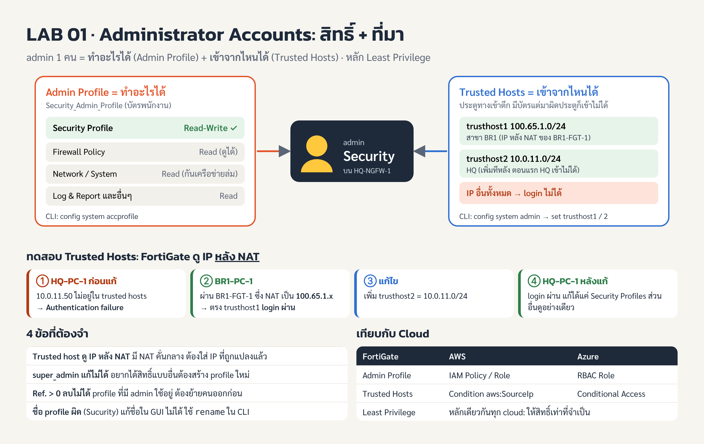

## ภาพรวม

LAB 01 ให้สร้าง admin ชื่อ `Security` ที่แก้ได้เฉพาะ Security Profile และ login ได้เฉพาะจาก IP (Internet Protocol address) ที่กำหนด ทำเสร็จในประมาณ 25 นาที จาก 40 นาทีที่ lab ให้ (โจทย์ประมาณไว้ 20 นาที)

คอร์ส: FortiOS 7.6 Administrator (FTAO), CIPAT (Cyber Innovation Promotion Association of Technology) Cyber Bootcamp Batch 2 · FortiOS v7.6.0 build3401 · Study Guide บทที่ 1 หน้า 5-31

**Objectives**

1. สร้าง administrator user ใหม่
2. จำกัดการเข้าถึงของ administrator
3. ทดสอบการเข้าถึงของ administrator

**เครื่องและรหัสผ่าน** (ทุกเครื่องใช้รหัส `Fortinet1!`)

| VM (Virtual Machine) | Username | ใช้ใน lab นี้ |
| --- | --- | --- |
| HQ-PC-1 (Ubuntu) | Administrator | เปิด Firefox เข้า GUI (Graphical User Interface) ของ HQ-NGFW-1 ที่ https://10.0.11.254 |
| BR1-PC-1 (Ubuntu) | Administrator | ทดสอบ login จากสาขา ไปที่ https://100.65.0.101 |
| HQ-NGFW-1 | admin | FortiGate หลักที่ตั้งค่า (GUI และ Console) |
| BR1-FGT-1 | admin | ไม่ต้องแตะ ทำ NAT (Network Address Translation) ให้ BR1-PC-1 |
| HQ-FAZ-1 | admin | FortiAnalyzer ไม่ได้ใช้ใน lab นี้ |

ชื่อเครื่อง: HQ = Headquarters (สำนักงานใหญ่), BR1 = Branch 1 (สาขา 1), PC = Personal Computer, NGFW = Next-Generation Firewall, FGT = FortiGate, FAZ = FortiAnalyzer

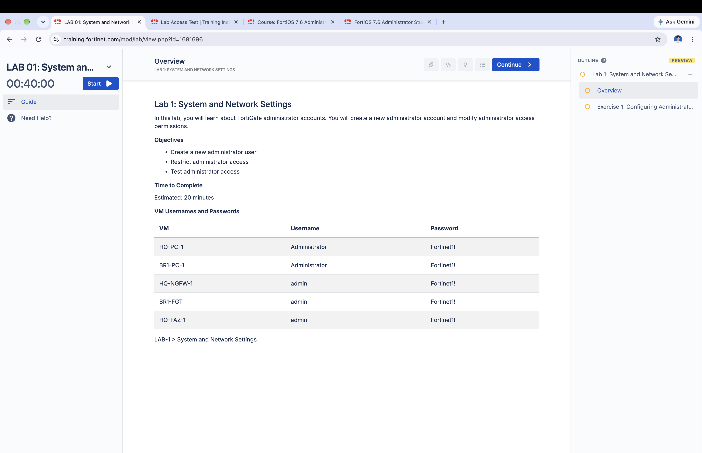

ข้อควรรู้เรื่อง lab: กด Start แล้วจะเตรียมเครื่อง (provisioning) ประมาณ 9-10 นาทีก่อนเริ่มนับเวลา หยุดชั่วคราวไม่ได้ และเปิดใหม่หลังกด Stop ไม่ได้ หน้า Overview กับ Exercise อ่านล่วงหน้าได้ในโหมด PREVIEW ก่อนกด Start

## Topology

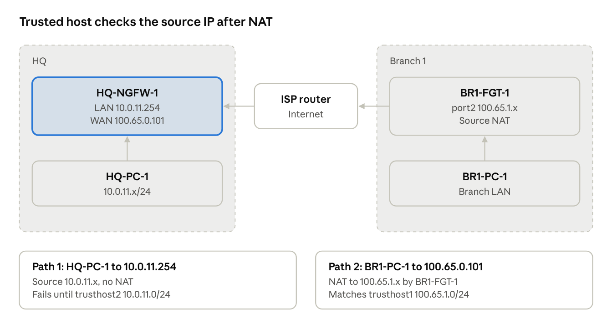

HQ-PC-1 ต่อตรงเข้าขา LAN (Local Area Network) จึงใช้ IP จริง 10.0.11.x ส่วน BR1-PC-1 ถูก BR1-FGT-1 ทำ NAT เปลี่ยน IP ต้นทางเป็น 100.65.1.x ก่อนผ่าน ISP (Internet Service Provider) router ไปถึงขา WAN (Wide Area Network) ของ HQ-NGFW-1 IP ของวง LAN สาขาและขาของ ISP router ไม่มีในโจทย์ ดูแผนผังจริงได้จากไฟล์ Network_Topology.jpg บน desktop ของ HQ-PC-1

## ขั้นที่ 0: เข้าเครื่อง lab และ login GUI

ทุกอย่างในส่วน A-D ทำบน Firefox ของเครื่อง HQ-PC-1 ไม่ใช่เบราว์เซอร์บนเครื่องตัวเอง

1. หลัง lab พร้อม คลิก HQ-PC-1 ที่แถบซ้าย แล้วกดไอคอนข้าง **Display** (เครื่องนี้ไม่มี RDP (Remote Desktop Protocol)) จะเปิดหน้าจอ Ubuntu ในแท็บใหม่
2. เปิด Firefox แล้วไปที่ `https://10.0.11.254` (HTTPS = Hypertext Transfer Protocol Secure) หรือกด bookmark HQ-NGFW-1
3. หน้า Warning: Potential Security Risk Ahead กด **Advanced... > Accept the Risk and Continue** เพราะ FortiGate ใช้ certificate แบบ self-signed (เรื่องของ LAB 07)
4. login `admin` / `Fortinet1!`

บน Dashboard เห็นสิ่งที่ตรงกับบทที่ 1: Mode = **NAT** (ค่าเริ่มต้น), widget Administrators แสดง `admin` ใช้ profile **super_admin** และ Licenses แสดงสถานะ FortiGuard แต่ละตัว

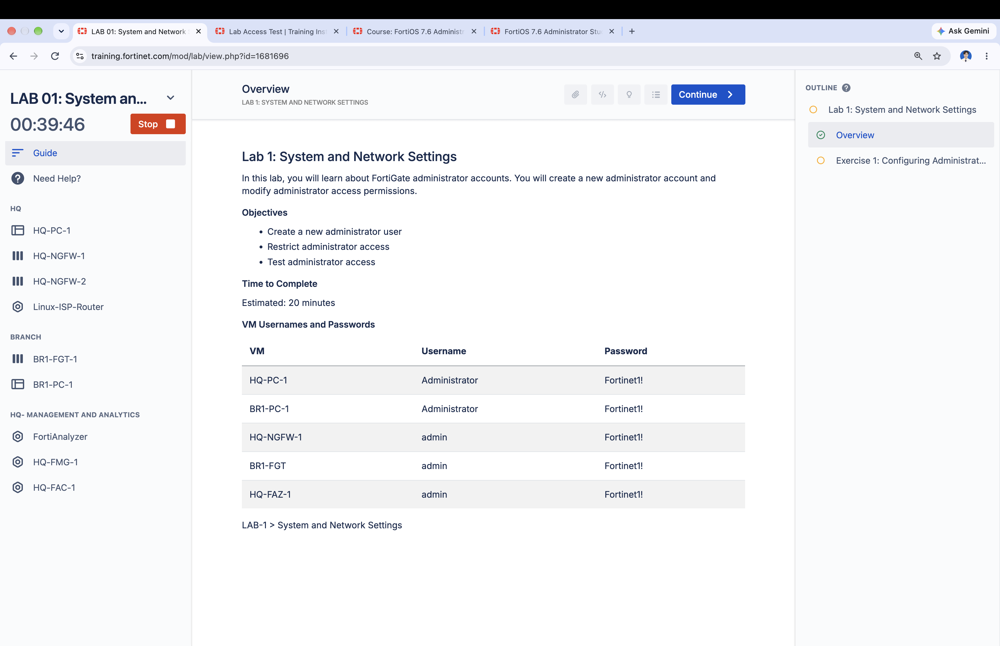

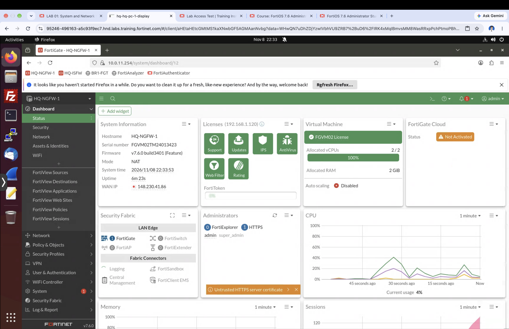

## ส่วน A: สร้าง Admin Profile

ผลที่ต้องได้: profile `Security_Admin_Profile` ที่ทุกหมวดเป็น **Read** ยกเว้น **Security Profile** เป็น **Read/Write** ตามหลัก least privilege

1. **System > Admin Profiles > Create New**
2. Name: `Security_Admin_Profile`
3. ที่หัวคอลัมน์ Permissions กด **Set All > Read**
4. แถว **Security Profile** กด **Read/Write**
5. กด **OK**

ก่อนสร้างมี profile อยู่ 2 ตัว: `super_admin` (Ref. 2, ใช้โดย user admin แก้ไม่ได้) และ `prof_admin` (Ref. 0) โดย Ref. (Reference count) คือจำนวนที่ที่ object นี้ถูกใช้งานอยู่

### ความผิดพลาดที่เจอและวิธีแก้

รอบแรกพิมพ์ชื่อผิดเป็น `Sucurity_Admin_Profile` และกด OK โดยทุกหมวดยังเป็น Read/Write (ค่าเริ่มต้นของ profile ใหม่) บทเรียนที่ได้:

- ชื่อ object ใน GUI **แก้ไม่ได้** หน้า Edit แสดงชื่อเป็นข้อความธรรมดา ต้องใช้ `rename` ใน CLI (Command Line Interface) หรือลบแล้วสร้างใหม่
- ปุ่ม **Edit in CLI** พาเข้าไปอยู่ใน object เลย (prompt เป็น `(Sucurity_Admin_P~ile) #`) ตรงนี้สั่ง `config ...` ไม่ได้ จะขึ้น `command parse error` แต่สั่ง `set` ได้เลย
- `next` ออกจาก object กลับไปที่ระดับ `(accprofile) #` (accprofile = access profile) ถึงจะ `rename` ได้ ส่วน `end` บันทึกและกลับไปที่ prompt หลัก
- หลังแก้ผ่าน CLI หน้า GUI อาจยังแสดงค่าเก่า ต้องรีเฟรช และห้ามกด OK ที่หน้าต่าง Edit เก่าที่ค้างอยู่

คำสั่งที่ใช้แก้ (พิมพ์ต่อจาก prompt ของ Edit in CLI):

```txt
set secfabgrp read
set ftviewgrp read
set authgrp read
set sysgrp read
set netgrp read
set loggrp read
set fwgrp read
set vpngrp read
set utmgrp read-write
set wanoptgrp read
set wifi read
next
rename Sucurity_Admin_Profile to Security_Admin_Profile
end
show system accprofile Security_Admin_Profile
```

หลักคิดของ profile นี้: ให้ Read ทุกหมวดเพื่อให้เห็นบริบทที่ต้องใช้ทำงาน แต่ให้ Write เฉพาะงานที่รับผิดชอบ (least privilege) ถ้าบัญชีนี้หลุดไป ผู้โจมตีแก้ได้แค่ security profile แก้ policy, network หรือสร้าง admin เพิ่มไม่ได้

| ชื่อใน CLI (ชื่อเต็ม) | เมนูใน GUI | ครอบคลุมอะไร | ตั้งเป็น | ทำไมตั้งแบบนี้ |
| --- | --- | --- | --- | --- |
| utmgrp (Unified Threat Management group) | Security Profile | AntiVirus, Web Filter, IPS, Application Control, DNS Filter, SSL inspection | Read/Write | เป็นหน้าที่หลักของ account นี้ จึงเป็นหมวดเดียวที่ต้องแก้ได้ |
| fwgrp (Firewall group) | Firewall | Firewall policy, address/service object, NAT, schedule | Read | policy เป็นตัวตัดสินว่า traffic ผ่านหรือไม่ แก้พลาดอาจเปิดช่องโหว่หรือทำเน็ตล่ม แต่ต้องดูได้เพื่อรู้ว่า profile ผูกกับ policy ไหน |
| sysgrp (System group) | System | admin, admin profile, firmware, HA, settings, backup | Read | ถ้าแก้ได้ จะสร้าง admin ใหม่หรือเพิ่มสิทธิ์ตัวเองได้ (privilege escalation) |
| netgrp (Network group) | Network | interface, routing, DNS, DHCP | Read | แก้พลาดทำให้เครือข่ายล่มทันที |
| loggrp (Log group) | Log & Report | log, report, การตั้งค่าที่เก็บ log | Read | ต้องอ่าน log เพื่อดูผลการ block แต่ไม่ควรแก้หรือปิดการเก็บ log เพราะ log คือหลักฐานตรวจสอบ |
| authgrp (Authentication group) | User & Device | user, user group, การ authenticate, อุปกรณ์ที่ตรวจพบ | Read | การแก้ user/group กระทบสิทธิ์คนทั้งองค์กร ไม่ใช่งานของ account นี้ |
| vpngrp (VPN group) | VPN | IPsec และ SSL VPN tunnel | Read | แก้พลาดทำให้สาขาหรือผู้ใช้ remote หลุดการเชื่อมต่อ |
| secfabgrp (Security Fabric group) | Security Fabric | การเชื่อม FortiGate กับอุปกรณ์ Fortinet อื่น (Fabric connector, topology) | Read | ดูภาพรวมได้ แต่การเชื่อมต่อกระทบอุปกรณ์หลายตัว |
| ftviewgrp (FortiView group) | FortiView | หน้าดู traffic ตาม source, destination, application | Read | เป็นหน้าดูข้อมูลอยู่แล้ว ใช้เช็กว่า security profile ทำงานไหม |
| wanoptgrp (WAN Optimization group) | WAN Opt & Cache | การเร่งความเร็ว WAN และ web cache | Read | ไม่เกี่ยวกับงาน security profile |
| wifi (WiFi & Switch) | WiFi & Switch | FortiAP, FortiSwitch, SSID | Read | ไม่เกี่ยวกับงานนี้ และแก้พลาดกระทบผู้ใช้ไร้สาย |

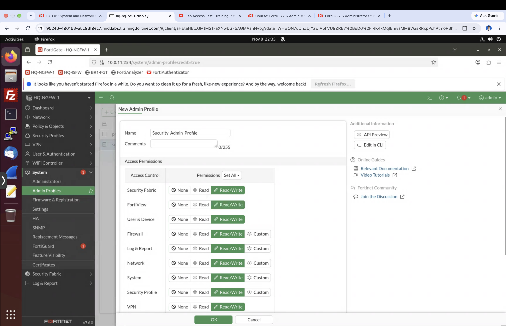

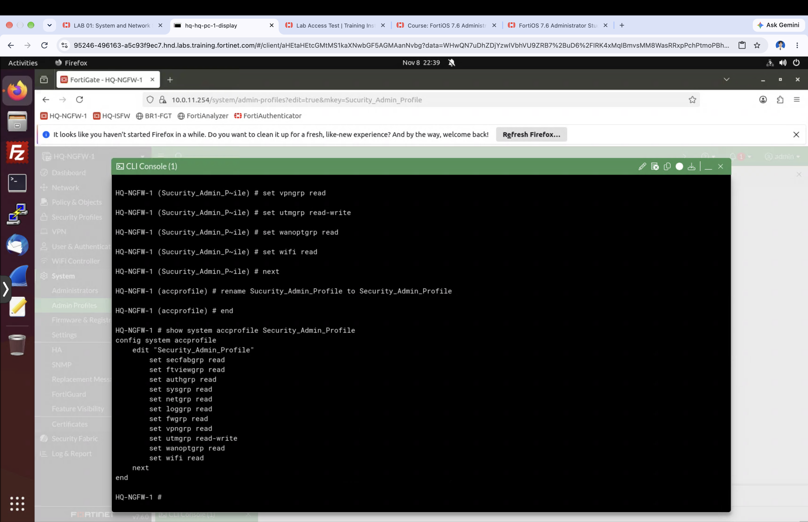

## ส่วน B: สร้าง Admin Account

ผลที่ต้องได้: admin ชื่อ `Security` ที่ผูกกับ `Security_Admin_Profile`

1. **System > Administrators > Create New > Administrator**
2. ใส่ค่าตามตารางข้างล่าง แล้วกด **OK** ยังไม่เปิด Restrict login to trusted hosts ในขั้นนี้

| Field | Value |
| --- | --- |
| Username | Security |
| Type | Local User |
| Password / Confirm Password | Fortinet1! |
| Administrator profile | Security_Admin_Profile |

ชื่อ admin และรหัสผ่านเป็น case-sensitive และใช้อักขระ `< > ( ) # "` ในชื่อ admin ไม่ได้ ถ้าเผลอเลือก `super_admin` การทดสอบในส่วน C จะไม่ได้ผลตามโจทย์

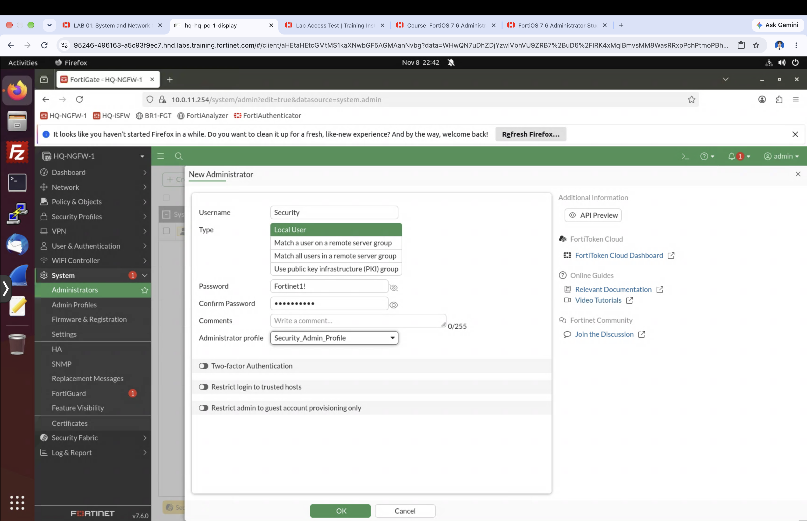

## ส่วน C: ทดสอบสิทธิ์ของ Security

ผลที่ได้: login เป็น `Security` ได้ แก้ Security Profiles ได้ ส่วนหมวดอื่นดูได้อย่างเดียว

1. คลิก **admin > Logout** แล้ว login `Security` / `Fortinet1!`
2. หน้าต่าง FortiGate Setup กด **Later** และหน้าต่างแนะนำ FortiOS ติ๊ก **Don't show again** แล้วกด **OK** (URL มี `viewOnly=` แสดงว่าระบบรู้ว่าสิทธิ์จำกัด)
3. **Security Profiles > AntiVirus** มีปุ่ม **Create new** และหน้า Edit แก้ได้พร้อมปุ่ม OK (สิทธิ์ Read/Write ใช้ได้) กด **Cancel** เพราะ profile `default` กับ `wifi-default` จะใช้ใน lab หลังๆ
4. เมนูอื่น เช่น Network หรือ Policy & Objects ดูได้อย่างเดียว ไม่มีปุ่มบันทึก
5. **Logout**

สังเกตเพิ่ม: ปุ่ม **Delete** ของ `wifi-default` เป็นสีเทา เพราะ Ref. = 1 คือมีที่ใช้อยู่ FortiGate ไม่ให้ลบ object ที่ยังถูกอ้างอิง (ต่างจาก profile ที่สะกดผิดซึ่ง Ref. = 0 ลบได้)

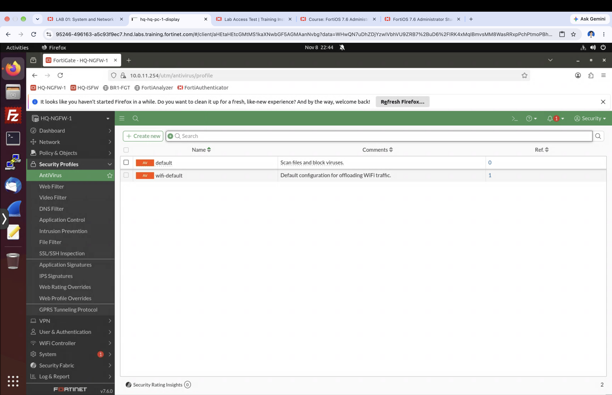

## ส่วน D-E: Trusted Host และการทดสอบ

ผลที่ได้: `Security` login ได้เฉพาะจาก IP ที่อยู่ใน trusted host โดย FortiGate ตรวจ IP ต้นทางที่ไปถึงตัวมันจริง หลังผ่าน NAT แล้ว

### D: ตั้ง Trusted Host 1

1. login เป็น `admin` แล้วไปที่ **System > Administrators** ดับเบิลคลิก **Security**
2. เปิด **Restrict login to trusted hosts**
3. Trusted Host 1: `100.65.1.0/24` (ยังไม่เพิ่ม host ที่ 2 ใน GUI)
4. กด **OK**

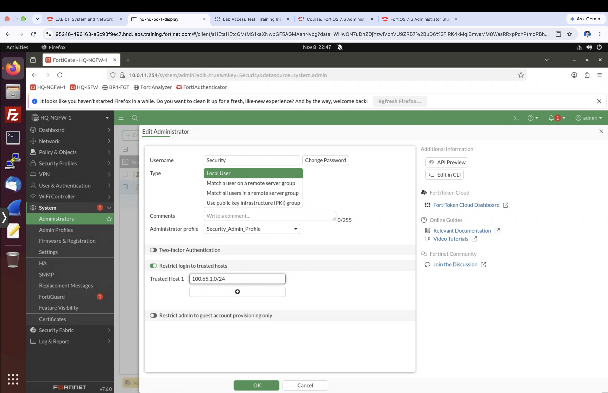

### E: ทดสอบ 3 ครั้ง

| ครั้ง | จากเครื่อง | ไปที่ | IP ที่ FortiGate เห็น | ผล |
| --- | --- | --- | --- | --- |
| 1 | HQ-PC-1 | https://10.0.11.254 | 10.0.11.x (ไม่ผ่าน NAT) | Authentication failure |
| 2 | BR1-PC-1 | https://100.65.0.101 | 100.65.1.x (NAT โดย BR1-FGT-1) | เข้าได้ |
| 3 (หลังเพิ่ม trusthost2) | HQ-PC-1 | https://10.0.11.254 | 10.0.11.x | เข้าได้ |

ครั้งที่ 1 ยังเห็นหน้า login เพราะ `admin` ยังเป็น trusted host 0.0.0.0/0 ถ้า admin ทุกคนถูกจำกัดและ IP ไม่ตรงกับใครเลย จะไม่เห็นหน้า login ตั้งแต่แรก

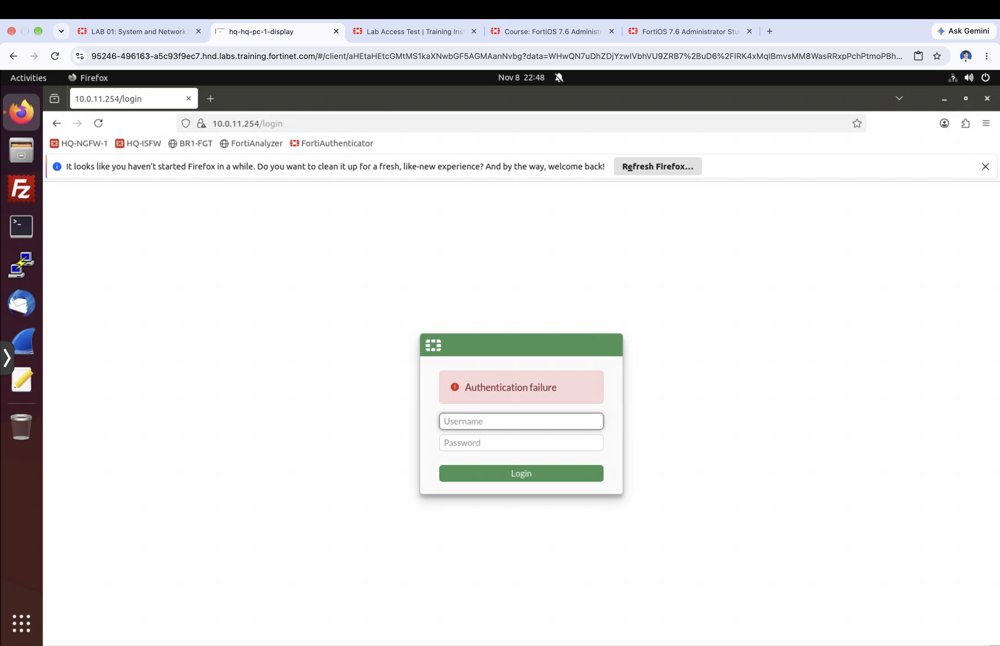

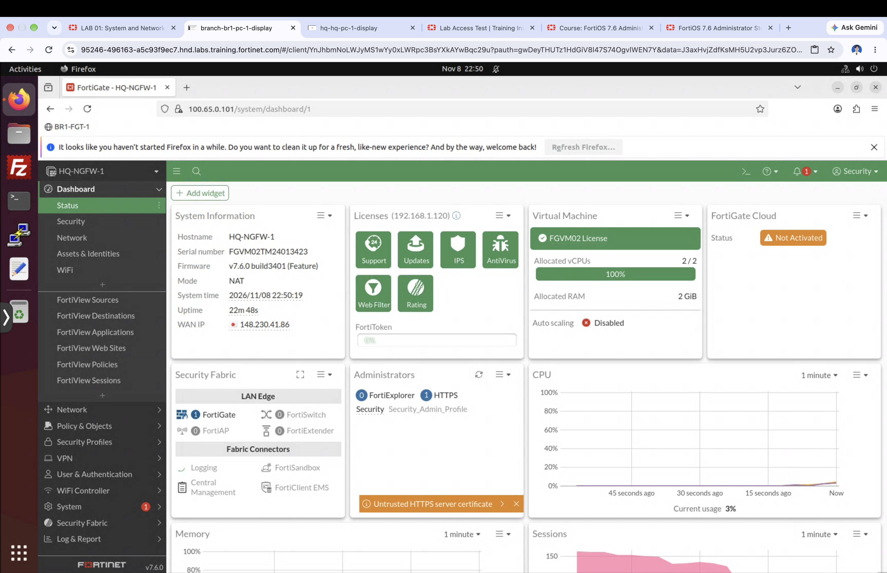

### เพิ่ม Trusted Host 2 ผ่าน CLI

ที่แท็บ lab คลิก **HQ-NGFW-1 > Console** กด Enter ให้ขึ้น prompt login แล้ว login `admin` / `Fortinet1!` (รหัสไม่แสดงบนจอ)

```txt
config system admin
edit Security
set trusthost2 10.0.11.0/24
end
show system admin Security
```

FortiOS แปลง `/24` (เขียนแบบ CIDR = Classless Inter-Domain Routing) เป็น `255.255.255.0` ให้เอง และเก็บรหัสผ่านเป็น `ENC ...` (Encrypted) ที่เข้ารหัสแล้ว

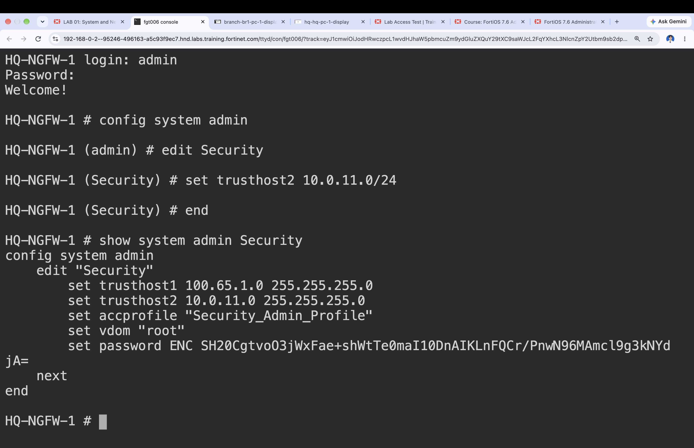

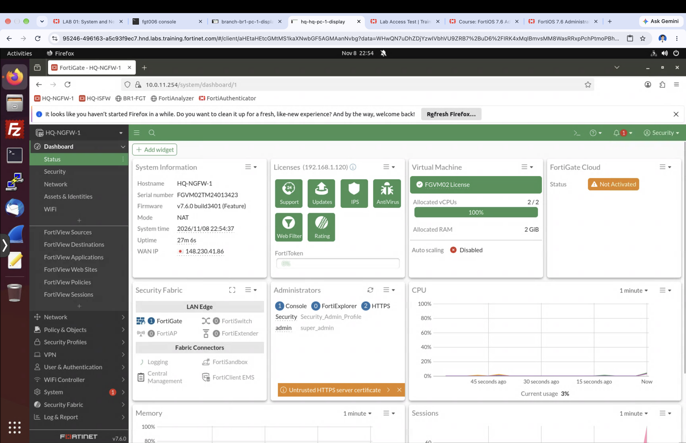

## สรุปบทเรียนและจุดออกสอบ

Admin profile กำหนดว่า admin ทำอะไรได้ ส่วน trusted host กำหนดว่า login ได้จากที่ไหน ใช้คู่กันตามหลัก least privilege

- `super_admin` เป็น profile ของ user `admin` แก้ไม่ได้ และมีสิทธิ์เต็ม
- สิทธิ์แต่ละหมวดเป็น None / Read / Read-Write บางหมวดมี Custom เพิ่ม
- ค่าเริ่มต้นของ trusted host คือ 0.0.0.0/0 (เข้าได้จากทุกที่) ตั้งได้หลายวง ตั้งแต่ `trusthost1` ถึง `trusthost10`
- trusted host ตรวจ IP ต้นทางหลัง NAT ถ้ามี NAT ระหว่างเครื่องกับ FortiGate ต้องใส่ IP หลัง NAT
- login จาก IP ที่ไม่อยู่ใน trusted host จะขึ้น Authentication failure แต่ถ้า admin ทุกคนถูกจำกัดและไม่ตรงกับใครเลย จะไม่เห็นหน้า login
- ลบ object ได้เมื่อ Ref. = 0 เท่านั้น
- ชื่อ object แก้ใน GUI ไม่ได้ ใช้ `rename <เก่า> to <ใหม่>` ใน CLI
- idle timeout ค่าเริ่มต้น 5 นาที (`config system global` > `set admintimeout`) override ต่อ profile ได้

### CLI cheat sheet

```txt
config system accprofile
    edit <profile>
        set utmgrp read-write
    next
    rename <old> to <new>
end
show system accprofile <profile>

config system admin
    edit <user>
        set accprofile <profile>
        set trusthost1 100.65.1.0/24
        set trusthost2 10.0.11.0/24
    next
end
show system admin <user>
```

CLI เปิดได้ 3 ทาง: ไอคอน `>_` บน GUI, ปุ่ม Edit in CLI ในหน้า Edit (เข้าไปใน object เลย) และ Console ของ VM ในหน้า lab

## ตัวย่อทั้งหมดในเอกสาร

| ตัวย่อ | ชื่อเต็ม | ความหมายใน lab นี้ |
| --- | --- | --- |
| accprofile | access profile | admin profile ใน CLI |
| AV | AntiVirus | security profile สแกนไวรัส |
| BR1 | Branch 1 | สาขาที่ 1 |
| CIDR | Classless Inter-Domain Routing | การเขียน subnet แบบ /24 |
| CLI | Command Line Interface | หน้าพิมพ์คำสั่ง |
| DHCP | Dynamic Host Configuration Protocol | แจก IP อัตโนมัติ |
| DNS | Domain Name System | แปลงชื่อโดเมนเป็น IP |
| ENC | Encrypted | ค่าที่เข้ารหัสไว้ใน config |
| FAZ | FortiAnalyzer | เครื่องเก็บและวิเคราะห์ log |
| FGT | FortiGate | firewall ของ Fortinet |
| GUI | Graphical User Interface | หน้าเว็บสำหรับตั้งค่า |
| HA | High Availability | FortiGate สำรองกัน (LAB 13) |
| HQ | Headquarters | สำนักงานใหญ่ |
| HTTPS | Hypertext Transfer Protocol Secure | โปรโตคอลที่ใช้เข้า GUI |
| IP | Internet Protocol (address) | ที่อยู่ของเครื่องในเครือข่าย |
| IPS | Intrusion Prevention System | ตรวจจับและบล็อกการโจมตี (LAB 10) |
| IPsec | Internet Protocol Security | VPN แบบ site-to-site (LAB 11) |
| ISP | Internet Service Provider | ผู้ให้บริการอินเทอร์เน็ต |
| LAN | Local Area Network | เครือข่ายภายใน |
| NAT | Network Address Translation | การเปลี่ยน IP ต้นทางหรือปลายทาง |
| NGFW | Next-Generation Firewall | firewall ที่ตรวจได้ถึงระดับ application |
| PC | Personal Computer | เครื่องผู้ใช้ |
| RDP | Remote Desktop Protocol | การเข้า desktop ระยะไกล |
| Ref. | Reference count | จำนวนที่ object ถูกใช้งาน |
| SSID | Service Set Identifier | ชื่อเครือข่าย WiFi |
| SSL | Secure Sockets Layer | การเข้ารหัส traffic |
| UTM | Unified Threat Management | ชุด security profile (utmgrp) |
| VM | Virtual Machine | เครื่องเสมือนใน lab |
| VPN | Virtual Private Network | อุโมงค์เข้ารหัสระหว่างเครือข่าย |
| WAN | Wide Area Network | ขาที่ออกอินเทอร์เน็ต |
