# 🔬 LAB 03 Summary: Firewall Policies and NAT

> 🇹🇭 ภาษาไทย: [LAB-03.md](LAB-03.md)
> Note: screenshots live in `images/lab03/`

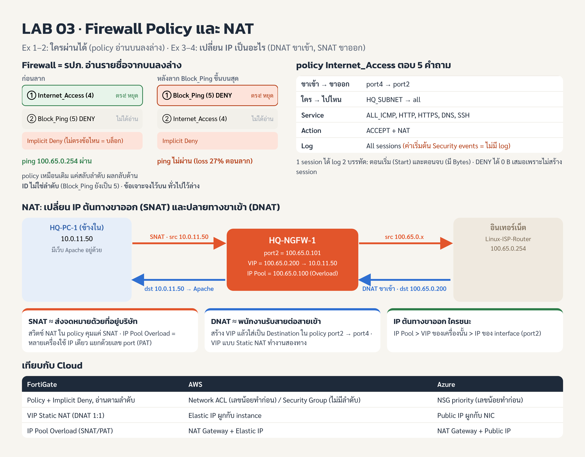

## Lab overview

**Goal:** practice creating address objects and firewall policies, observe the effect of policy order, do DNAT with a VIP and SNAT with an IP Pool on HQ-NGFW-1.

| Device | IP / Interface | Role in the lab |
| --- | --- | --- |
| HQ-PC-1 | 10.0.11.50 | Internal user machine, and an Apache web server for Ex 3 |
| HQ-NGFW-1 port4 (LAN) | 10.0.11.254 | Internal gateway and the GUI |
| HQ-NGFW-1 port2 (WAN) | 100.65.0.101/24 | Internet-facing leg |
| VIP-INTERNAL-HOST | 100.65.0.200 | Public IP mapped to 10.0.11.50 |
| INTERNAL-HOST-EXT-IP (IP Pool) | 100.65.0.100 | IP for Overload SNAT |
| Linux-ISP-Router (LINUX_ETH2) | 100.65.0.254 | Internet-side machine, used to test ping and DNAT |
| FortiAnalyzer | 10.0.13.125 | Collects logs from FortiGate |

**Problems encountered and fixes**

- Course lab 2-1 showed ERRORED (Start button disabled) → switched to course 2-4
- BR1-PC-1 display wouldn't connect → tested DNAT from Linux-ISP-Router with `curl` instead
- Typing `ping` in FortiGate's CLI gave `Unknown action 0` → must use HQ-PC-1's Terminal (traffic has to go **through** the firewall)
- `diagnose sys session clear` dropped the GUI/CLI → because our own session also has src 10.0.11.50; press Enter and reconnect
- Ex 1 Verify FAILED because Ex 4 re-enabled the Internet policy → disable it temporarily, Verify, then re-enable

## Exercise 1: Address Object and Firewall Policy

Create a more specific policy and log every session, until you see that one session produces two logs.

**What was configured**

| Object | Key values |
| --- | --- |
| Address `HQ_SUBNET` | Interface any, Subnet `10.0.11.0/24` |
| Policy `Internet` (ID 1) | Set to Disabled |
| Policy `Internet_Access` (ID 4) | port4 → port2, HQ_SUBNET → all, ALL_ICMP/HTTP/HTTPS/DNS/SSH, NAT on |
| Logging | Log allowed traffic = **All sessions**, Generate logs when session starts = **on** |

**Image notes**

- **Logging Options page:** the default is Security events, which logs only traffic that hits a Security Profile; when a policy has no profile there are no logs, so change it to All sessions
- **Forward Traffic (Disk) page:** the **Accept (Start)** row is the log at session start (no bytes yet); rows with bytes like 586 B / 644 B are the log at session close; destination 8.8.8.8 is the DNS the machine must query before reaching a site
- **FortiAnalyzer page:** the same log set, but arriving ~10 seconds later than Disk, because FortiGate sends logs in batches over the network

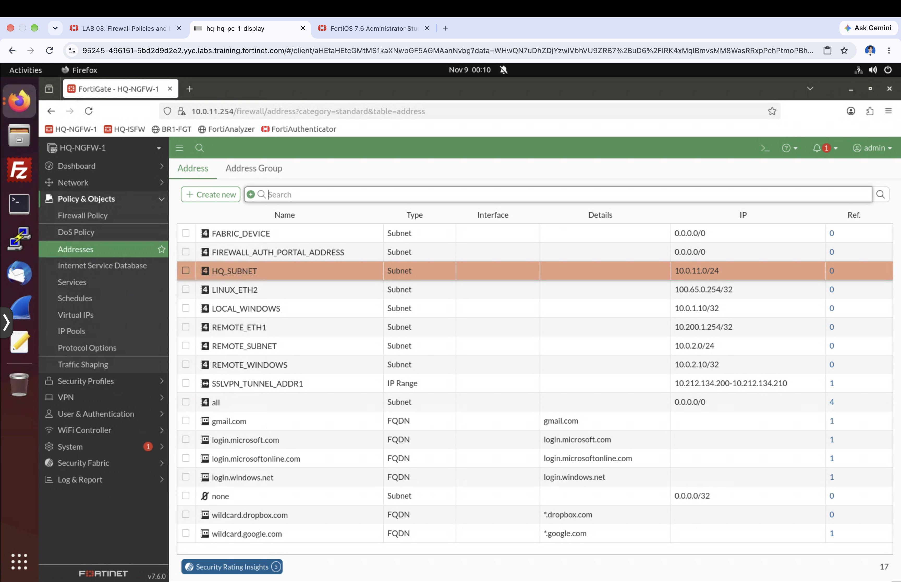

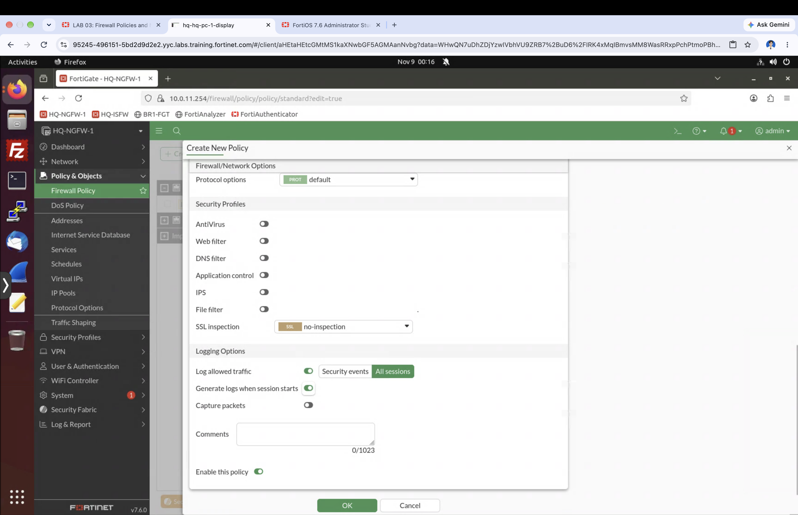

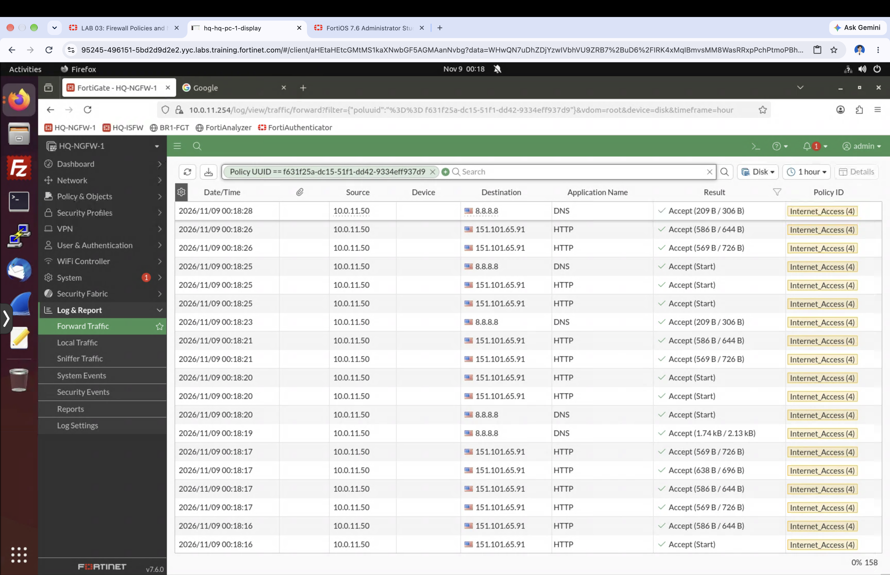

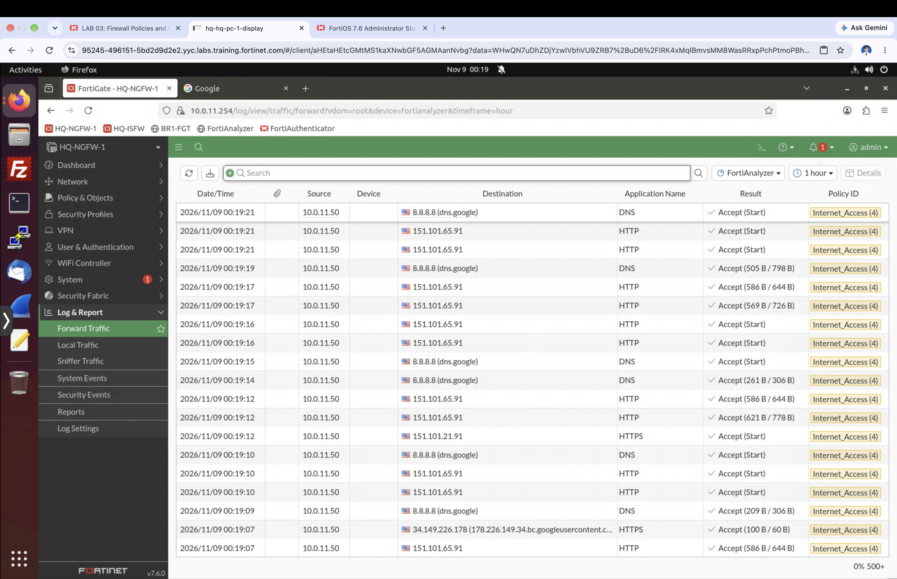

Lesson: when the Internet policy is disabled before creating the new one, traffic falls to the **Implicit Deny** and the internet becomes unreachable.

## Exercise 2: Policy order and the DENY action

Just dragging Block_Ping above Internet_Access changes the result immediately: of 211 pings only 153 reply (27% packet loss), and the next round is 100% loss.

**What was configured:** Policy `Block_Ping` (ID 5): Action **DENY**, port4 → port2, HQ_SUBNET → LINUX_ETH2 (100.65.0.254/32), Service PING, Log violation traffic on

**Sequence of events**

1. After creating Block_Ping it sat **below** Internet_Access → `ping 100.65.0.254` still passed, because ping matched Internet_Access's ALL_ICMP first (Block_Ping's Bytes = 0 B)
2. Drag Block_Ping to the top (or use CLI `move 5 before 4`) → ping fails immediately
3. Check logs in FortiAnalyzer: Fortinet Logs > FortiGate > Traffic, filter `Application=PING`; see **Policy violation** 0 B/0 B on every row

**Image notes**

- **Policy list after dragging:** Block_Ping **(5)** sits above Internet_Access **(4)**, proving that ID does not indicate processing order
- **Terminal page:** `ttl=63` = TTL 64 decremented by 1 passing through FortiGate (proof it went through the firewall), and a summary of 211 sent / 153 received
- **FortiAnalyzer page:** the ❌ Policy violation icon from 10.0.11.50 → 100.65.0.254 appears only because Log violation traffic was enabled (a DENY policy doesn't log by default)

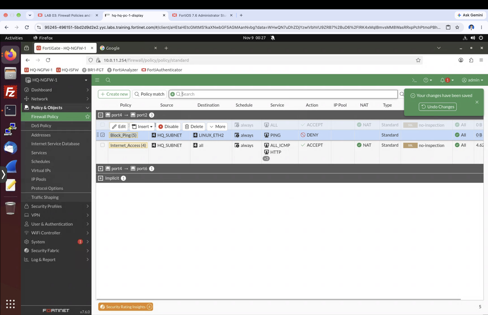

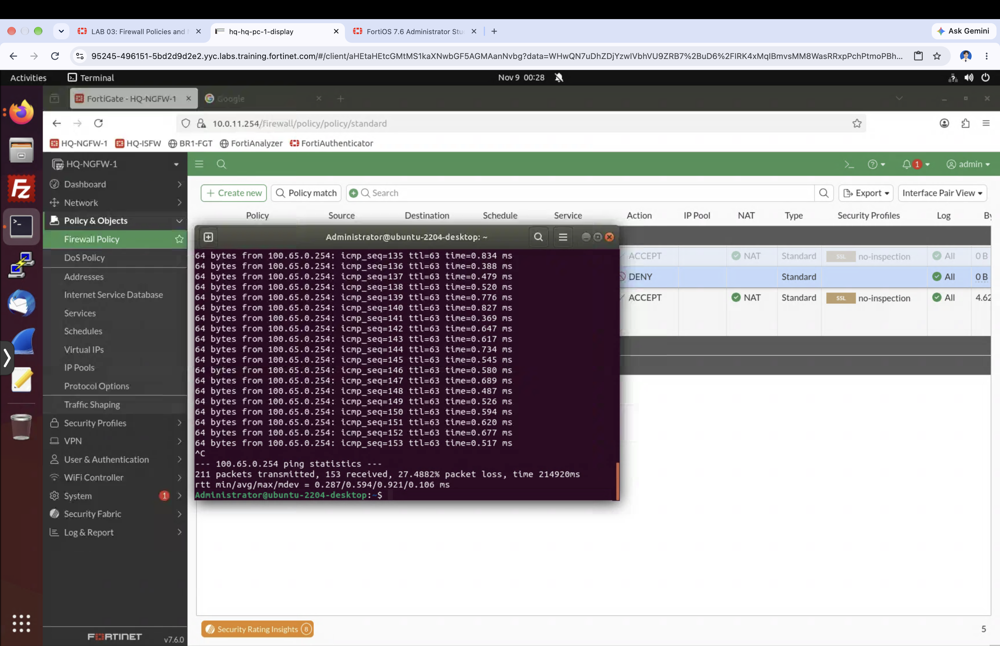

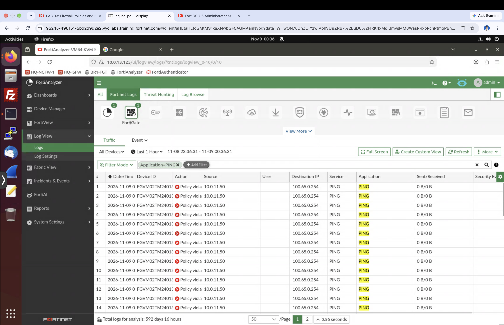

Lesson: a specific policy must sit **above** a general one, or no traffic reaches it at all (first match).

## Exercise 3: DNAT with a VIP

People on the internet can reach the web server on HQ-PC-1 via `100.65.0.200` (curl returns the "Apache2 Ubuntu Default Page: It works" page), and the VIP also translates the outbound SNAT.

**What was configured**

| Object | Key values |
| --- | --- |
| VIP `VIP-INTERNAL-HOST` | Interface port2, Static NAT, `100.65.0.200` → `10.0.11.50`, Port Forwarding off (forward every port 1:1) |
| Policy `Web-Server-Access` (ID 6) | **port2 → port4** (inbound), all → VIP-INTERNAL-HOST, HTTP/HTTPS, **NAT off**, Log All |

**The resulting path:** Linux-ISP-Router (100.65.0.254) → requests the web from 100.65.0.200 → FortiGate port2 hits the VIP and translates the destination to 10.0.11.50 (DNAT) → policy 6 allows it → Apache replies

**Image notes**

- **New Virtual IP page:** setting External IP and Map to IPv4 is the heart of DNAT
- **Policy list page:** the new port2 → port4 group shows NAT = Disabled, but DNAT still works, because DNAT comes from the VIP in the Destination; the NAT switch is SNAT
- **curl on Linux-ISP-Router page:** returns HTML containing `<title>Apache2 Ubuntu Default Page: It works</title>`
- **`get system session list` page:** the SOURCE-NAT column for 10.0.11.50 is **100.65.0.200**, not 100.65.0.101 — the Static-NAT VIP works **both ways**

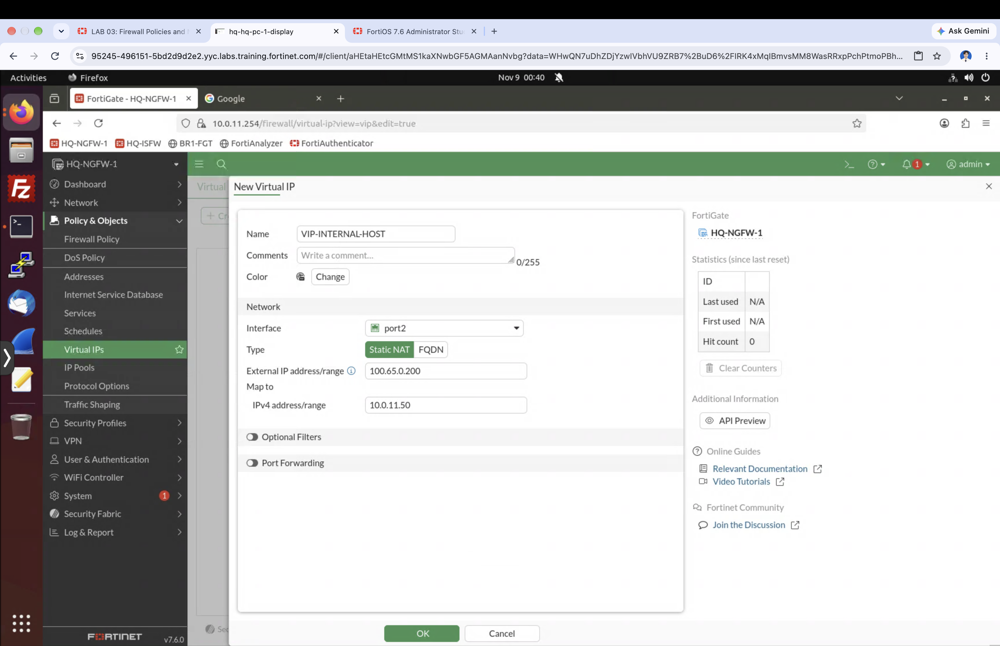

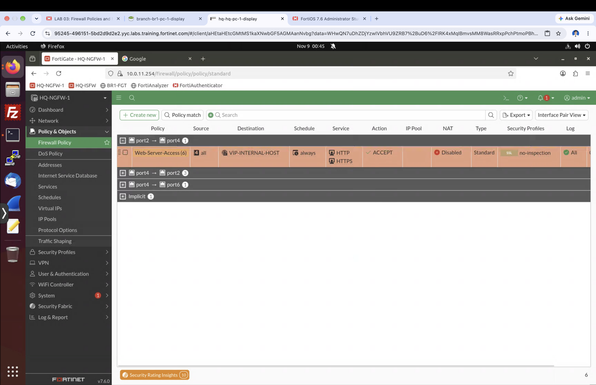

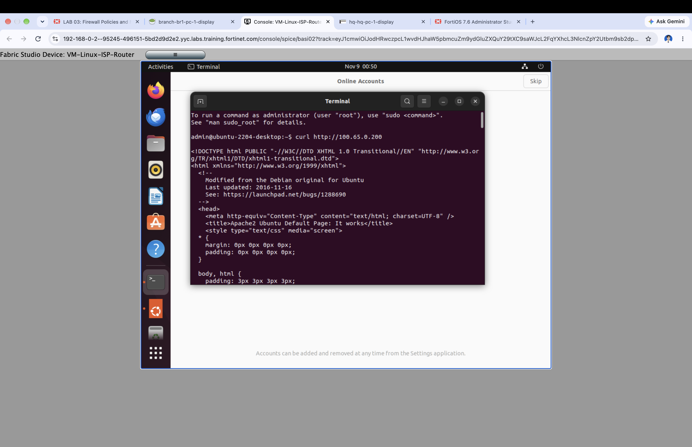

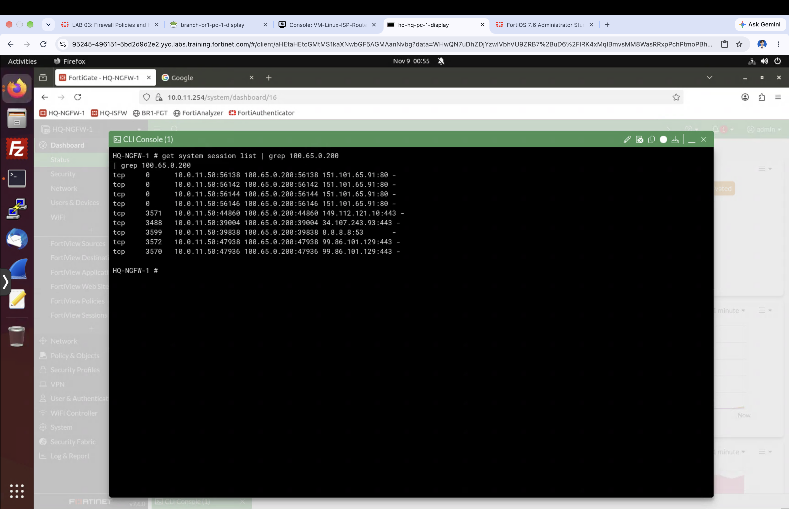

Lesson: DNAT = create a VIP + put the VIP in the policy's Destination. Don't turn on the NAT switch; if you do, the web server won't see the visitor's real IP.

## Exercise 4: Dynamic NAT with an IP Pool

Once a policy uses the IP Pool, SOURCE-NAT changes from 100.65.0.200 (VIP) to **100.65.0.100**, meaning the IP Pool takes priority over the VIP.

**What was configured**

| Object | Key values |
| --- | --- |
| IP Pool `INTERNAL-HOST-EXT-IP` | Type **Overload**, `100.65.0.100-100.65.0.100`, ARP Reply on |
| Policy `Internet` (ID 1) | Enabled, NAT on, **Use Dynamic IP Pool** = INTERNAL-HOST-EXT-IP |

**SNAT priority as seen in the lab**

| Situation | SOURCE-NAT |
| --- | --- |
| Normal policy (Use Outgoing Interface Address) | 100.65.0.101 (port2's IP) |
| A Static-NAT VIP for that machine | 100.65.0.200 |
| Policy uses an IP Pool | **100.65.0.100** (wins) |

**Image notes**

- **New Dynamic IP Pool page:** Overload = many machines share one IP, separated by port number (PAT); ARP Reply must be on so the outside router knows 100.65.0.100 lives on FortiGate
- **Policy list page:** the Internet (1) row now has the IP Pool = INTERNAL-HOST-EXT-IP column and sits at the top of port4 → port2, so traffic immediately matches this policy (side effect: it's above Block_Ping too, so ping passes again)
- **`get system session list` page:** every session leaves via 100.65.0.100; a session with destination 10.0.11.254:443 has no SNAT, because it talks to FortiGate itself

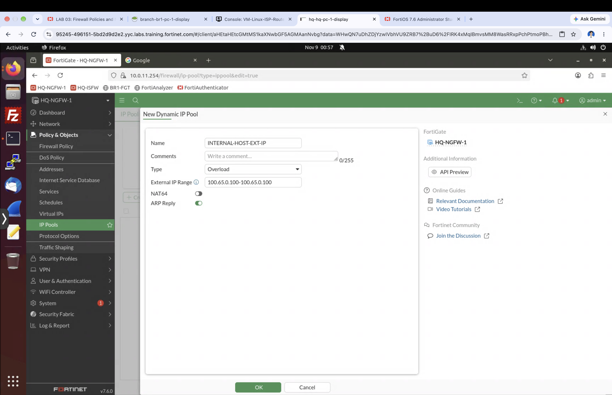

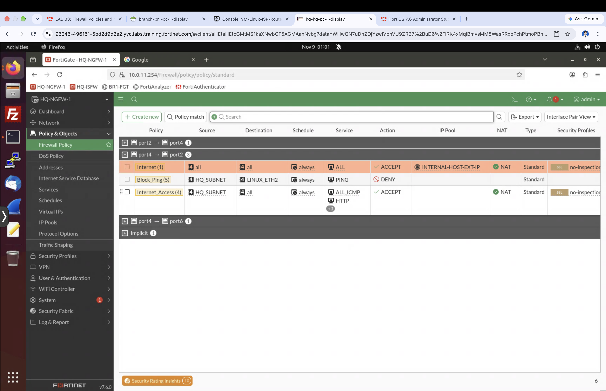

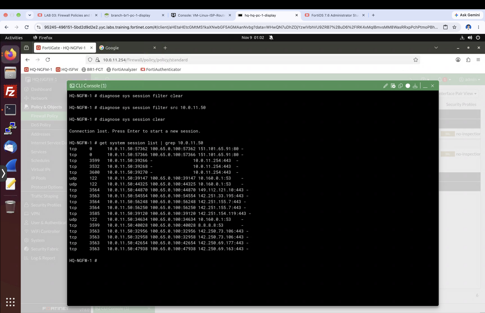

## Quiz and Verify

Each Exercise needs **Take quiz → Verify → Execute** until PASSED, for the Outline circle to turn green.

| Exercise | Question | Correct answer | Reason |
| --- | --- | --- | --- |
| 1 | Traffic matches no policy — what happens? | Blocked by Implicit Deny | The firewall denies by default |
| 2 | After reordering a policy, what happens to its ID? | ID doesn't change | Block_Ping is still (5) even at the top |
| 3 | What makes FortiGate do DNAT? | Create a VIP and reference it in a policy | The NAT switch is SNAT, unrelated to DNAT |
| 4 | Command to view a session's SNAT | `get system session list` | `get` = live state, `show` = config |

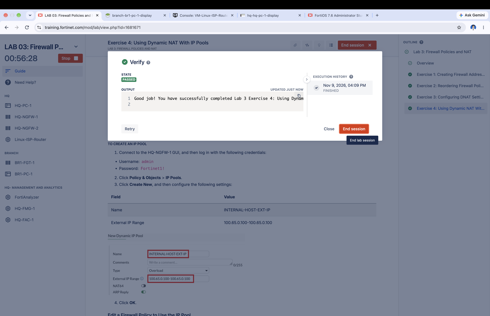

Lesson for the next lab: the Verify script checks the config **at the moment you press it**; Verify each item as soon as you finish it, before changing values for the next item.

## Cloud comparison

| FortiGate | AWS | Azure |
| --- | --- | --- |
| Firewall policy + Implicit Deny | Security Group (deny by default) | Network Security Group |
| Policy order (first match) | Network ACL (lower rule number first) | NSG priority (lower number first) |
| Address object (HQ_SUBNET) | Prefix list / CIDR in a rule | Service tag / Application Security Group |
| VIP Static NAT (DNAT 1:1) | Elastic IP bound to an instance | Public IP bound to a NIC |
| VIP + port forwarding | Load Balancer listener | Load Balancer inbound NAT rule |
| IP Pool Overload (SNAT/PAT) | NAT Gateway + Elastic IP | NAT Gateway + Public IP |
| Forward Traffic log / FortiAnalyzer | VPC Flow Logs / CloudWatch | NSG Flow Logs / Log Analytics |

Key difference: AWS-style Security Groups have no order (all allow rules are combined) and no deny, whereas FortiGate and NACL/NSG read in order and can deny.

## CLI commands used

| Command | What it does |
| --- | --- |
| `config firewall policy` / `move 5 before 4` / `end` | Reorder policies instead of dragging in the GUI |
| `get system session list` | View sessions with SOURCE-NAT |
| `get system session list \| grep 10.0.11.50` | Filter to lines containing this IP |
| `diagnose sys session filter clear` | Clear the existing filter |
| `diagnose sys session filter src 10.0.11.50` | Set a filter by source |
| `diagnose sys session clear` | Delete sessions (all, if no filter is set) — careful: the GUI can drop |
| `ping 100.65.0.254` / `ping -c 4 ...` | Test from HQ-PC-1's Terminal (not FortiGate CLI) |
| `curl http://100.65.0.200` | Test DNAT from Linux-ISP-Router |

## Abbreviation glossary

| Abbr. | Full name | Meaning in this lab |
| --- | --- | --- |
| NAT | Network Address Translation | translating an IP address |
| SNAT | Source Network Address Translation | translate the source IP (outbound to internet) |
| DNAT | Destination Network Address Translation | translate the destination IP (inbound to a server) |
| PAT | Port Address Translation | many machines share one IP, separated by port (IP Pool Overload) |
| VIP | Virtual IP | FortiGate's object for DNAT |
| NGFW | Next-Generation Firewall | a firewall with IPS, App Control, etc. (HQ-NGFW-1) |
| ISFW | Internal Segmentation Firewall | a firewall between internal networks (HQ-ISFW) |
| FGT | FortiGate | e.g. BR1-FGT-1 |
| FAZ | FortiAnalyzer | log collection and analysis box |
| FMG | FortiManager | manages many FortiGates (HQ-FMG-1) |
| FAC | FortiAuthenticator | identity authentication box (HQ-FAC-1) |
| HQ / BR | Headquarters / Branch | head office / branch |
| LAN / WAN | Local Area Network / Wide Area Network | port4 internal / port2 internet-facing |
| ISP | Internet Service Provider | Linux-ISP-Router simulates the provider side |
| ICMP | Internet Control Message Protocol | ping's protocol (ALL_ICMP) |
| DNS | Domain Name System | resolve site names to IPs (8.8.8.8, port 53) |
| HTTP / HTTPS | Hypertext Transfer Protocol (Secure) | web ports 80 / 443 |
| SSH | Secure Shell | encrypted remote access, port 22 |
| TTL | Time To Live | decremented by 1 per router (64 → 63) |
| ARP | Address Resolution Protocol | maps IP to MAC (IP Pool's ARP Reply) |
| CLI / GUI | Command Line Interface / Graphical User Interface | command screen / web page |
| UUID | Universally Unique Identifier | a policy's ID in log filters |
| ID | Identifier | policy number — does not indicate order |
| SSL | Secure Sockets Layer | in the Security Profiles column (no-inspection) |
| AWS / VPC | Amazon Web Services / Virtual Private Cloud | used in the cloud comparison table |
| NSG / NACL | Network Security Group / Network Access Control List | Azure's / AWS's firewall |
