# 🔬 LAB 03 สรุป: Firewall Policies and NAT

> หมายเหตุ: รูปภาพประกอบ (`images/lab03/...`) จะเพิ่มทีหลัง — โครงสร้างลิงก์รูปเตรียมไว้แล้ว

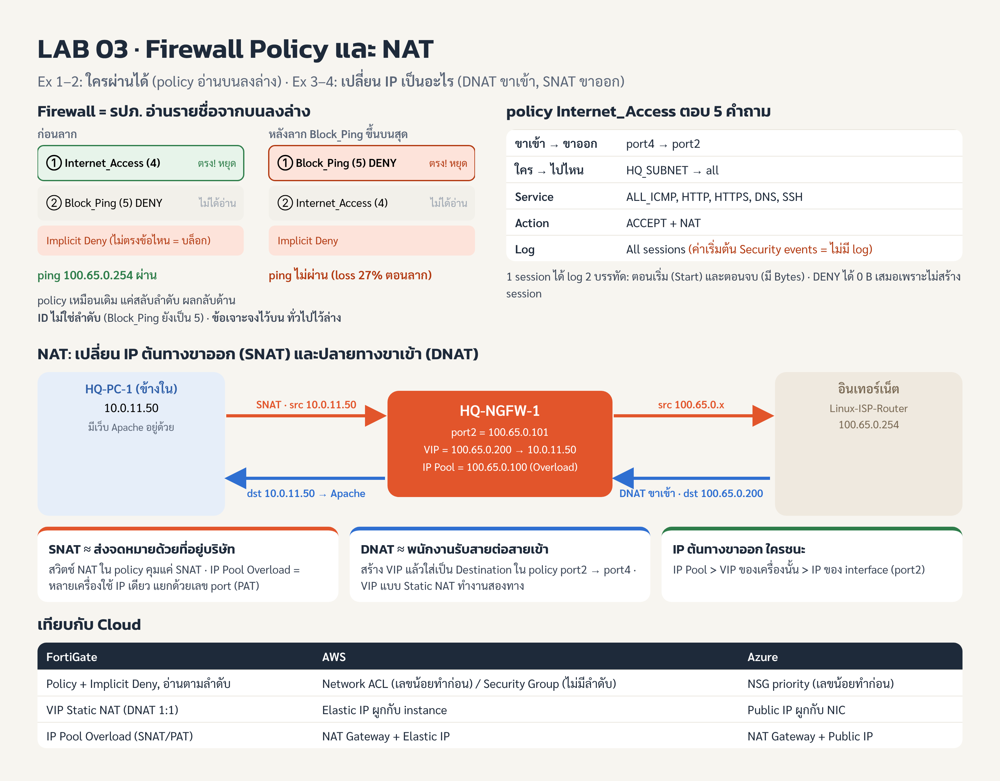

## ภาพรวมแล็บ

**เป้าหมาย:** ฝึกสร้าง address object และ firewall policy, ดูผลของลำดับ policy, ทำ DNAT ด้วย VIP และทำ SNAT ด้วย IP Pool บน HQ-NGFW-1

| อุปกรณ์ | IP / Interface | หน้าที่ในแล็บ |
| --- | --- | --- |
| HQ-PC-1 | 10.0.11.50 | เครื่องผู้ใช้ภายใน และเป็นเว็บเซิร์ฟเวอร์ Apache สำหรับ Ex 3 |
| HQ-NGFW-1 port4 (LAN) | 10.0.11.254 | gateway ฝั่งภายใน และหน้า GUI |
| HQ-NGFW-1 port2 (WAN) | 100.65.0.101/24 | ขาออกอินเทอร์เน็ต |
| VIP-INTERNAL-HOST | 100.65.0.200 | IP สาธารณะที่ map ไป 10.0.11.50 |
| INTERNAL-HOST-EXT-IP (IP Pool) | 100.65.0.100 | IP สำหรับ SNAT แบบ Overload |
| Linux-ISP-Router (LINUX_ETH2) | 100.65.0.254 | เครื่องฝั่งอินเทอร์เน็ต ใช้ทดสอบ ping และ DNAT |
| FortiAnalyzer | 10.0.13.125 | เก็บ log จาก FortiGate |

**ปัญหาที่เจอและวิธีแก้**

- แล็บคอร์ส 2-1 ขึ้น ERRORED (ปุ่ม Start กดไม่ได้) → เปลี่ยนไปทำในคอร์ส 2-4
- BR1-PC-1 เชื่อมต่อหน้าจอไม่ได้ → ทดสอบ DNAT จาก Linux-ISP-Router ด้วย `curl` แทน
- พิมพ์ `ping` ใน CLI ของ FortiGate ขึ้น `Unknown action 0` → ต้องใช้ Terminal ของ HQ-PC-1 (ทราฟฟิกต้องวิ่ง**ผ่าน** firewall)
- `diagnose sys session clear` ทำให้ GUI/CLI หลุด → เพราะ session ของเราเองก็มี src 10.0.11.50 กด Enter แล้วต่อใหม่ได้
- Verify ของ Ex 1 FAILED เพราะ Ex 4 เปิด policy Internet กลับ → ปิดชั่วคราว Verify แล้วค่อยเปิดกลับ

## Exercise 1: Address Object และ Firewall Policy

สร้าง policy ที่เจาะจงกว่าเดิม และเปิด log ทุก session จนเห็นว่า 1 session มี 2 log

**สิ่งที่ตั้งค่า**

| ออบเจกต์ | ค่าสำคัญ |
| --- | --- |
| Address `HQ_SUBNET` | Interface any, Subnet `10.0.11.0/24` |
| Policy `Internet` (ID 1) | ตั้งเป็น Disabled |
| Policy `Internet_Access` (ID 4) | port4 → port2, HQ_SUBNET → all, ALL_ICMP/HTTP/HTTPS/DNS/SSH, NAT เปิด |
| Logging | Log allowed traffic = **All sessions**, Generate logs when session starts = **เปิด** |

**คำอธิบายภาพ**

- **หน้า Logging Options:** ค่าเริ่มต้นเป็น Security events ซึ่งจะบันทึกเฉพาะทราฟฟิกที่เจอ Security Profile เมื่อ policy ไม่มี profile เลยจะไม่มี log ต้องเปลี่ยนเป็น All sessions
- **หน้า Forward Traffic (Disk):** แถว **Accept (Start)** คือ log ตอนเริ่ม session (ยังไม่มี byte) ส่วนแถวที่มี byte เช่น 586 B / 644 B คือ log ตอนปิด session ปลายทาง 8.8.8.8 คือ DNS ที่เครื่องต้องถามก่อนเข้าเว็บ
- **หน้า FortiAnalyzer:** log ชุดเดียวกัน แต่มาช้ากว่า Disk ประมาณ 10 วินาที เพราะ FortiGate ส่ง log ไปเป็นชุดผ่านเครือข่าย

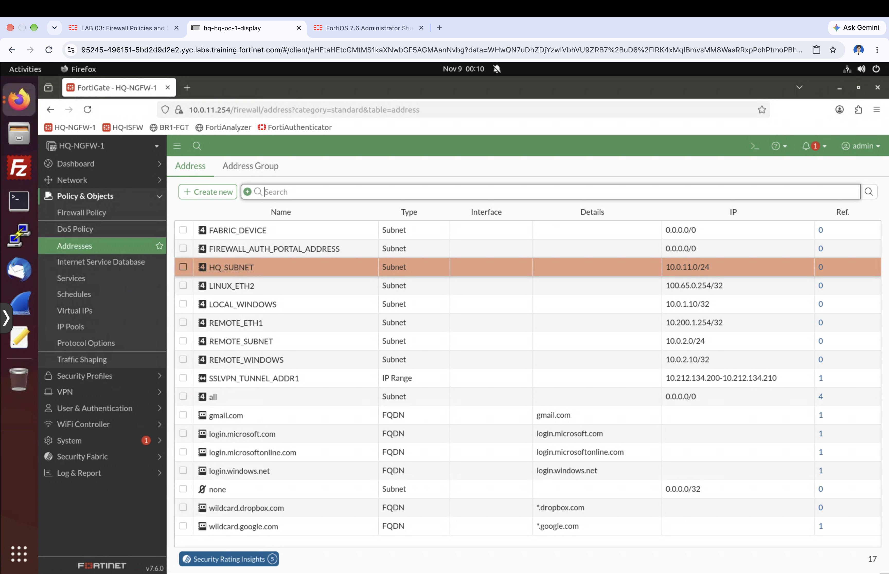

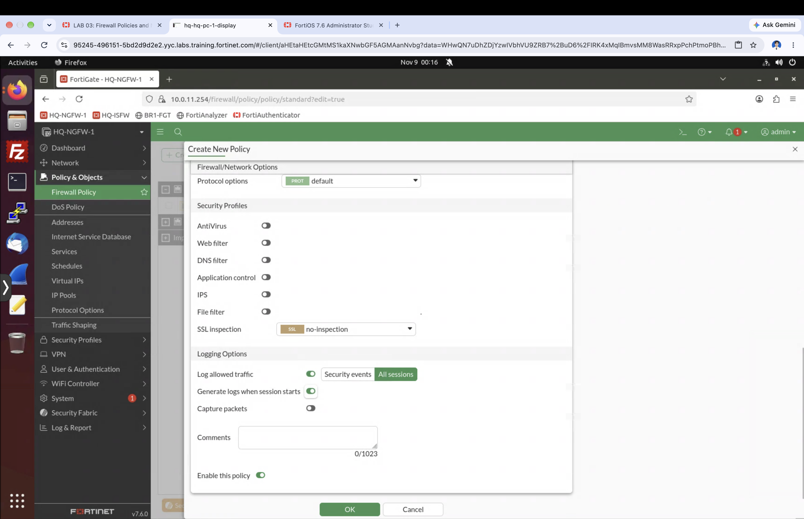

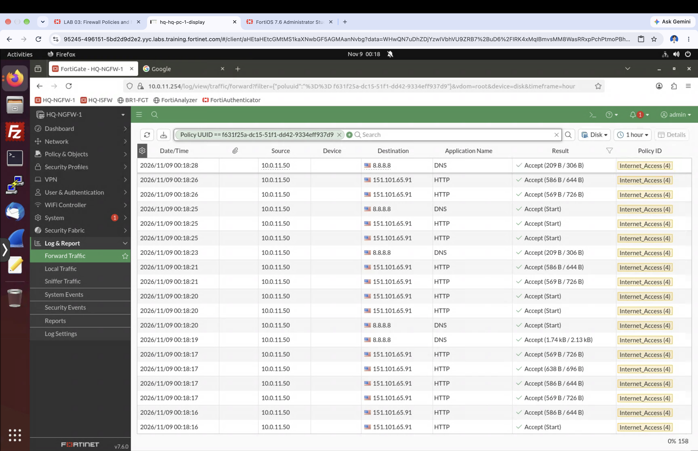

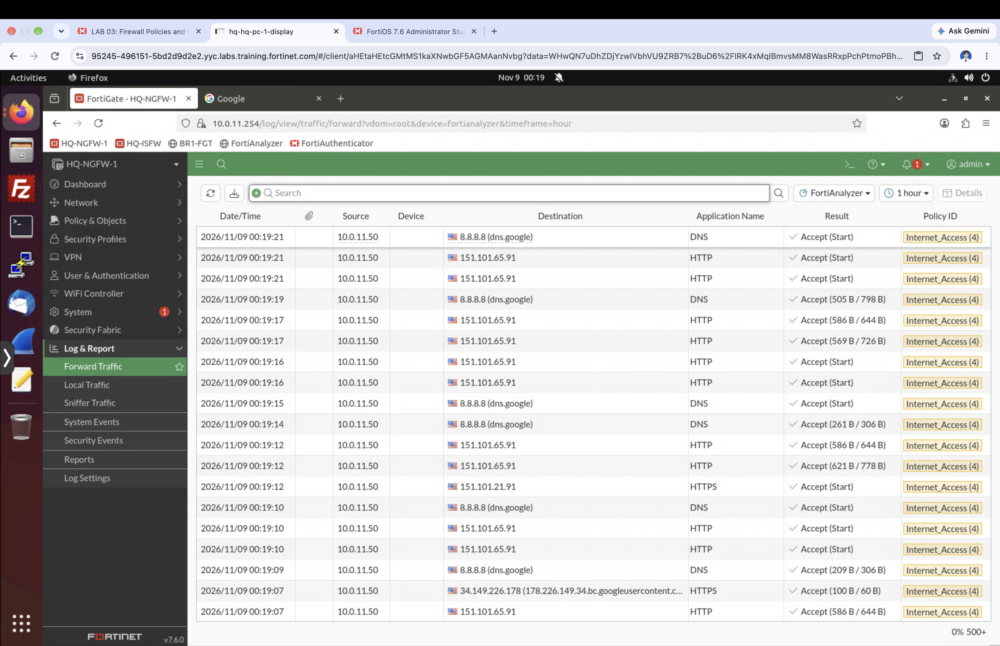

บทเรียน: ตอนปิด policy Internet ก่อนสร้างตัวใหม่ ทราฟฟิกตกไปที่ **Implicit Deny** ทำให้เข้าเน็ตไม่ได้

## Exercise 2: ลำดับ Policy และ Action DENY

แค่ลาก Block_Ping ขึ้นไปไว้เหนือ Internet_Access ผลก็เปลี่ยนทันที: ping 211 ครั้ง ตอบกลับแค่ 153 (packet loss 27%) และรอบถัดมา loss 100%

**สิ่งที่ตั้งค่า:** Policy `Block_Ping` (ID 5): Action **DENY**, port4 → port2, HQ_SUBNET → LINUX_ETH2 (100.65.0.254/32), Service PING, Log violation traffic เปิด

**ลำดับเหตุการณ์**

1. สร้าง Block_Ping แล้วมันไปอยู่**ใต้** Internet_Access → `ping 100.65.0.254` ยังผ่าน เพราะ ping ตรงกับ ALL_ICMP ของ Internet_Access ก่อน (Bytes ของ Block_Ping = 0 B)
2. ลาก Block_Ping ขึ้นไปบนสุด (หรือใช้ CLI `move 5 before 4`) → ping fail ทันที
3. ดู log ใน FortiAnalyzer: Fortinet Logs > FortiGate > Traffic แล้วกรอง `Application=PING` เห็น **Policy violation** 0 B/0 B ทุกแถว

**คำอธิบายภาพ**

- **หน้า Policy list หลังลาก:** Block_Ping **(5)** อยู่เหนือ Internet_Access **(4)** พิสูจน์ว่า ID ไม่ได้บอกลำดับการทำงาน
- **หน้า Terminal:** `ttl=63` = TTL 64 ลดลง 1 ตอนผ่าน FortiGate (หลักฐานว่าวิ่งผ่าน firewall) และสรุป 211 ส่ง / 153 รับ
- **หน้า FortiAnalyzer:** ไอคอน ❌ Policy violation จาก 10.0.11.50 → 100.65.0.254 มีได้เพราะเปิด Log violation traffic ไว้ (policy DENY ไม่ log เป็นค่าเริ่มต้น)

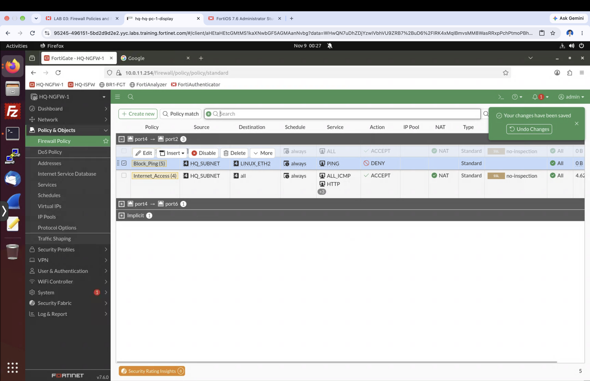

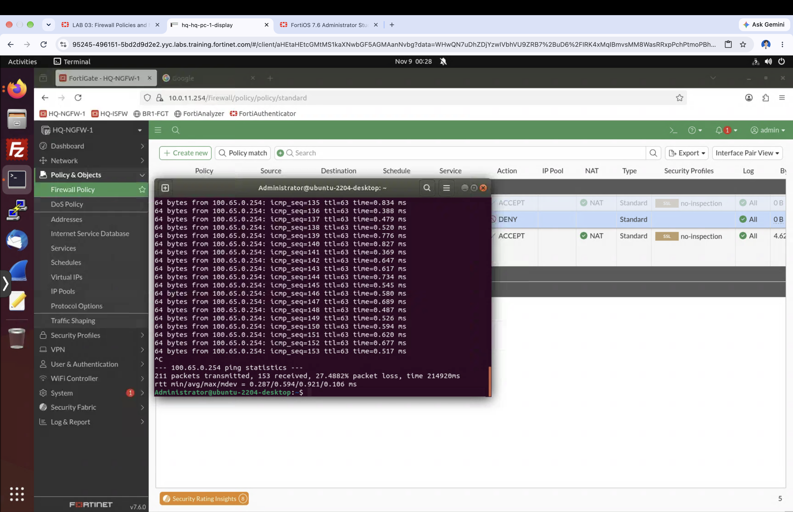

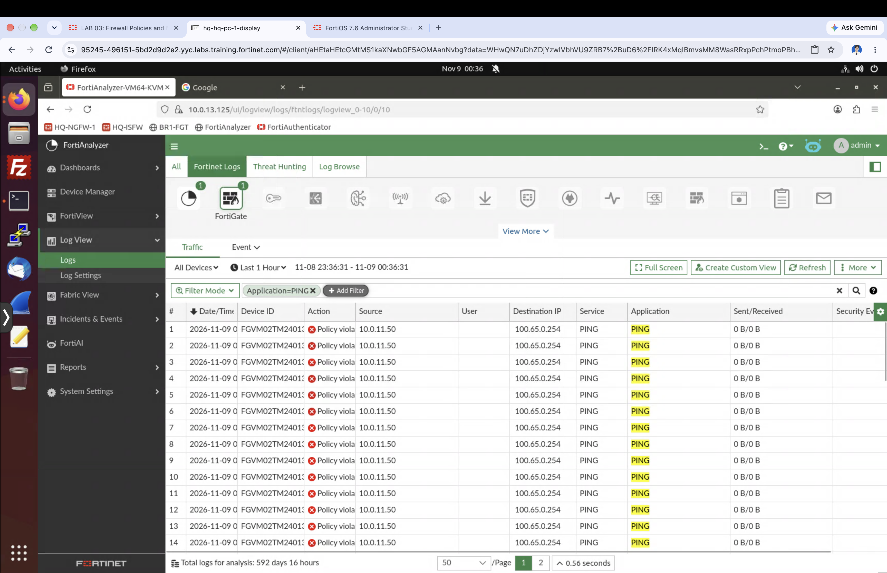

บทเรียน: policy ที่เจาะจงต้องอยู่**เหนือ** policy ทั่วไป มิฉะนั้นจะไม่มีทราฟฟิกไหนไปถึงเลย (first match)

## Exercise 3: DNAT ด้วย VIP

คนจากอินเทอร์เน็ตเข้าเว็บบน HQ-PC-1 ได้ผ่าน `100.65.0.200` (curl ได้หน้า "Apache2 Ubuntu Default Page: It works") และ VIP ยังแปลง SNAT ขาออกให้ด้วย

**สิ่งที่ตั้งค่า**

| ออบเจกต์ | ค่าสำคัญ |
| --- | --- |
| VIP `VIP-INTERNAL-HOST` | Interface port2, Static NAT, `100.65.0.200` → `10.0.11.50`, Port Forwarding ปิด (ส่งทุก port แบบ 1:1) |
| Policy `Web-Server-Access` (ID 6) | **port2 → port4** (ขาเข้า), all → VIP-INTERNAL-HOST, HTTP/HTTPS, **NAT ปิด**, Log All |

**เส้นทางที่เกิดขึ้น:** Linux-ISP-Router (100.65.0.254) → ขอเว็บจาก 100.65.0.200 → FortiGate port2 เจอ VIP แปลงปลายทางเป็น 10.0.11.50 (DNAT) → policy 6 อนุญาต → Apache ตอบกลับ

**คำอธิบายภาพ**

- **หน้า New Virtual IP:** กำหนด External IP กับ Map to IPv4 คือหัวใจของ DNAT
- **หน้า Policy list:** กลุ่มใหม่ port2 → port4 คอลัมน์ NAT ขึ้น Disabled แต่ DNAT ยังทำงาน เพราะ DNAT มาจาก VIP ใน Destination ส่วนสวิตช์ NAT คือ SNAT
- **หน้า curl บน Linux-ISP-Router:** ได้ HTML ที่มี `<title>Apache2 Ubuntu Default Page: It works</title>`
- **หน้า `get system session list`:** คอลัมน์ SOURCE-NAT ของ 10.0.11.50 เป็น **100.65.0.200** ไม่ใช่ 100.65.0.101 คือ VIP แบบ Static NAT ทำงาน**สองทาง**

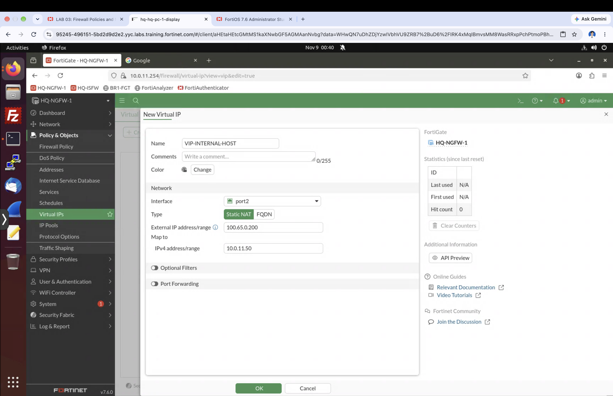

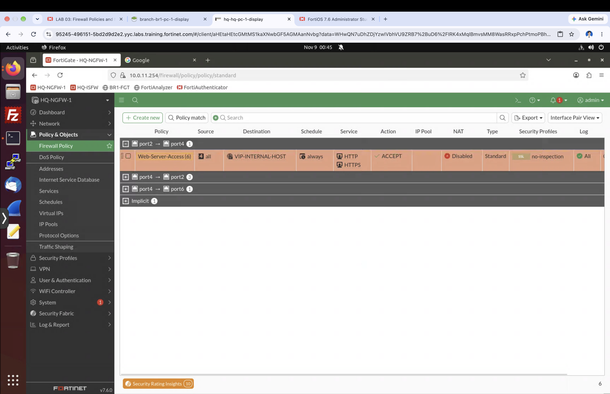

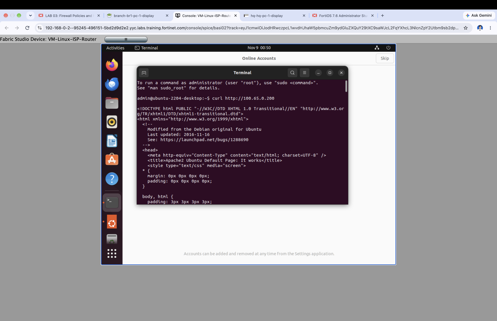

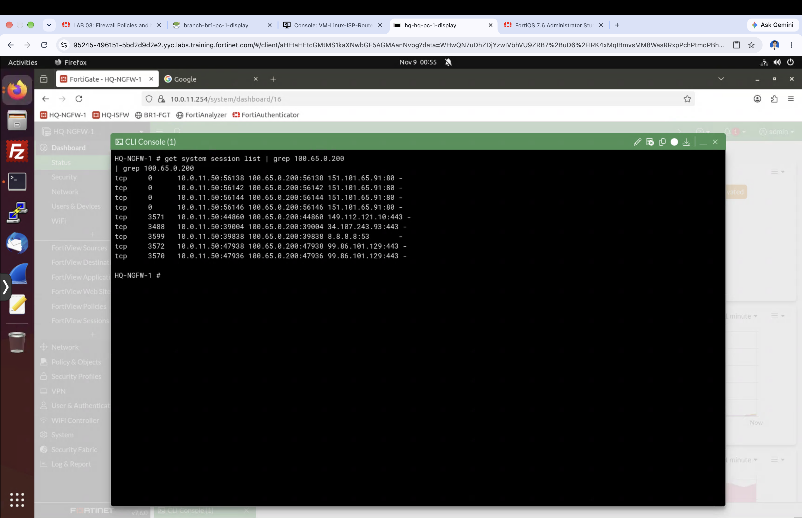

บทเรียน: DNAT = สร้าง VIP + ใส่ VIP ใน Destination ของ policy ไม่ต้องเปิดสวิตช์ NAT เปิดแล้วเว็บเซิร์ฟเวอร์จะไม่เห็น IP จริงของผู้เข้าชม

## Exercise 4: Dynamic NAT ด้วย IP Pool

พอ policy ใช้ IP Pool แล้ว SOURCE-NAT เปลี่ยนจาก 100.65.0.200 (VIP) เป็น **100.65.0.100** แปลว่า IP Pool มีลำดับความสำคัญเหนือ VIP

**สิ่งที่ตั้งค่า**

| ออบเจกต์ | ค่าสำคัญ |
| --- | --- |
| IP Pool `INTERNAL-HOST-EXT-IP` | Type **Overload**, `100.65.0.100-100.65.0.100`, ARP Reply เปิด |
| Policy `Internet` (ID 1) | Enabled, NAT เปิด, **Use Dynamic IP Pool** = INTERNAL-HOST-EXT-IP |

**ลำดับความสำคัญของ SNAT ที่เห็นในแล็บ**

| สถานการณ์ | SOURCE-NAT |
| --- | --- |
| Policy ปกติ (Use Outgoing Interface Address) | 100.65.0.101 (IP ของ port2) |
| มี VIP Static NAT ของเครื่องนั้น | 100.65.0.200 |
| Policy ใช้ IP Pool | **100.65.0.100** (ชนะ) |

**คำอธิบายภาพ**

- **หน้า New Dynamic IP Pool:** Overload = หลายเครื่องใช้ IP เดียวกัน แยกด้วยเลข port (PAT) ส่วน ARP Reply ต้องเปิดให้ router ฝั่งนอกรู้ว่า 100.65.0.100 อยู่ที่ FortiGate
- **หน้า Policy list:** แถว Internet (1) มีคอลัมน์ IP Pool = INTERNAL-HOST-EXT-IP และอยู่บนสุดของ port4 → port2 ทราฟฟิกเลยย้ายมาตรงกับ policy นี้ทันที (ผลข้างเคียง: มันอยู่เหนือ Block_Ping ด้วย ping จึงกลับมาผ่าน)
- **หน้า `get system session list`:** ทุก session ออกเน็ตด้วย 100.65.0.100 ส่วน session ที่ปลายทางเป็น 10.0.11.254:443 ไม่มี SNAT เพราะคุยกับตัว FortiGate เอง

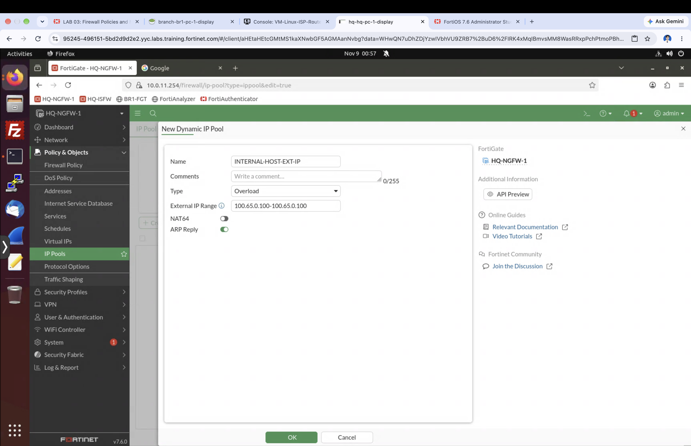

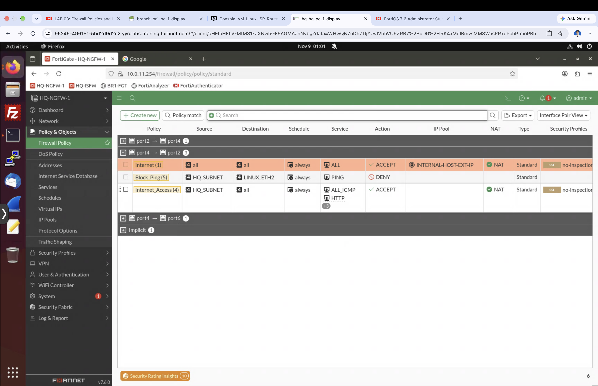

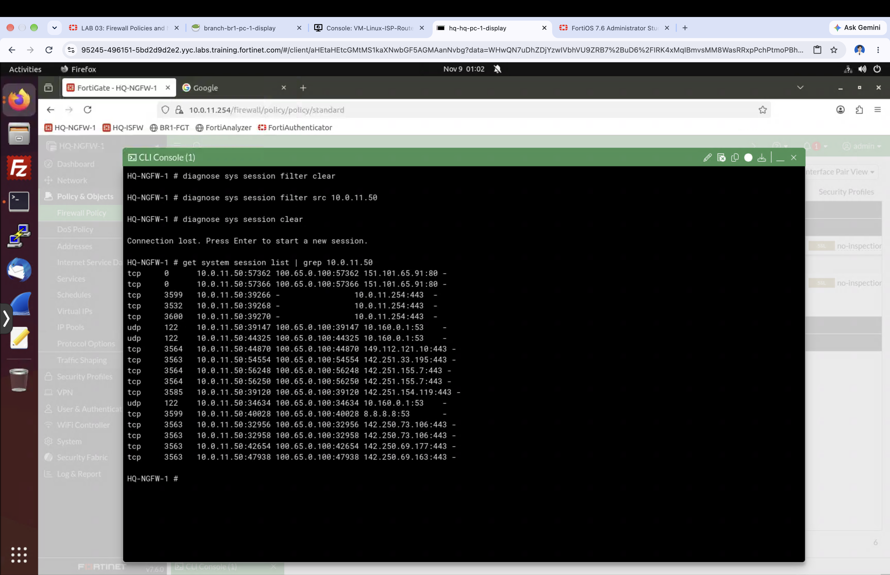

## Quiz และ Verify

แต่ละ Exercise ต้องทำ **Take quiz → Verify → Execute** จนขึ้น PASSED วงกลมใน Outline ถึงจะเป็นสีเขียว

| Exercise | คำถาม | คำตอบที่ถูก | เหตุผล |
| --- | --- | --- | --- |
| 1 | ทราฟฟิกไม่ตรง policy ไหนเลย เกิดอะไร | ถูกบล็อกโดย Implicit Deny | firewall ปฏิเสธเป็นค่าเริ่มต้น |
| 2 | ย้ายลำดับ policy แล้ว ID เป็นอย่างไร | ID ไม่เปลี่ยน | Block_Ping ยังเป็น (5) แม้อยู่บนสุด |
| 3 | ต้องทำอะไรเพื่อให้ FortiGate ทำ DNAT | สร้าง VIP แล้วอ้างใน policy | สวิตช์ NAT คือ SNAT ไม่เกี่ยวกับ DNAT |
| 4 | คำสั่งดู SNAT ของ session | `get system session list` | `get` = สถานะที่ทำงานอยู่, `show` = config |

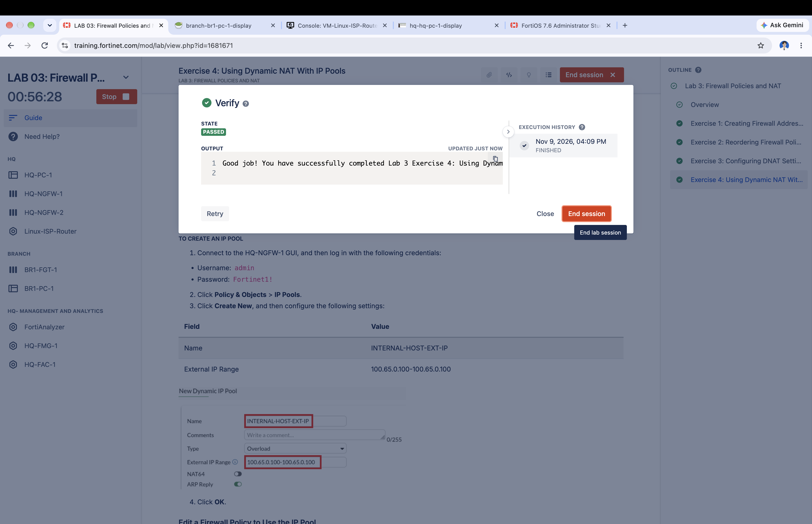

บทเรียนสำหรับแล็บถัดไป: สคริปต์ Verify ตรวจ config **ณ ตอนที่กด** ให้ Verify แต่ละข้อทันทีที่ทำเสร็จ ก่อนจะไปแก้ค่าในข้อถัดไป

## เทียบกับ Cloud

| FortiGate | AWS | Azure |
| --- | --- | --- |
| Firewall policy + Implicit Deny | Security Group (deny เป็นค่าเริ่มต้น) | Network Security Group |
| ลำดับ policy (first match) | Network ACL (rule number น้อยทำก่อน) | NSG priority (เลขน้อยทำก่อน) |
| Address object (HQ_SUBNET) | Prefix list / CIDR ใน rule | Service tag / Application Security Group |
| VIP Static NAT (DNAT 1:1) | Elastic IP ผูกกับ instance | Public IP ผูกกับ NIC |
| VIP + port forwarding | Load Balancer listener | Load Balancer inbound NAT rule |
| IP Pool Overload (SNAT/PAT) | NAT Gateway + Elastic IP | NAT Gateway + Public IP |
| Forward Traffic log / FortiAnalyzer | VPC Flow Logs / CloudWatch | NSG Flow Logs / Log Analytics |

ข้อต่างสำคัญ: Security Group แบบ AWS ไม่มีลำดับ (รวม rule allow ทั้งหมด) และไม่มี deny ส่วน FortiGate กับ NACL/NSG อ่านตามลำดับและมี deny ได้

## คำสั่ง CLI ที่ใช้

| คำสั่ง | ใช้ทำอะไร |
| --- | --- |
| `config firewall policy` / `move 5 before 4` / `end` | ย้ายลำดับ policy แทนการลากใน GUI |
| `get system session list` | ดู session พร้อม SOURCE-NAT |
| `get system session list \| grep 10.0.11.50` | กรองเฉพาะบรรทัดที่มี IP นี้ |
| `diagnose sys session filter clear` | ล้าง filter เดิม |
| `diagnose sys session filter src 10.0.11.50` | ตั้ง filter ตาม source |
| `diagnose sys session clear` | ลบ session (ทั้งหมด ถ้าไม่ตั้ง filter) ระวัง: GUI หลุดได้ |
| `ping 100.65.0.254` / `ping -c 4 ...` | ทดสอบจาก Terminal ของ HQ-PC-1 (ไม่ใช่ CLI FortiGate) |
| `curl http://100.65.0.200` | ทดสอบ DNAT จาก Linux-ISP-Router |

## อภิธานศัพท์ตัวย่อ

| ตัวย่อ | ชื่อเต็ม | ความหมายในแล็บนี้ |
| --- | --- | --- |
| NAT | Network Address Translation | การแปลง IP address |
| SNAT | Source Network Address Translation | แปลง IP ต้นทาง (ขาออกเน็ต) |
| DNAT | Destination Network Address Translation | แปลง IP ปลายทาง (ขาเข้าเซิร์ฟเวอร์) |
| PAT | Port Address Translation | หลายเครื่องใช้ IP เดียว แยกด้วย port (IP Pool Overload) |
| VIP | Virtual IP | object สำหรับ DNAT ของ FortiGate |
| NGFW | Next-Generation Firewall | firewall ที่มี IPS, App Control ฯ (HQ-NGFW-1) |
| ISFW | Internal Segmentation Firewall | firewall กั้นระหว่างเครือข่ายภายใน (HQ-ISFW) |
| FGT | FortiGate | เช่น BR1-FGT-1 |
| FAZ | FortiAnalyzer | เครื่องเก็บและวิเคราะห์ log |
| FMG | FortiManager | เครื่องจัดการ FortiGate หลายตัว (HQ-FMG-1) |
| FAC | FortiAuthenticator | เครื่องยืนยันตัวตน (HQ-FAC-1) |
| HQ / BR | Headquarters / Branch | สำนักงานใหญ่ / สาขา |
| LAN / WAN | Local Area Network / Wide Area Network | port4 ฝั่งภายใน / port2 ฝั่งอินเทอร์เน็ต |
| ISP | Internet Service Provider | Linux-ISP-Router จำลองฝั่งผู้ให้บริการเน็ต |
| ICMP | Internet Control Message Protocol | โปรโตคอลของ ping (ALL_ICMP) |
| DNS | Domain Name System | แปลงชื่อเว็บเป็น IP (8.8.8.8, port 53) |
| HTTP / HTTPS | Hypertext Transfer Protocol (Secure) | เว็บ port 80 / 443 |
| SSH | Secure Shell | เข้าเครื่องระยะไกลแบบเข้ารหัส port 22 |
| TTL | Time To Live | ลดลง 1 ทุก router (64 → 63) |
| ARP | Address Resolution Protocol | จับคู่ IP กับ MAC (ARP Reply ของ IP Pool) |
| CLI / GUI | Command Line Interface / Graphical User Interface | หน้าจอพิมพ์คำสั่ง / หน้าเว็บ |
| UUID | Universally Unique Identifier | รหัสประจำ policy ใน filter ของ log |
| ID | Identifier | หมายเลข policy ไม่ได้บอกลำดับ |
| SSL | Secure Sockets Layer | ในคอลัมน์ Security Profiles (no-inspection) |
| AWS / VPC | Amazon Web Services / Virtual Private Cloud | ใช้ในตารางเทียบ cloud |
| NSG / NACL | Network Security Group / Network Access Control List | firewall ของ Azure / AWS |
