# 🔬 LAB 11 สรุป: IPsec VPN แบบ Dial-up vs Static (FortiGate)

> หมายเหตุ: รูปภาพประกอบอยู่ใน `images/lab11/`

## ภาพรวม LAB 11

**เป้าหมาย:** เชื่อมออฟฟิศใหญ่ (HQ) กับสาขา (BR1) ผ่านอินเทอร์เน็ตด้วยอุโมงค์เข้ารหัส IPsec ทำ 2 แบบ คือ **Dial-up** (Exercise 1) และ **Static** (Exercise 2) ผลลัพธ์: ผ่านทั้ง 2 Exercise, ping ผ่านอุโมงค์ได้ ttl=62, packet loss 0%

ภาพในหัวคือ: HQ-PC-1 (10.0.11.50) → HQ-NGFW-1 (100.65.0.101) → **อุโมงค์ IPsec** → BR1-FGT (100.65.1.111) → BR1-PC-1 (172.20.1.60)

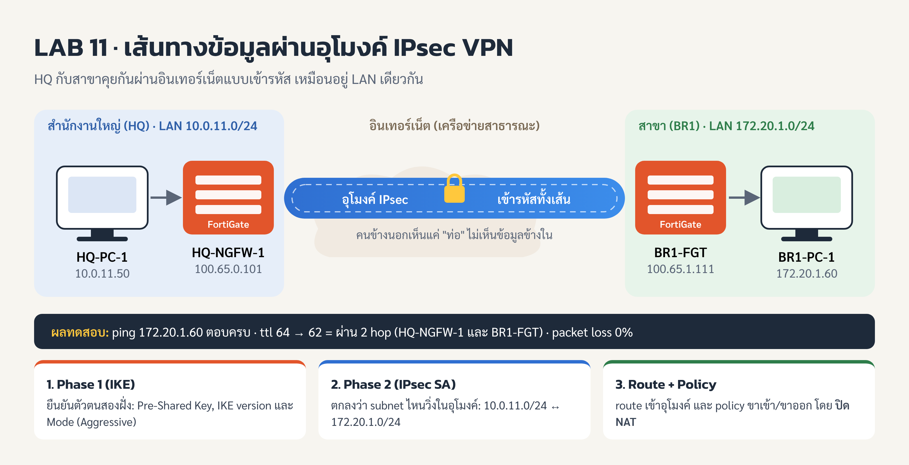

เปรียบเทียบง่ายๆ: VPN คือ "ท่อลับ" ที่วิ่งบนถนนสาธารณะ (อินเทอร์เน็ต) ทำให้ 2 ออฟฟิศคุยกันได้เหมือนอยู่ใน LAN เดียว คนข้างนอกเห็นแค่ท่อ ไม่เห็นของข้างใน

### คำย่อที่ใช้ในแล็บนี้

| คำย่อ | ชื่อเต็ม | ความหมายแบบสั้น |
| --- | --- | --- |
| VPN | Virtual Private Network | เครือข่ายส่วนตัวที่วิ่งบนเครือข่ายสาธารณะ |
| IPsec | Internet Protocol Security | ชุดโปรโตคอลเข้ารหัสแพ็กเก็ต IP |
| IKE | Internet Key Exchange | โปรโตคอลตกลงกุญแจและยืนยันตัวตน (Phase 1) |
| SA | Security Association | "สัญญา" ว่าจะเข้ารหัสด้วยวิธีไหน (Phase 2 สร้าง IPsec SA) |
| PSK | Pre-Shared Key | รหัสผ่านที่ 2 ฝั่งตั้งตรงกัน (ในแล็บคือ fortinet) |
| NAT | Network Address Translation | การแปลง IP ต้นทาง ต้อง **ปิด** บน policy VPN |
| HQ | Headquarters | สำนักงานใหญ่ |
| BR1 | Branch 1 | สาขาที่ 1 |
| TTL | Time To Live | ตัวนับ hop ลดลง 1 ทุกครั้งที่ผ่าน router |

### 3 ชิ้นที่ต้องมีเสมอ

1. **Phase 1 (IKE):** ตกลงวิธีคุยและยืนยันตัวตน เช่น PSK, IKE version, Mode (Main/Aggressive)
2. **Phase 2 (IPsec SA):** ตกลงว่า subnet ไหนจะวิ่งผ่านอุโมงค์ (local/remote selector)
3. **Route + Firewall Policy:** ถนนที่ส่งทราฟฟิกเข้าอุโมงค์ และ policy 2 ข้อ (ขาออก/ขาเข้า) โดยปิด NAT

### Dial-up กับ Static ต่างกันยังไง

|  | Exercise 1: Dial-up | Exercise 2: Static |
| --- | --- | --- |
| HQ รู้ IP สาขาไหม | ไม่รู้ (Remote gateway = Dialup User) | รู้ (100.65.1.111) |
| จับคู่ด้วย | Peer ID **BR1-FGT** (ต้องใช้ Aggressive mode) | IP ของ gateway |
| Phase 2 ฝั่ง HQ | Remote 0.0.0.0/0 | Remote 172.20.1.0/24 |
| Route บน HQ | FortiGate เพิ่มให้อัตโนมัติ | ต้องสร้างเอง |
| ใครเริ่มอุโมงค์ | สาขาเท่านั้น | ฝั่งไหนก็ได้ |

จำง่ายๆ: **Dial-up** = HQ เปิดประตูรอให้สาขาโทรเข้ามา · **Static** = ทั้งสองฝั่งรู้เบอร์ของกันและกัน

## Exercise 1: IPsec แบบ Dial-up (ทำทีละขั้น)

โจทย์: HQ **ไม่รู้** IP ของสาขา จึงตั้งเป็น Dialup User แล้วใช้ **Peer ID** เป็นตัวจับคู่แทน

### ขั้นที่ 1 — สร้าง Phase 1 บน HQ-NGFW-1

- VPN > VPN Tunnels > Create New > **Custom**
- Name **ToBranch** · Remote gateway **Dialup User** · Interface **port2**
- Pre-shared key **fortinet** · IKE Version **1** · Mode **Aggressive**
- Accepted peer ID: **Specific peer ID = BR1-FGT**

ทำไมต้อง Aggressive? เพราะ Peer ID ถูกส่งในขั้นแรกก่อนเข้ารหัสได้เฉพาะ Aggressive mode ถ้าใช้ Main mode HQ จะไม่รู้ว่าคนที่โทรเข้ามาคือใคร

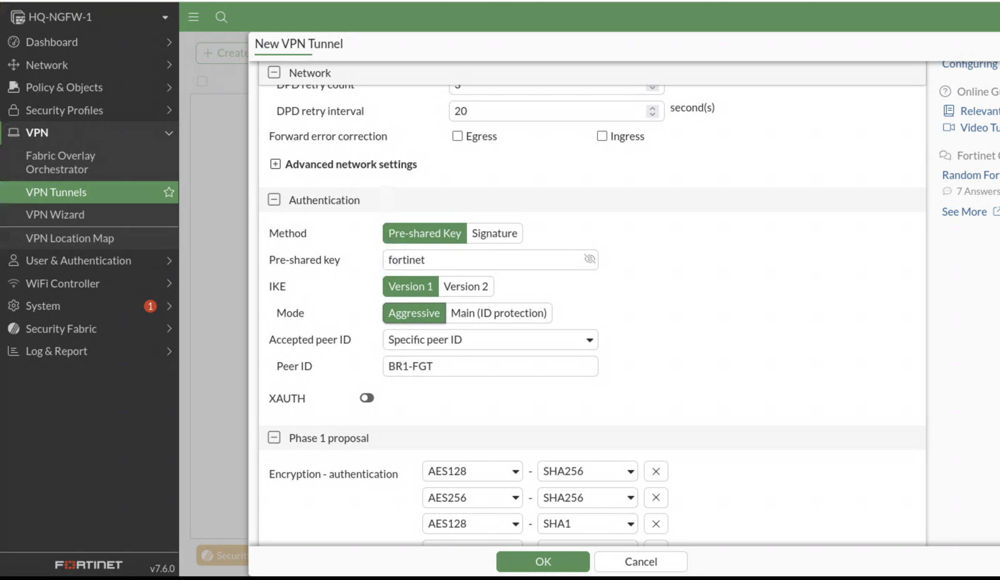

### ขั้นที่ 2 — Phase 2 บน HQ

- Local address **10.0.11.0/24**
- Remote address **0.0.0.0/0** (ปล่อยค่าเดิม)

0.0.0.0/0 แปลว่ารับ subnet ไหนของสาขาก็ได้ ในอนาคตเพิ่มสาขาใหม่ก็ใช้อุโมงค์เดิมได้

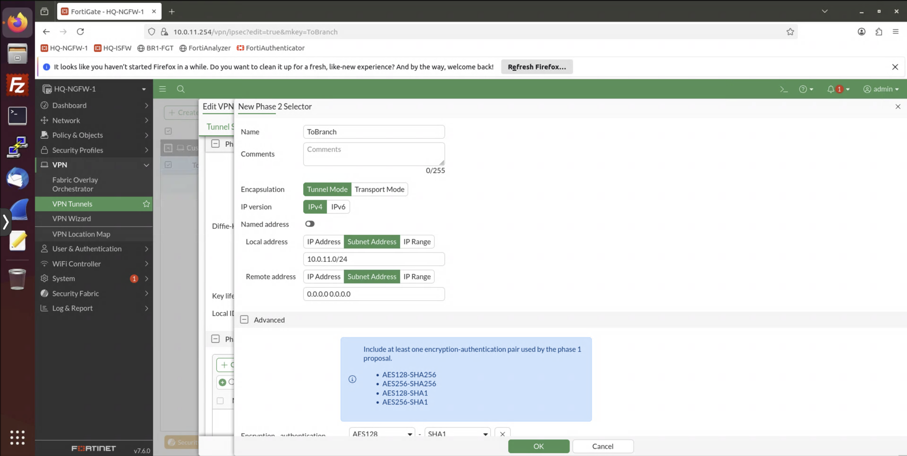

### ขั้นที่ 3 — อุโมงค์ ToBranch ถูกสร้าง

สถานะยังเป็น **Inactive** ซึ่งปกติ เพราะ HQ รอให้สาขาโทรเข้ามาก่อน

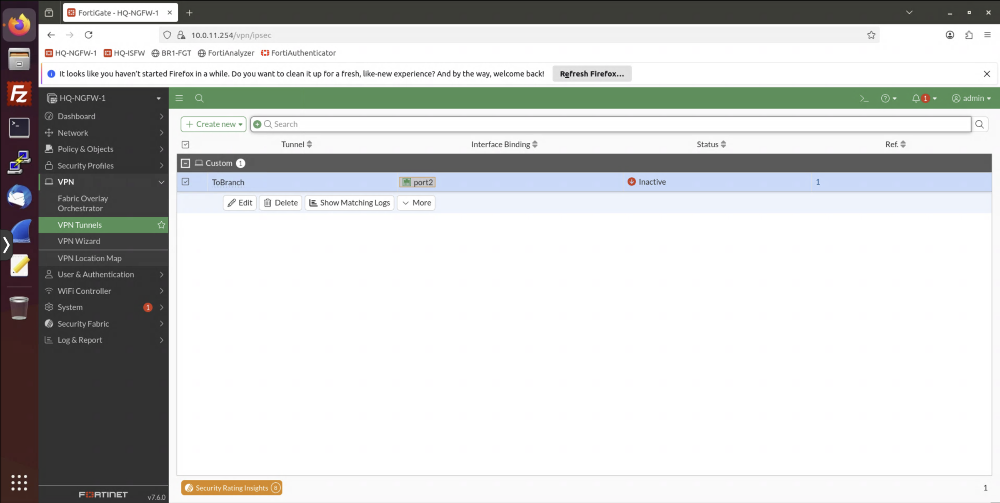

### ขั้นที่ 4 — Firewall Policy บน HQ 2 ข้อ

- **Branch_out:** port4 (LAN) → ToBranch
- **Branch_in:** ToBranch → port4
- Service ALL · **NAT ปิด** ทั้งคู่

ทำไมปิด NAT? สองฝั่งต้องเห็น IP จริงของกัน ถ้าแปลง IP ทราฟฟิกจะไม่ตรงกับ Phase 2 selector

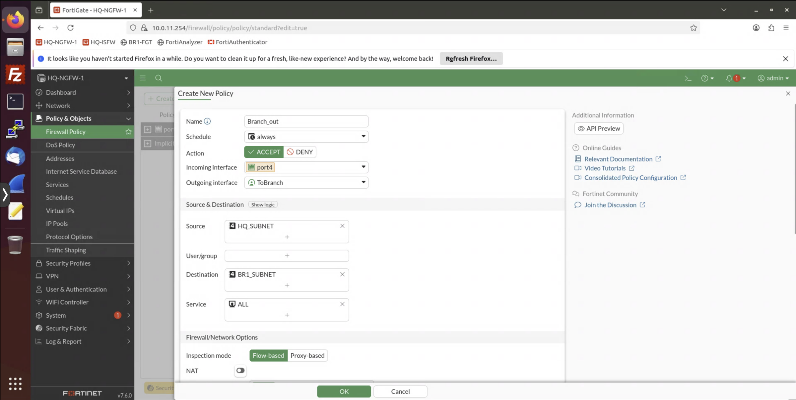

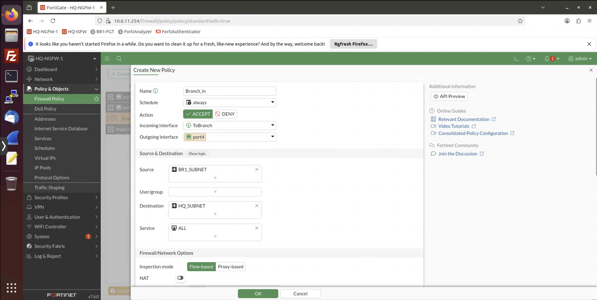

### ขั้นที่ 5 — Phase 1 บน BR1-FGT (ฝั่งสาขา)

- Name **ToHQ** · Remote gateway **Static IP 100.65.0.101** · Interface port2
- PSK **fortinet** · IKE Version 1 · Mode **Aggressive**
- **Local ID = BR1-FGT** (ต้องตรงกับ Peer ID ที่ HQ รออยู่)

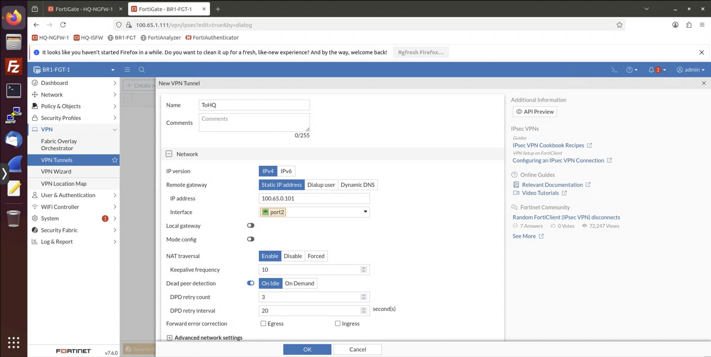

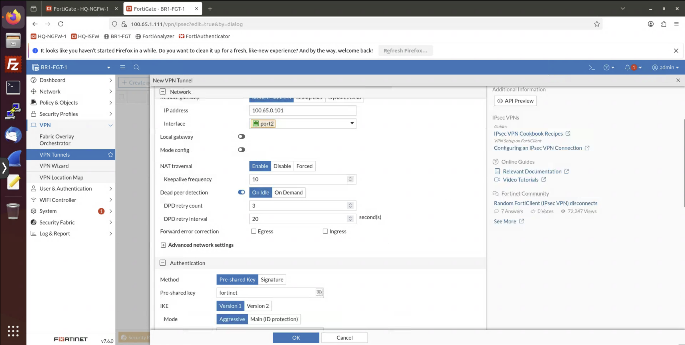

### ขั้นที่ 6 — Phase 2 บน BR1-FGT

- Local **172.20.1.0/24** · Remote **10.0.11.0/24**
- สาขารู้ปลายทางแน่นอน จึงระบุ subnet ตรงๆ

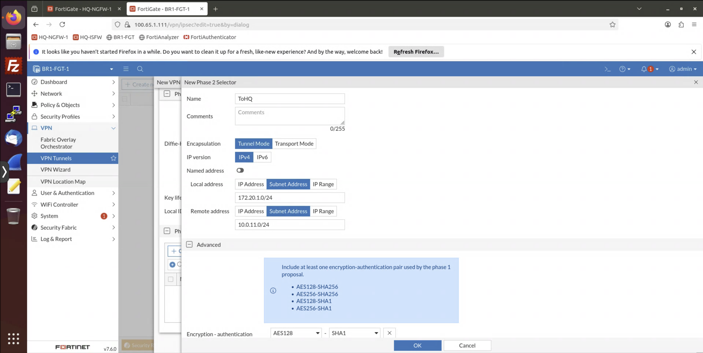

### ขั้นที่ 7 — Static route บนสาขา

- Destination **10.0.11.0/24** → Interface **ToHQ**
- ฝั่งที่โทรออกต้องมีถนนเข้าอุโมงค์เอง (ต่างจาก HQ ที่ได้ route อัตโนมัติ)

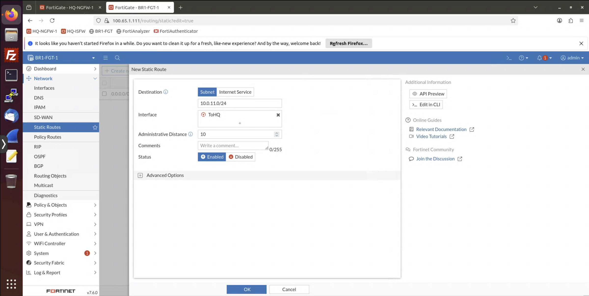

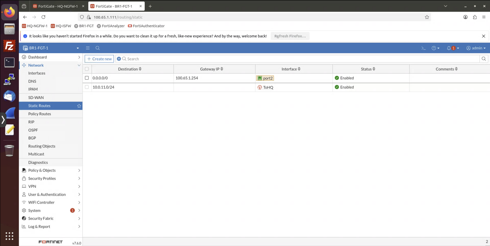

### ขั้นที่ 8 — Policy บนสาขา 2 ข้อ

- **HQ_out:** port4 → ToHQ · **HQ_in:** ToHQ → port4 · NAT Disabled ทั้งคู่

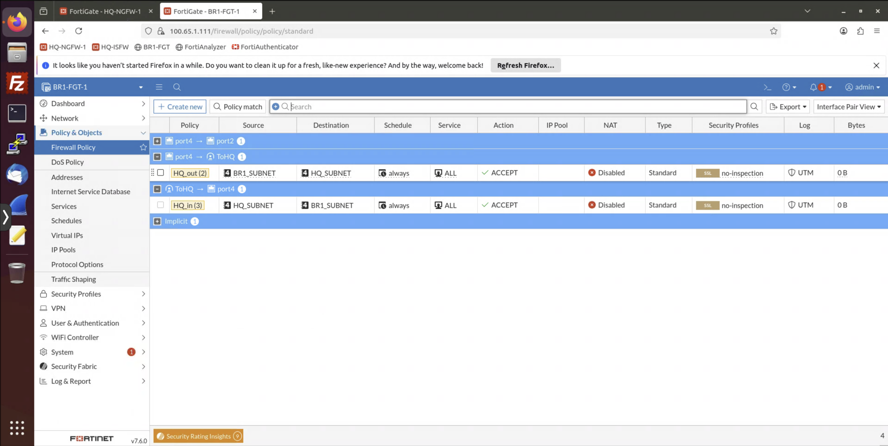

### ขั้นที่ 9 — Bring Up อุโมงค์ (เริ่มจากสาขา)

- Dashboard > Network > IPsec
- คลิกขวา ToHQ > **Bring Up > All Phase 2 Selectors**
- Phase 1 และ Phase 2 เป็นลูกศรสีเขียว = อุโมงค์ขึ้นแล้ว

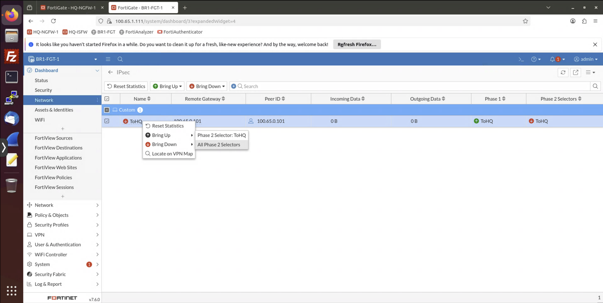

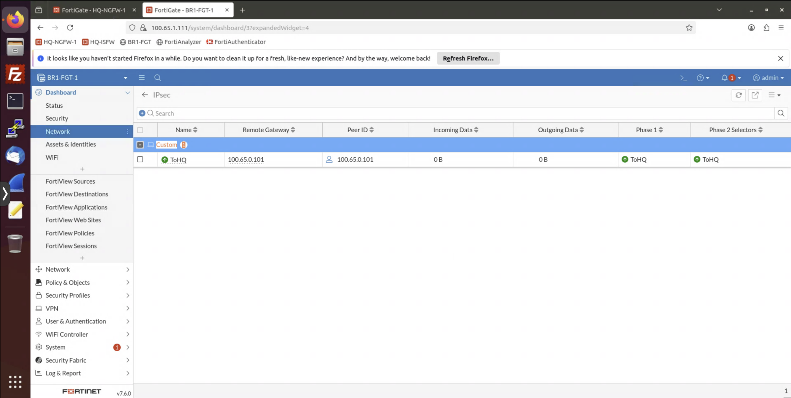

### ขั้นที่ 10 — ทดสอบด้วย ping

- เปิด **Terminal ของ HQ-PC-1** (ไม่ใช่ CLI ของ FortiGate) พิมพ์ `ping 172.20.1.60`
- ตอบครบ ~1 ms, **ttl=62** → 64 ลดลง 2 = ผ่าน 2 hop คือ HQ-NGFW-1 และ BR1-FGT
- หน้า IPsec เห็น Incoming/Outgoing เท่ากัน (6.72 kB)

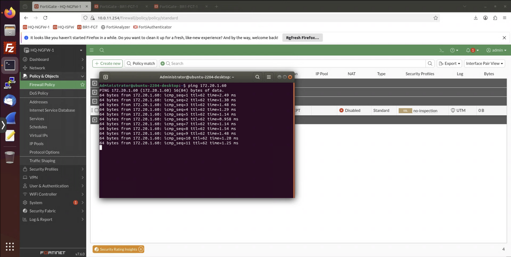

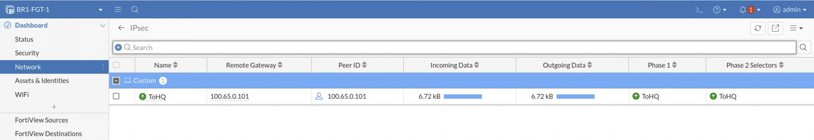

### ขั้นที่ 11 — Verify Exercise 1

- Take quiz > Verify > Execute = **PASSED**
- ต้องทำ**ก่อน** Revert ใน Exercise 2 เพราะ Revert จะลบ config ของ Exercise 1 ทิ้ง

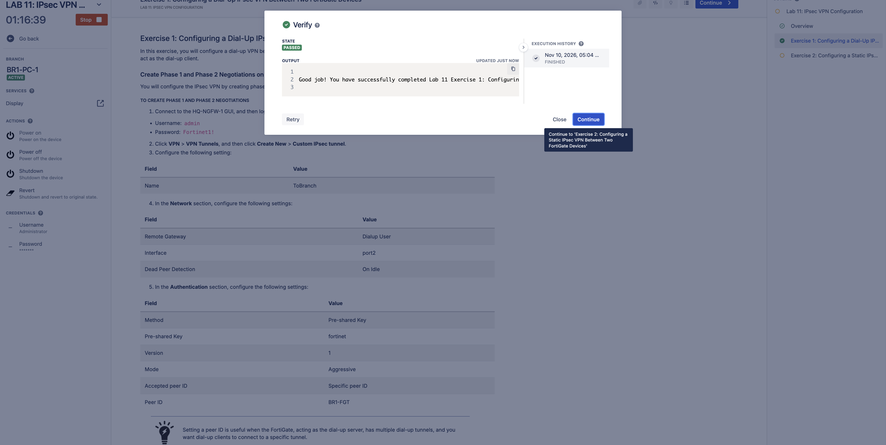

## Exercise 2: IPsec แบบ Static (ทำทีละขั้น)

โจทย์: ตอนนี้ HQ **รู้** IP สาขาแล้ว (100.65.1.111) จึงตั้งอุโมงค์แบบ Static ฝั่งสาขาไม่ต้องแก้อะไร

### ขั้นที่ 1 — Revert HQ กลับไปจุดเริ่ม

- มุมขวาบน admin > Configuration > **Revisions**
- เลือก **15 · HQ-static-ipsec** > Revert > OK (ระวังอย่าเลือก 14 ที่เป็น dialup)
- เครื่อง reboot ประมาณ 1–2 นาที แล้ว log in ใหม่

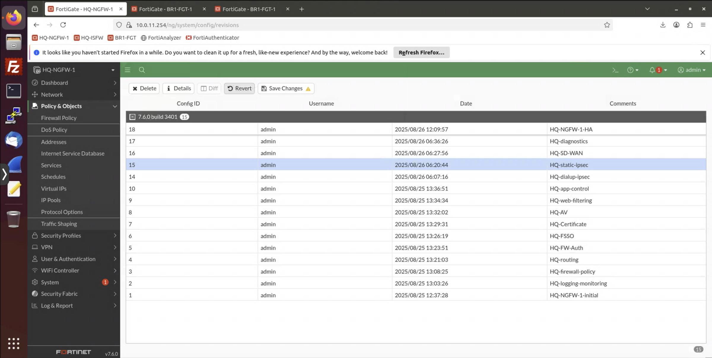

### ขั้นที่ 2 — Phase 1 แบบ Static บน HQ

- Name ToBranch · Remote gateway **Static IP Address = 100.65.1.111** · port2
- PSK fortinet · Version 1 · Aggressive (ให้ตรงกับสาขาที่ตั้งไว้แล้ว)
- Accepted peer ID: **Any** เพราะ HQ รู้ IP แล้ว ไม่ต้องดู Peer ID

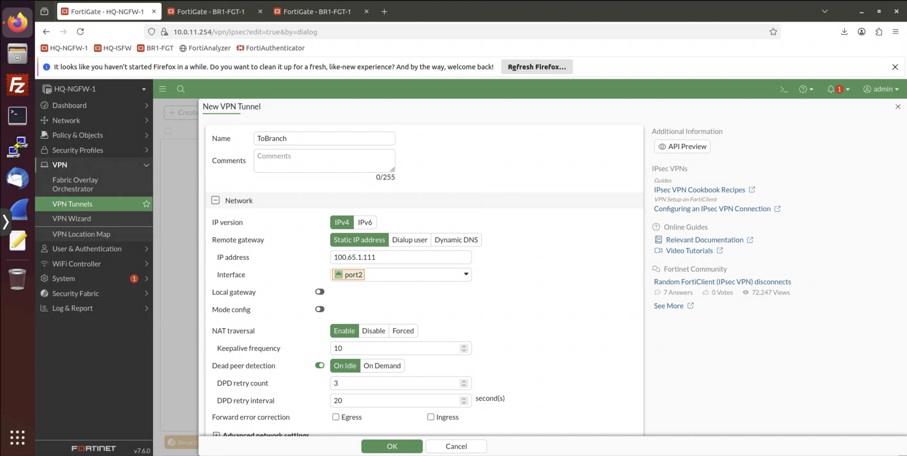

### ขั้นที่ 3 — Phase 2 แบบ Static

- Local **10.0.11.0/24** · Remote **172.20.1.0/24** (ห้ามใช้ 0.0.0.0/0)
- ค่าต้อง "สลับกัน" กับฝั่งสาขาพอดี: local ของเรา = remote ของเขา

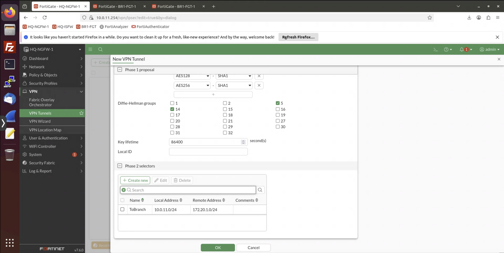

### ขั้นที่ 4 — Static route บน HQ

- Destination **172.20.1.0/24** → Interface **ToBranch**
- แบบ Static ไม่มี route อัตโนมัติเหมือน Dial-up ต้องสร้างเอง

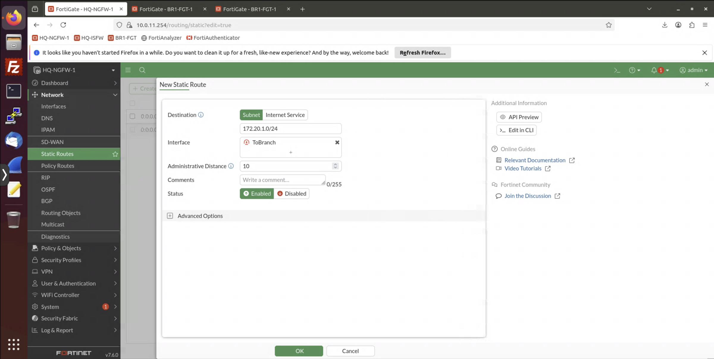

### ขั้นที่ 5 — Policy 2 ข้อบน HQ

- Branch_out / Branch_in เหมือน Exercise 1 · NAT ปิด
- Revert ลบ policy เดิมไปแล้ว จึงต้องสร้างใหม่

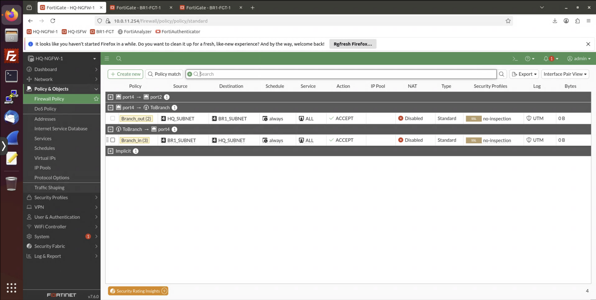

### ขั้นที่ 6 — Bring Up จากฝั่ง HQ

- คลิกขวา ToBranch > Bring Up
- Static เริ่มจากฝั่งไหนก็ได้ เพราะทั้งสองฝั่งรู้ IP กัน

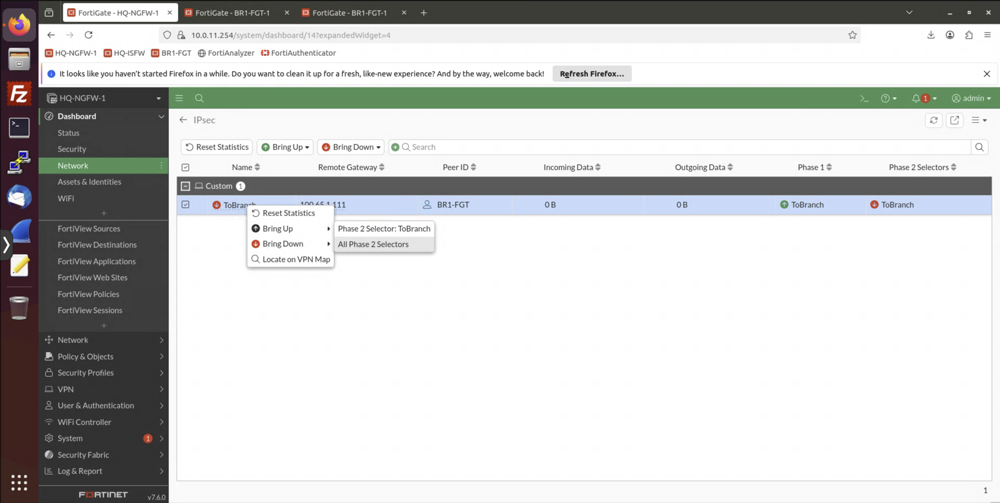

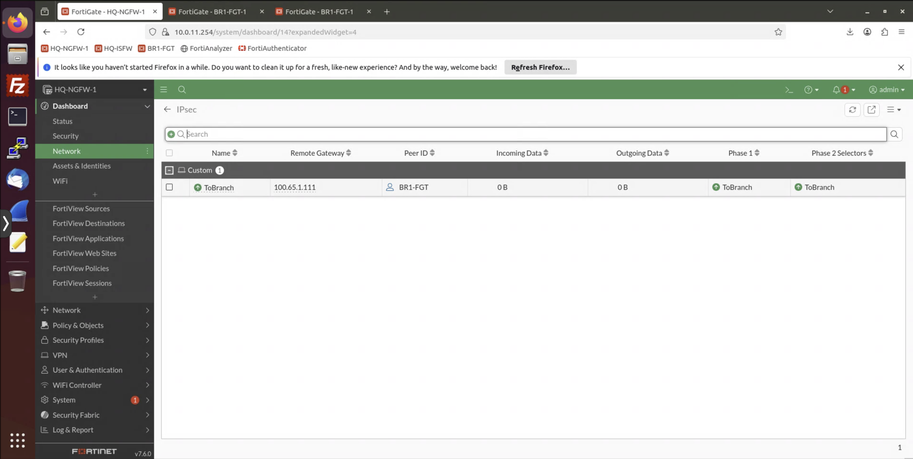

### ขั้นที่ 7 — ping แล้ว Verify

- Terminal ของ HQ-PC-1: `ping 172.20.1.60` ตอบครบ ttl=62
- Verify Exercise 2 = **PASSED**

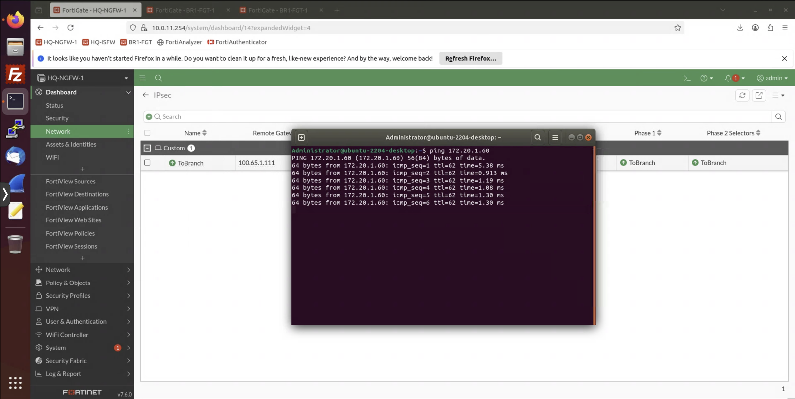

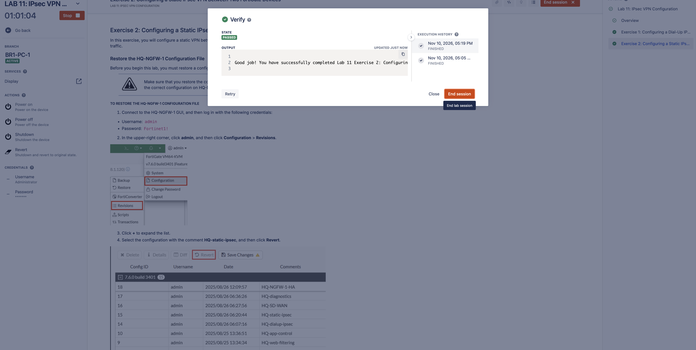

## ปัญหาที่เจอระหว่างทำ

| อาการ | สาเหตุ | วิธีแก้ |
| --- | --- | --- |
| อุโมงค์ไม่ขึ้น | ตั้ง Mode เป็น Main | เปลี่ยนเป็น **Aggressive** ทั้งสองฝั่ง |
| BR1-PC-1 ไม่ขึ้นให้เข้า | เครื่องในแล็บไม่ได้เปิดให้ใช้ | ping จาก HQ-PC-1 ไปหาแทน |
| ping ใน CLI ขึ้น Unknown action 0 | พิมพ์ ping ใน CLI ของ FortiGate | ใช้ Terminal ของ PC (เครื่องหมาย $) หรือ `execute ping` |
| Verify Ex2 = FAILED | กดก่อนทำเสร็จ | ทำครบทุกขั้นแล้วกดใหม่ |

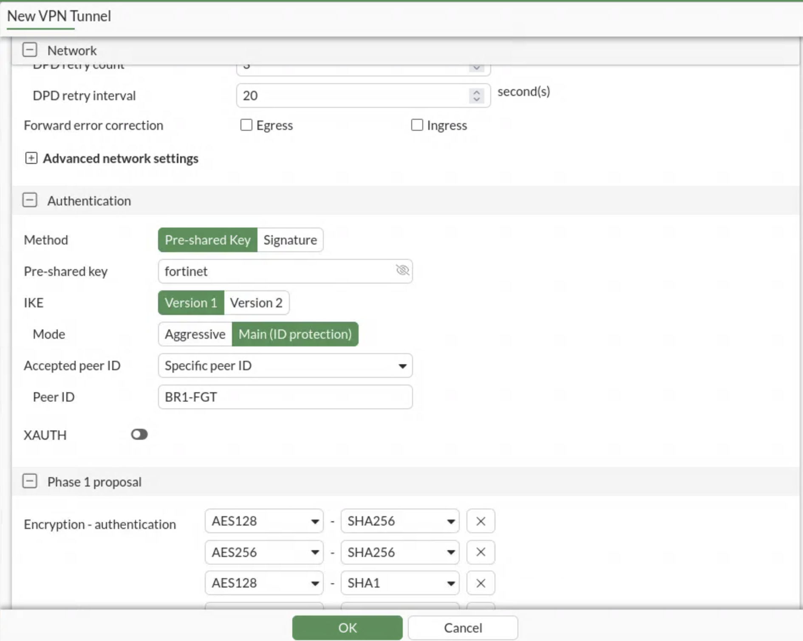

## ทบทวน quiz

- **ต้องกด Bring Up เท่านั้นอุโมงค์ถึงจะขึ้น?** → **False** ทราฟฟิกที่ตรง Phase 2 selector ก็เปิดอุโมงค์ได้เอง
- **อะไรต้องตรงกันสองฝั่ง?** → **Pre-shared key** และ **Phase 2 local/remote** (สลับกัน)

## เทียบกับ Cloud (สายงานที่เราเล็ง)

| FortiGate | AWS | Azure |
| --- | --- | --- |
| IPsec site-to-site VPN | Site-to-Site VPN + Virtual Private Gateway (VGW) หรือ Transit Gateway (TGW) | VPN Gateway (S2S) |
| Phase 1/2, PSK | Tunnel options (IKEv1/v2, PSK) | Connection + IPsec policy |
| อุปกรณ์ฝั่งออฟฟิศ | Customer Gateway (CGW) | Local Network Gateway |
| Static route เข้าอุโมงค์ | Static routes หรือ BGP (Border Gateway Protocol) | Address space ใน Local Network Gateway หรือ BGP |

ในงานจริง FortiGate ที่ออฟฟิศมักทำหน้าที่เป็น Customer Gateway ต่ออุโมงค์เข้า AWS/Azure ด้วยค่า Phase 1/2 แบบเดียวกับแล็บนี้

## สรุปสั้นๆ

- IPsec = Phase 1 (ยืนยันตัวตน) + Phase 2 (เลือก subnet) + Route + Policy ที่ปิด NAT
- Dial-up ใช้เมื่อ HQ ไม่รู้ IP สาขา จับคู่ด้วย Peer ID + Aggressive mode สาขาเป็นฝ่ายเริ่ม
- Static ใช้เมื่อรู้ IP ทั้งสองฝั่ง ต้องสร้าง route เอง และเริ่มจากฝั่งไหนก็ได้
- ตรวจผลด้วย ping จาก PC ดู ttl=62 และดู Incoming/Outgoing บนหน้า IPsec
