# 🔬 LAB 13 Summary: High Availability (HA)

> 🇹🇭 ภาษาไทย: [LAB-13.md](LAB-13.md)
> Note: screenshots live in `images/lab13/`

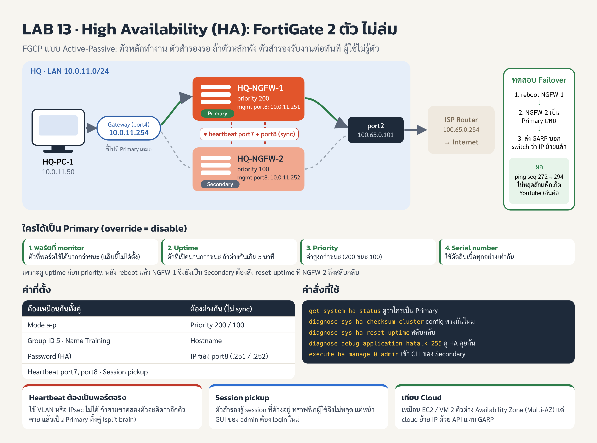

## Overview

LAB 13 passed all 3/3 Exercises: two FortiGates work as an Active-Passive pair; when the primary reboots, a ping to 4.2.2.2 from HQ-PC-1 drops not a single packet (seq 272–294 continuous) and a YouTube clip keeps playing.

| Exercise | Topic | Result |
| --- | --- | --- |
| 1 | Configure HA on both boxes + check sync | PASSED |
| 2 | Failover by reboot, switch back with reset-uptime, read hatalk debug | PASSED |
| 3 | A separate management interface per box (port8) | PASSED |

**Abbreviations used**

| Abbr. | Full name | Short meaning |
| --- | --- | --- |
| HA | High Availability | a system that doesn't go down when one box fails |
| FGCP | FortiGate Clustering Protocol | the protocol FortiGate uses to find peers, elect a primary, and sync config |
| A-P | Active-Passive | the primary works, the secondary waits |
| HB | Heartbeat | the links the two boxes talk over constantly (port7, port8) |
| GARP | Gratuitous ARP | announces to the switch that an IP has moved to a new box |
| CLI / GUI | Command-Line Interface / Graphical User Interface | the command screen / the web page |

**Topology:** HQ-PC-1 (10.0.11.50) → port4 of both boxes (LAN 10.0.11.254) → port2 (100.65.0.101) → Linux-ISP-Router (100.65.0.254) → Internet. The two boxes connect directly via port7 and port8 as heartbeat.

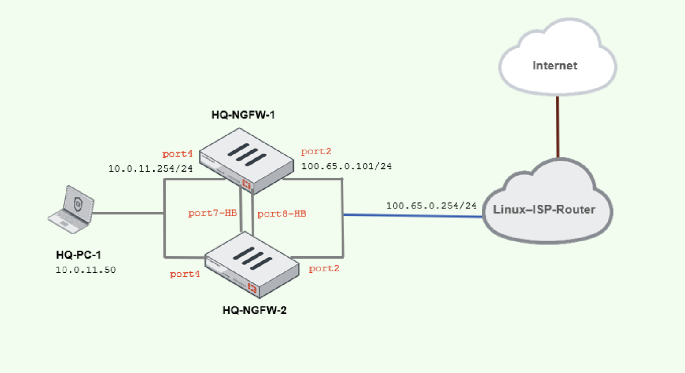

**Console tab names in the lab:** fgt006 = HQ-NGFW-1, fgt007 = HQ-NGFW-2

## Exercise 1: Configure HA and check sync

**Step 1: Configure HQ-NGFW-1 via GUI** — System → HA

| Field | Value |
| --- | --- |
| Mode | Active-Passive |
| Device priority | 200 |
| Group ID / Group name | 5 / Training |
| Password | Fortinet |
| Session pickup | on |
| Monitor interfaces | remove all |
| Heartbeat interfaces | port7, port8 (remove port4) |

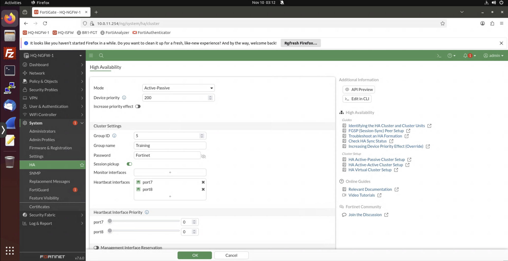

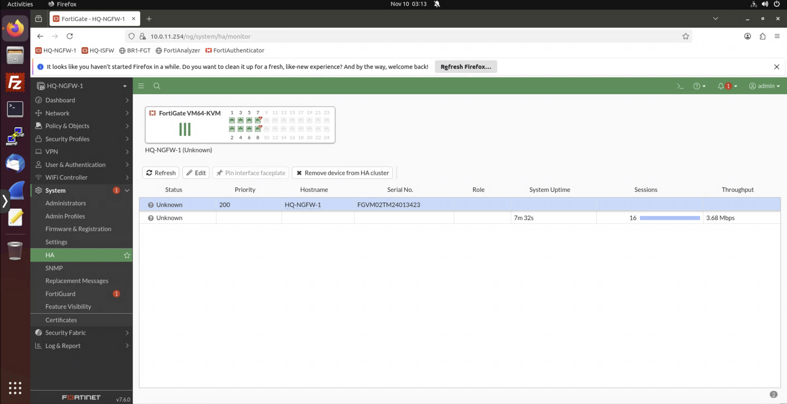

**Step 2: Configure HQ-NGFW-2 via CLI** (console fgt007)

```txt
config system ha
set mode a-p
set group-name Training
set group-id 5
set password Fortinet
set hbdev port7 0 port8 0
set session-pickup enable
set override disable
set priority 100
end
```

Group ID, Group name and Password must match NGFW-1, or the two boxes won't form a group. Priority 100 is lower than 200, intentionally making NGFW-1 the primary.

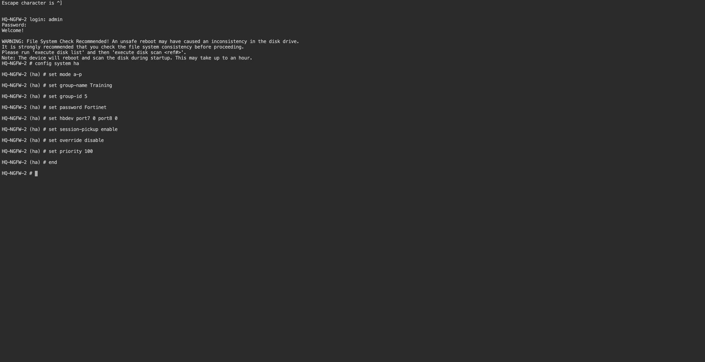

**Step 3: Wait 4–5 minutes to sync** — the console shows, in order: `secondary's external files are not in sync` → `secondary succeeded to sync external files` → `secondary starts to sync with primary` → `logout all admin users`; then log in again.

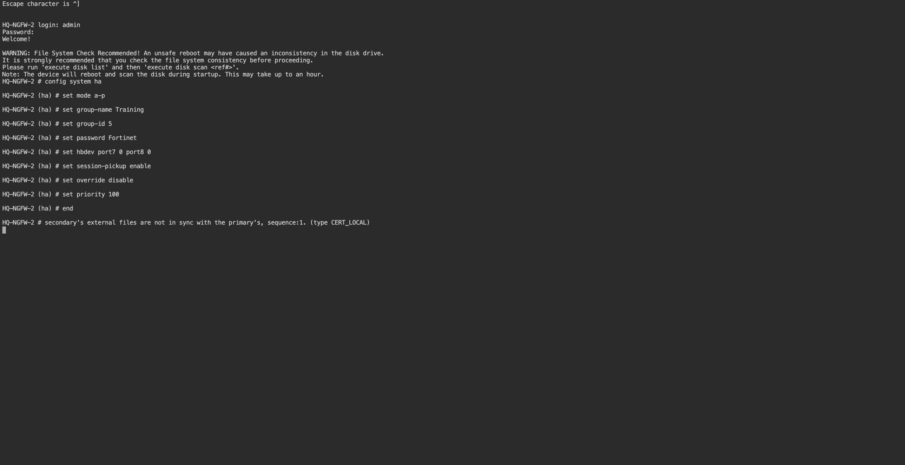

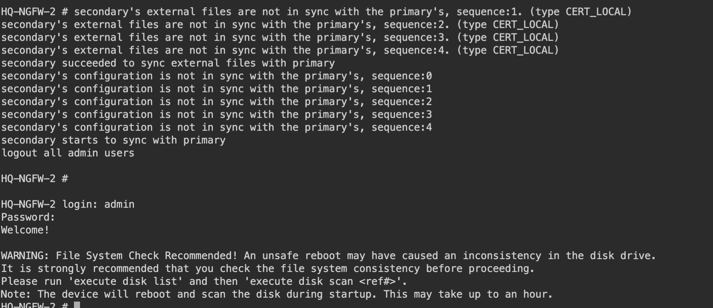

**Step 4: Check the checksum** — `diagnose sys ha checksum cluster`; the global, root and all checksums match on both serials, meaning the config is identical.

| Serial | is_root_primary | Role |
| --- | --- | --- |
| FGVM02TM24013423 | 1 | Primary (NGFW-1) |
| FGVM02TM24013501 | 0 | Secondary (NGFW-2) |

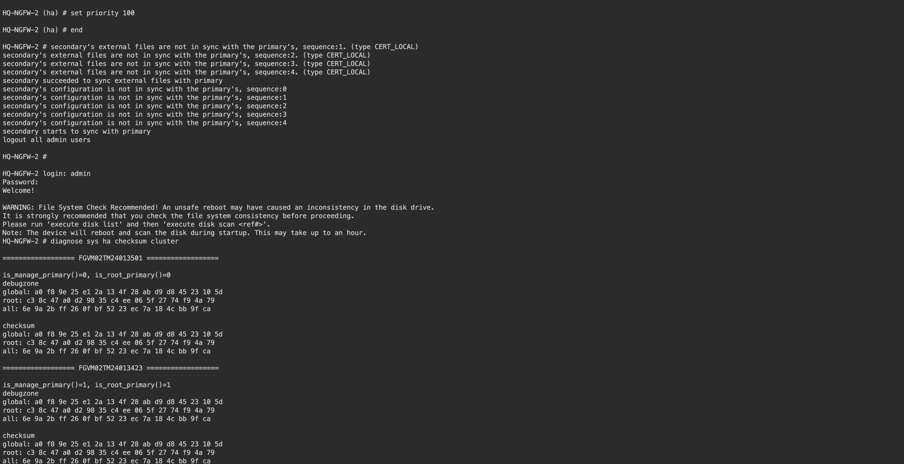

**Why NGFW-1 is primary:** no monitored port → compare uptime, but they differ by under 5 minutes → compare priority, where 200 beats 100.

**Step 5: Take quiz → Verify → PASSED**

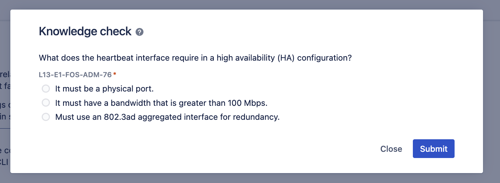

## Exercise 2: Failover

**Step 1: Keep traffic running on HQ-PC-1** — play a YouTube clip longer than 5 minutes and run `ping 4.2.2.2` in the Terminal (time ~33 ms).

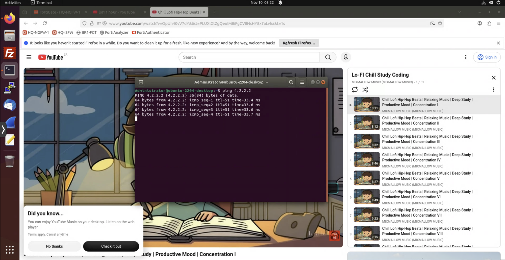

**Step 2: Reboot the primary** — console fgt006 (NGFW-1): `execute reboot`, then press y; it shows System is rebooting → System is starting.

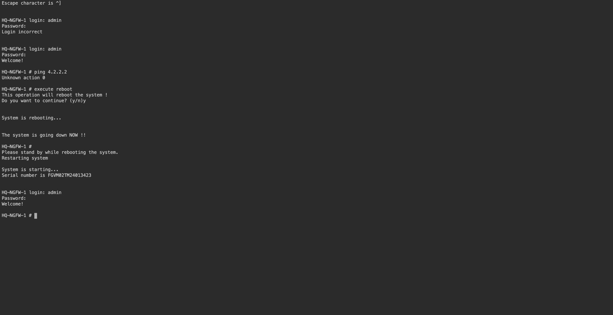

**Step 3: Observe** — the ping is continuous seq 272 → 294 with no missing numbers; the GUI shows Lost Connection because the admin session doesn't move, but user traffic doesn't drop thanks to session pickup.

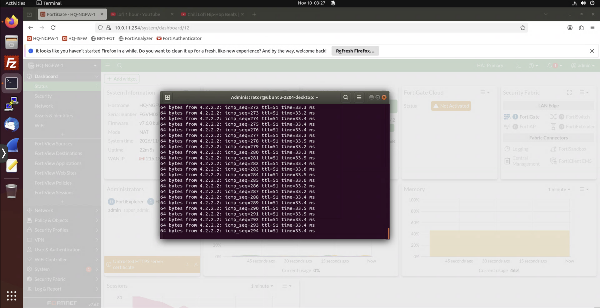

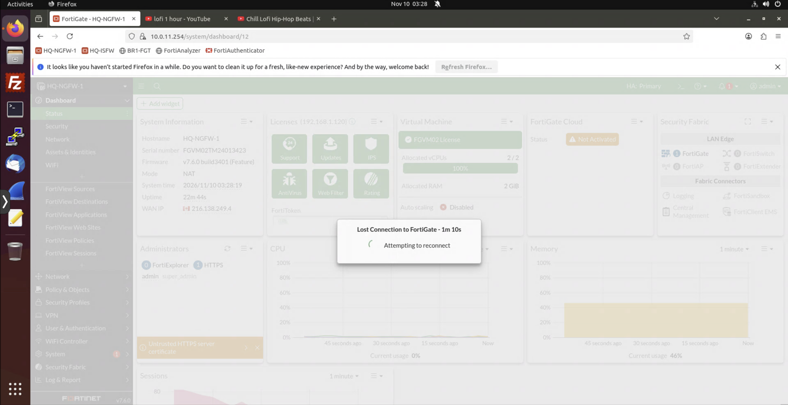

**Step 4: Check the new roles** — `get system ha status` on NGFW-2: Primary = FGVM...3501 (NGFW-2), Secondary = FGVM...3423 (NGFW-1).

| Time | Event (Primary selected using) |
| --- | --- |
| 03:26:51 | 3501 is primary because its uptime exceeds 3423 |
| 03:26:12 | 3501 is primary because it's the only member in the cluster |
| 03:26:03 | 3501 is primary because 3423 set the SET_AS_SECONDARY flag (rebooting) |
| 03:14:38 | 3423 is primary because of higher priority |

NGFW-1 returns as secondary despite priority 200, because override = disable makes the system look at uptime before priority.

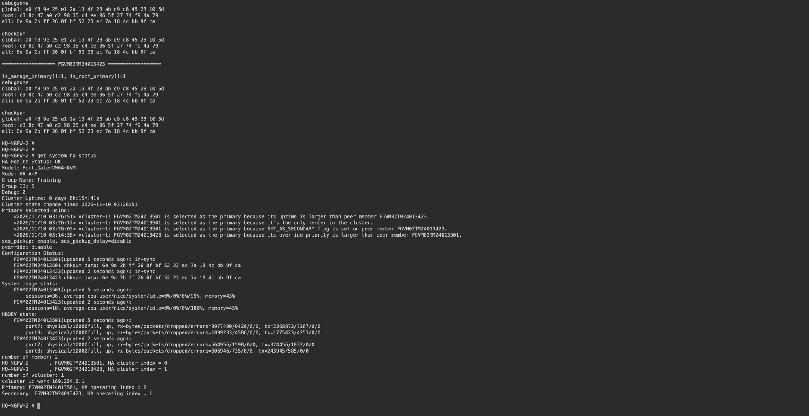

**Step 5: Switch back with reset uptime** — on NGFW-2: `diagnose sys ha reset-uptime`, then `get system status` shows Current HA mode: a-p, secondary.

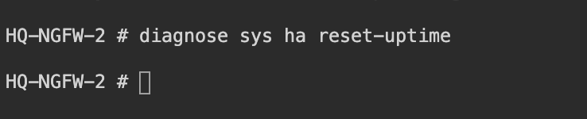

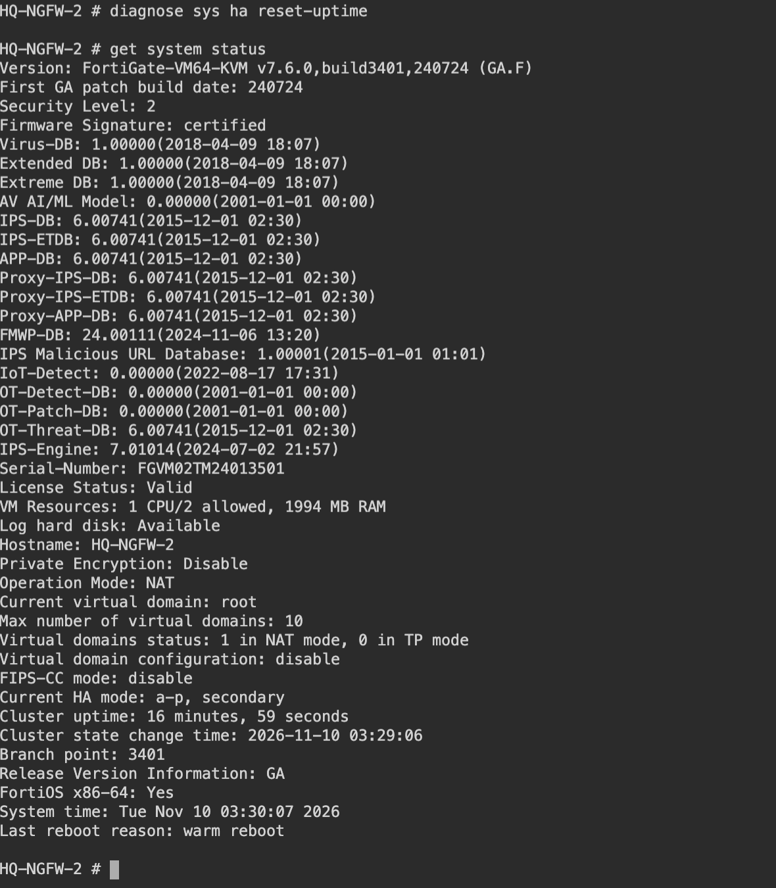

**Step 6: Watch debug as a member leaves and rejoins** — on NGFW-1: `diagnose debug enable` + `diagnose debug application hatalk 255`, then reboot NGFW-2.

| Debug line | Meaning |
| --- | --- |
| new member 'FGVM...3501' is added into group | NGFW-2 rejoins the cluster |
| recv hb packet ... on hbdev='port7' / 'port8' | heartbeat received on both links |
| 'FGVM...3423' is elected as the cluster primary of 2 members | NGFW-1 remains primary |
| 'port7' is selected as 'port_ha' | port7 chosen as the main sync link |
| send_vip_arp ... port2 ip 100.65.0.101 | sends GARP to the switch, speeding up failover |

Turn debug off with `diagnose debug application hatalk 0` and `diagnose debug disable`.

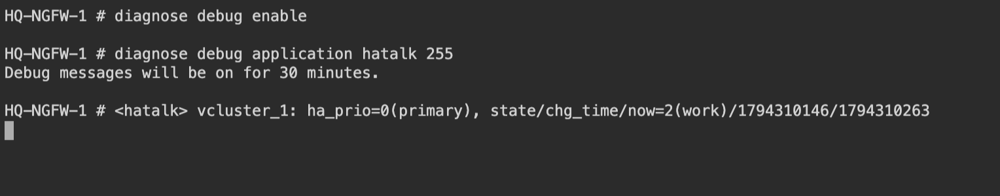

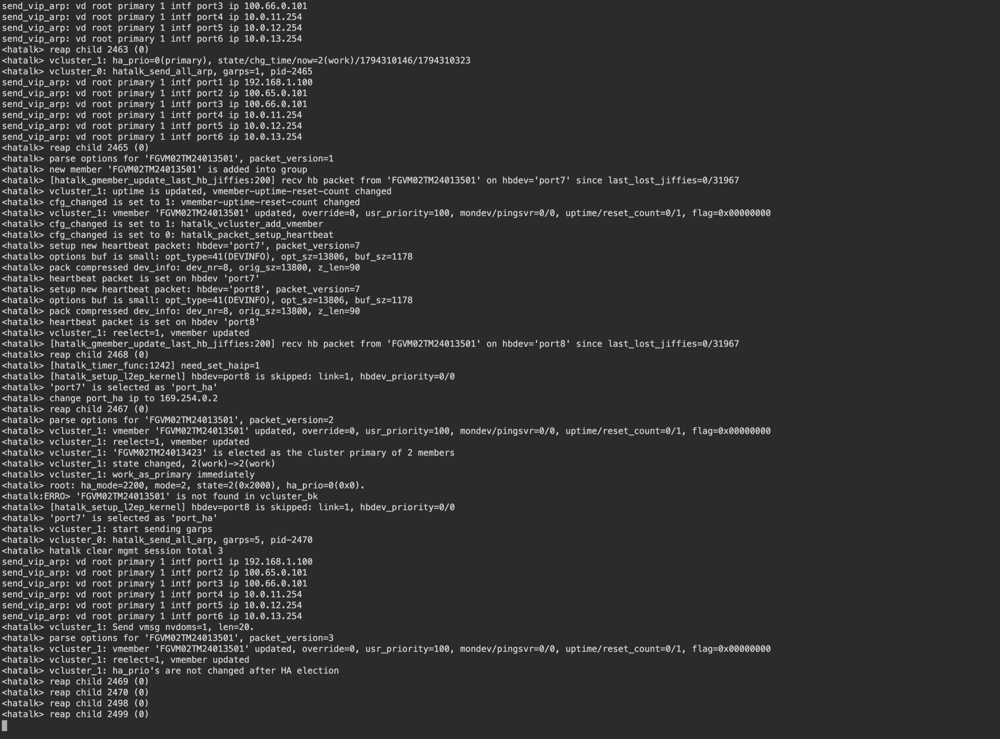

**Step 7: Verify → PASSED**

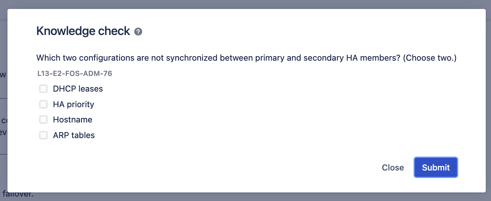

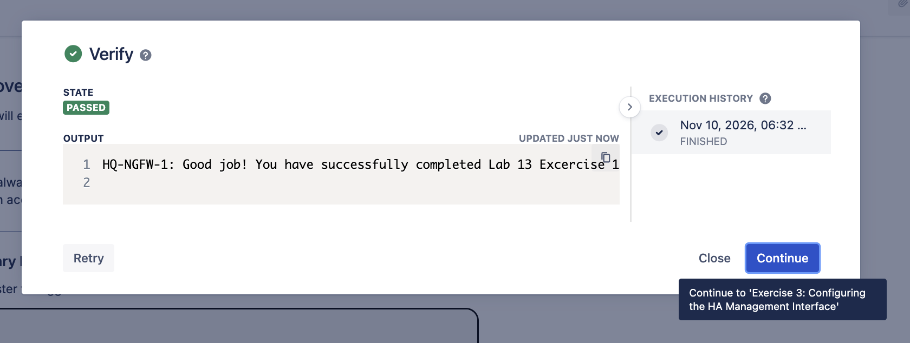

## Exercise 3: Management interface

Normally IP 10.0.11.254 always points to the primary; to reach the secondary directly, each box needs its own IP.

**Step 1: Enter the secondary's CLI through the primary** — on NGFW-1: `execute ha manage 0 admin`, enter password `Fortinet1!` (an SSH to 169.254.0.1 over the heartbeat); the prompt changes to `HQ-NGFW-2 #`, then `get system status` shows a-p, secondary; then `exit`.

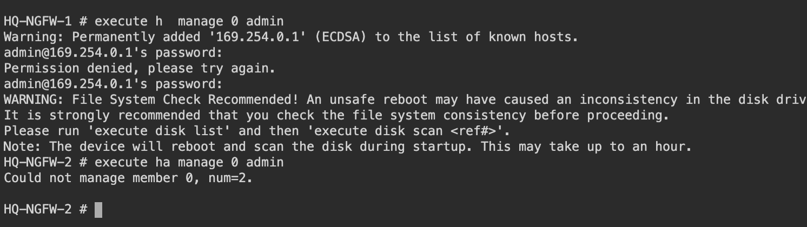

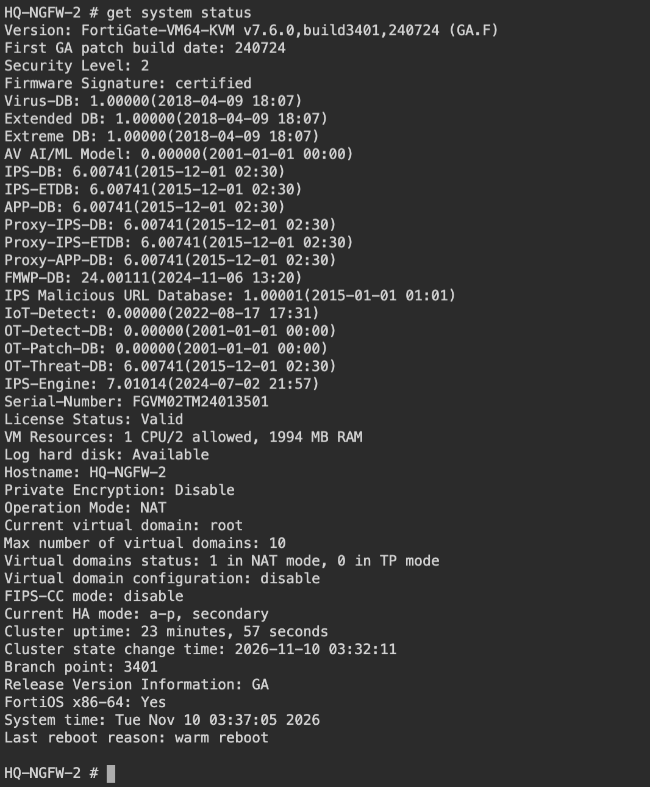

**Step 2: Enable Management Interface Reservation (GUI)** — System → HA → right-click HQ-NGFW-1 → Edit → enable Management Interface Reservation, Interface = port8 → OK. Both boxes stay Synchronized.

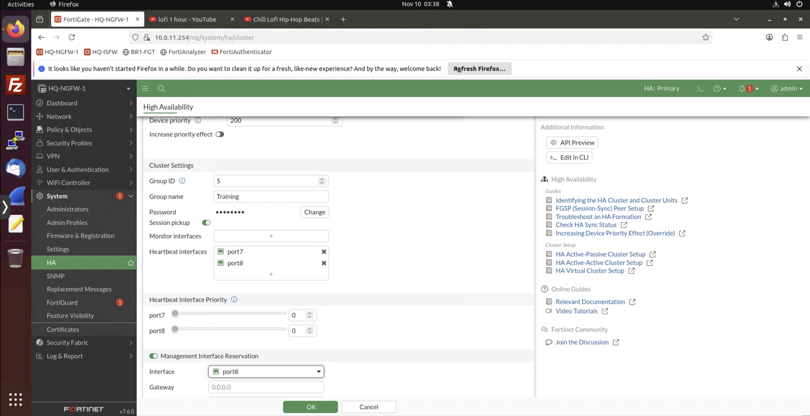


**Step 3: Set an IP on port8 per box** (this value doesn't sync; set it on each box)

```txt
config system interface
edit port8
set ip 10.0.11.251/24      (NGFW-1) | 10.0.11.252/24 (NGFW-2)
set allowaccess ping ssh snmp https
end
```

The IP can overlap port4's subnet, because the management interface's route is kept out of the routing table.

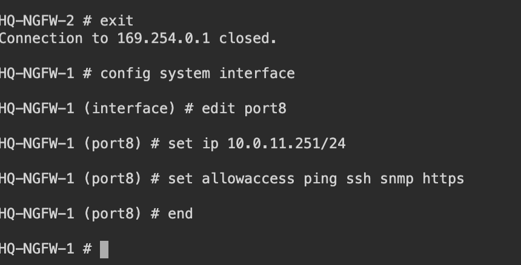

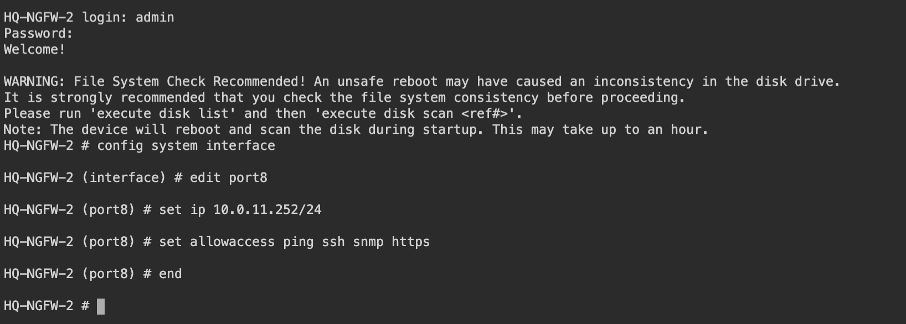

**Step 4: Test** — Firefox on HQ-PC-1 open `https://10.0.11.252`; the tab shows FortiGate - HQ-NGFW-2 (if a File System Check warning appears, click Remind me later).

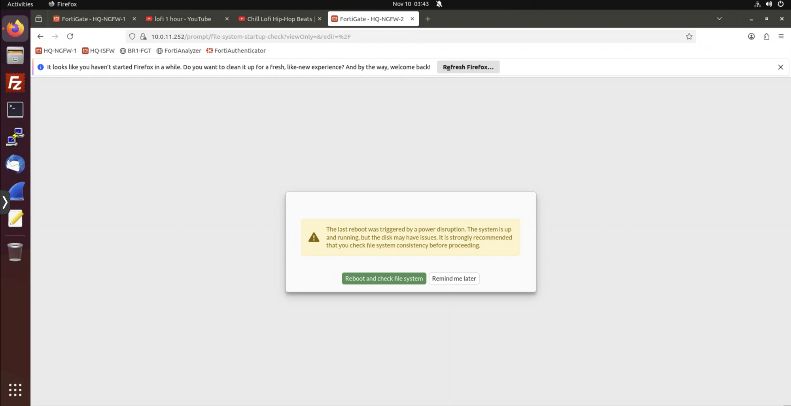

**Step 5: Verify → PASSED** before the Disconnect and Revert steps, which are skipped since they only prepare the box for the next lab.

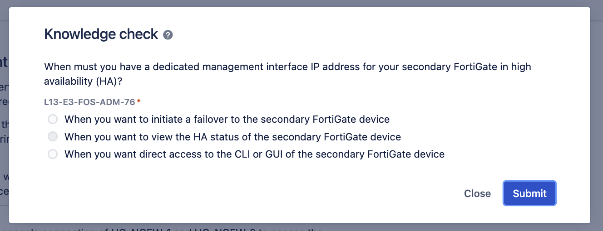

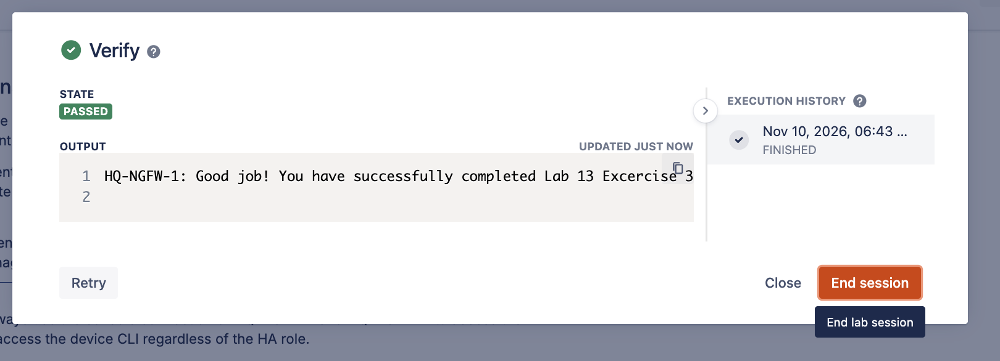

## Quiz, problems encountered, and cloud comparison

| Question | Answer | Reason |
| --- | --- | --- |
| What must a heartbeat interface be? | a physical port | VLAN, IPsec, aggregate can't be used; risk of split brain |
| Two values that don't sync | HA priority, Hostname | they must differ per box |
| When do you need a secondary management IP? | when you want to reach the secondary's CLI/GUI directly | checking status and triggering failover can be done from the primary |

**Problems encountered**

| Symptom | Cause | Fix |
| --- | --- | --- |
| `ping` in CLI shows Unknown action 0 | FortiGate's CLI isn't the PC | use HQ-PC-1's Terminal (prompt ending in `$`) |
| Login incorrect / Permission denied | mistyped password | `Fortinet1!` capital F, then 1 and ! |
| `excute ha message` / `execute manage` don't work | typo or missing words | `execute ha manage 0 admin`; Tab helps autocomplete |
| GUI shows Lost Connection | admin session doesn't move on failover | refresh and log in again |
| `http://10.0.11.252` hangs | only https in allowaccess | use `https://` |
| File System Check warning | the lab box was just created | click Remind me later; don't reboot to scan the disk |

**Cloud comparison**

| FortiGate HA | AWS | Azure |
| --- | --- | --- |
| Two boxes Active-Passive | 2 EC2 in different Availability Zones (Multi-AZ) | 2 VMs in different Availability Zones |
| Heartbeat port7/port8 | Elastic Load Balancer / Route 53 health check | Azure Load Balancer health probe |
| Session pickup | Connection draining / RDS Multi-AZ failover | Load Balancer + session persistence |
| GARP moves the IP to the new box | move the Elastic IP / route table to the standby | move the Public IP / UDR |
| Separate management interface | Management subnet + Systems Manager | Azure Bastion / management NIC |

A FortiGate-VM on AWS and Azure can do HA just like this lab, but in the cloud it moves the IP with an API call instead of GARP, because cloud networks don't accept ARP the way a normal network does.
