# 🔬 LAB 13 สรุป: High Availability (HA)

> 🇬🇧 English version: [LAB-13-EN.md](LAB-13-EN.md)
> รูปภาพประกอบอยู่ใน `images/lab13/`

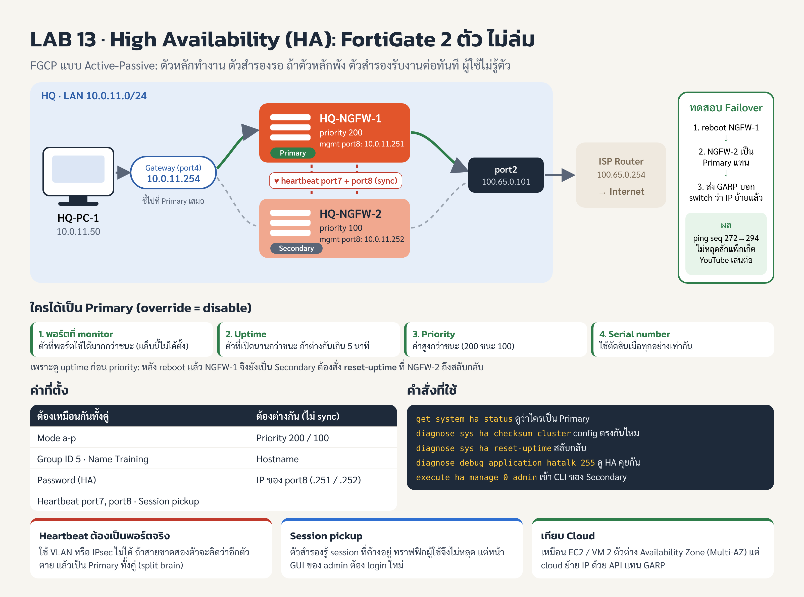

## ภาพรวม

LAB 13 ผ่านครบ 3/3 Exercise: FortiGate 2 ตัวทำงานเป็นคู่แบบ Active-Passive ตอน reboot ตัวหลัก ping 4.2.2.2 จาก HQ-PC-1 ไม่หลุดสักแพ็กเก็ต (seq 272–294 ต่อเนื่อง) และคลิป YouTube เล่นต่อ

| Exercise | เรื่อง | ผล |
| --- | --- | --- |
| 1 | ตั้งค่า HA ทั้งสองเครื่อง + ตรวจ sync | PASSED |
| 2 | Failover ด้วย reboot, สลับกลับด้วย reset-uptime, ดู debug hatalk | PASSED |
| 3 | Management interface แยกแต่ละเครื่อง (port8) | PASSED |

**ตัวย่อที่ใช้**

| ตัวย่อ | ชื่อเต็ม | ความหมายสั้นๆ |
| --- | --- | --- |
| HA | High Availability | ระบบที่ไม่ล่มเมื่อเครื่องใดเครื่องหนึ่งเสีย |
| FGCP | FortiGate Clustering Protocol | โปรโตคอลที่ FortiGate ใช้หาเพื่อน เลือก primary และ sync config |
| A-P | Active-Passive | ตัวหลักทำงาน ตัวสำรองรอ |
| HB | Heartbeat | สายที่สองเครื่องคุยกันตลอดเวลา (port7, port8) |
| GARP | Gratuitous ARP | ประกาศบอก switch ว่า IP ย้ายมาอยู่เครื่องใหม่แล้ว |
| CLI / GUI | Command-Line Interface / Graphical User Interface | หน้าจอพิมพ์คำสั่ง / หน้าเว็บ |

**Topology:** HQ-PC-1 (10.0.11.50) → port4 ของทั้งสองเครื่อง (LAN 10.0.11.254) → port2 (100.65.0.101) → Linux-ISP-Router (100.65.0.254) → Internet สองเครื่องต่อกันตรงด้วย port7 และ port8 เป็น heartbeat

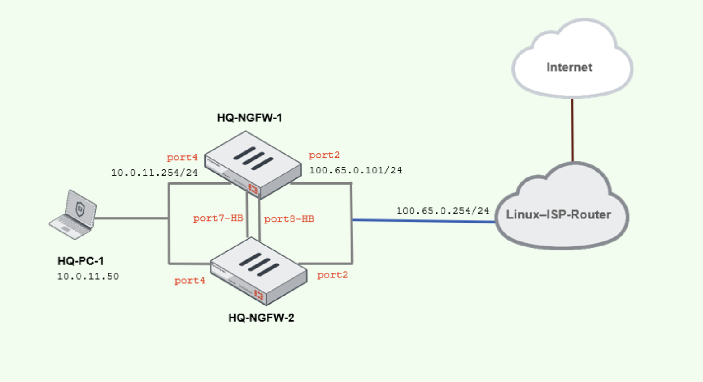

**ชื่อแท็บ console ใน lab:** fgt006 = HQ-NGFW-1, fgt007 = HQ-NGFW-2

## Exercise 1: ตั้งค่า HA และตรวจ sync

**ขั้น 1: ตั้งค่า HQ-NGFW-1 ผ่าน GUI** — System → HA

| ช่อง | ค่า |
| --- | --- |
| Mode | Active-Passive |
| Device priority | 200 |
| Group ID / Group name | 5 / Training |
| Password | Fortinet |
| Session pickup | เปิด |
| Monitor interfaces | ลบออกหมด |
| Heartbeat interfaces | port7, port8 (ลบ port4 ออก) |

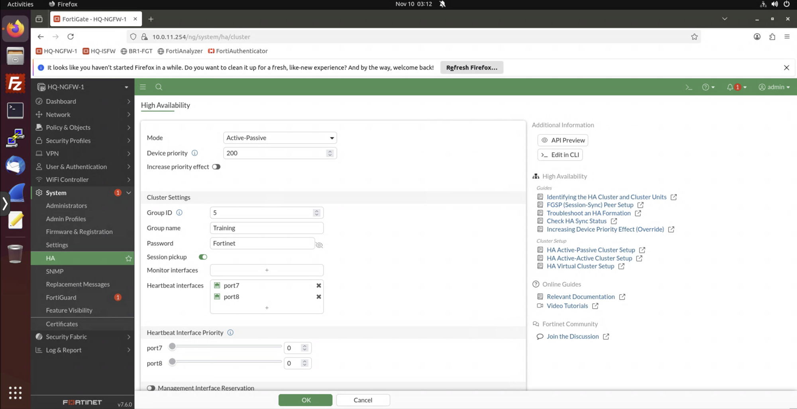

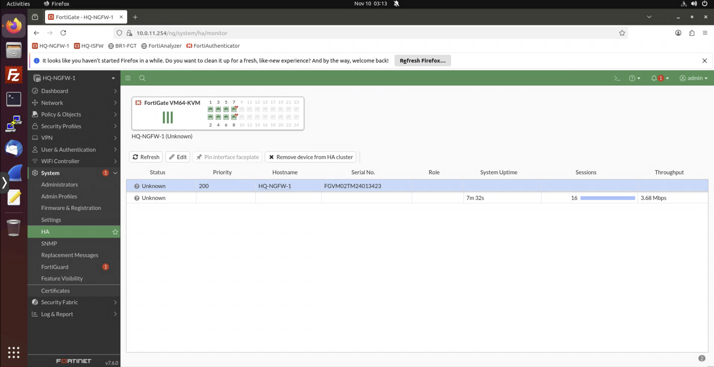

**ขั้น 2: ตั้งค่า HQ-NGFW-2 ผ่าน CLI** (console fgt007)

```txt
config system ha
set mode a-p
set group-name Training
set group-id 5
set password Fortinet
set hbdev port7 0 port8 0
set session-pickup enable
set override disable
set priority 100
end
```

Group ID, Group name และ Password ต้องตรงกับ NGFW-1 ไม่อย่างนั้นสองเครื่องจะไม่รวมกลุ่มกัน priority 100 ต่ำกว่า 200 ตั้งใจให้ NGFW-1 เป็น primary

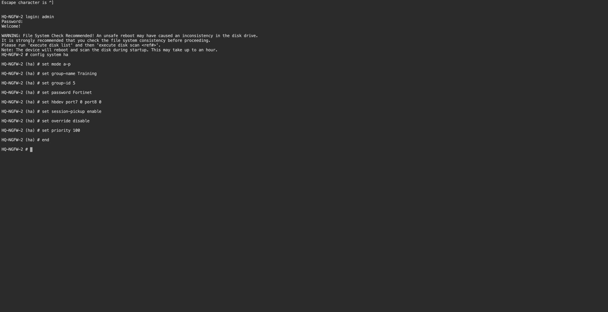

**ขั้น 3: รอ sync 4–5 นาที** — console ขึ้นตามลำดับ: `secondary's external files are not in sync` → `secondary succeeded to sync external files` → `secondary starts to sync with primary` → `logout all admin users` แล้ว login ใหม่

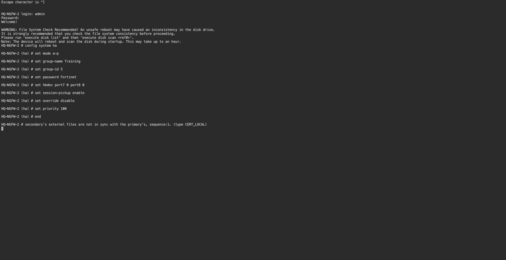

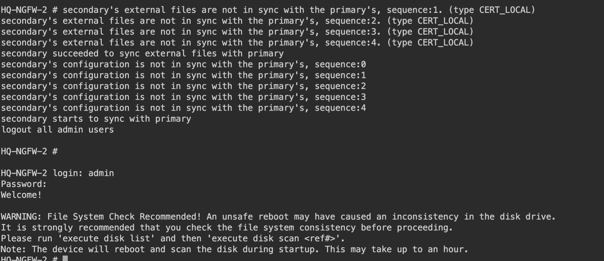

**ขั้น 4: ตรวจ checksum** — `diagnose sys ha checksum cluster` checksum global, root, all ของทั้งสอง serial ตรงกันทุกบรรทัด แปลว่า config เหมือนกัน

| Serial | is_root_primary | บทบาท |
| --- | --- | --- |
| FGVM02TM24013423 | 1 | Primary (NGFW-1) |
| FGVM02TM24013501 | 0 | Secondary (NGFW-2) |

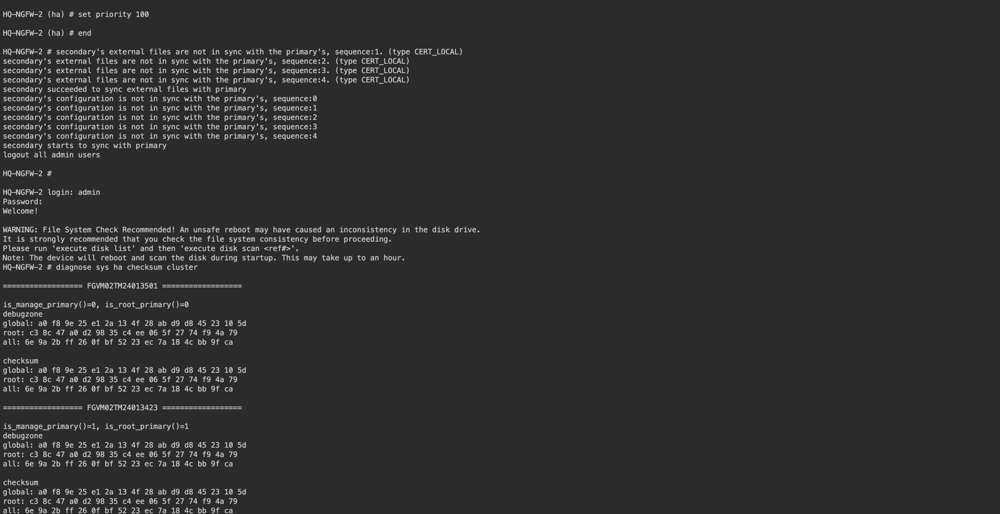

**ทำไม NGFW-1 เป็น primary:** ไม่ได้ตั้ง monitored port → ดู uptime แต่ต่างกันไม่ถึง 5 นาที → ดู priority ที่ 200 ชนะ 100

**ขั้น 5: Take quiz → Verify → PASSED**

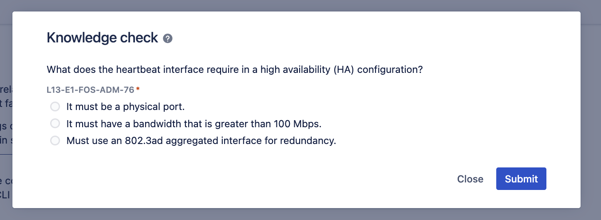

## Exercise 2: Failover

**ขั้น 1: เปิดทราฟฟิกค้างไว้บน HQ-PC-1** — เล่นคลิป YouTube ยาวเกิน 5 นาที และรัน `ping 4.2.2.2` ใน Terminal (time ประมาณ 33 ms)

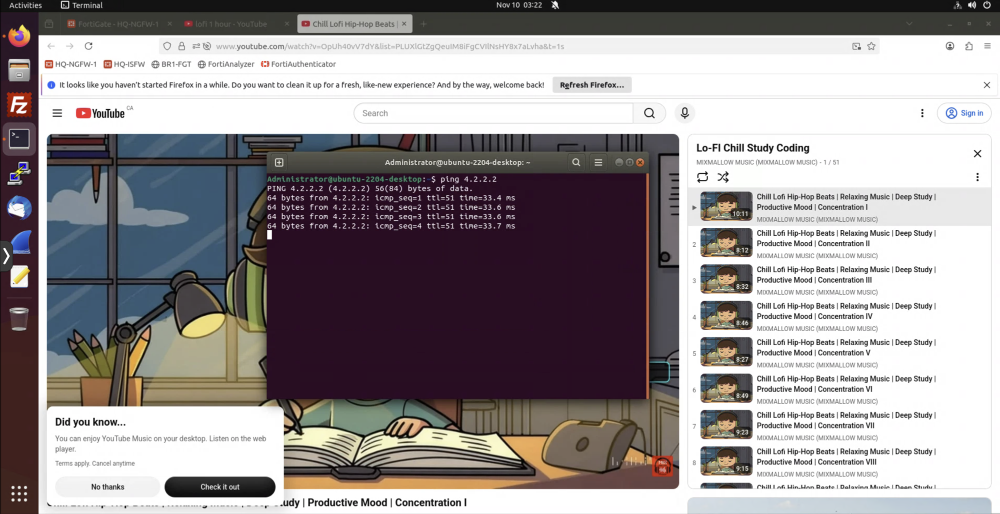

**ขั้น 2: reboot ตัวหลัก** — console fgt006 (NGFW-1): `execute reboot` แล้วกด y เครื่องขึ้น System is rebooting → System is starting

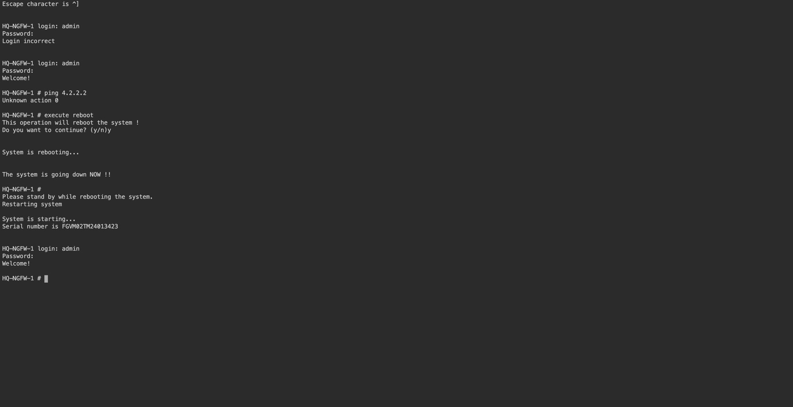

**ขั้น 3: ดูผล** — ping ต่อเนื่อง seq 272 → 294 ไม่มีเลขหาย ส่วนหน้า GUI ขึ้น Lost Connection เพราะ session ของ admin ไม่ย้ายตาม แต่ทราฟฟิกผู้ใช้ไม่หลุดเพราะเปิด session pickup

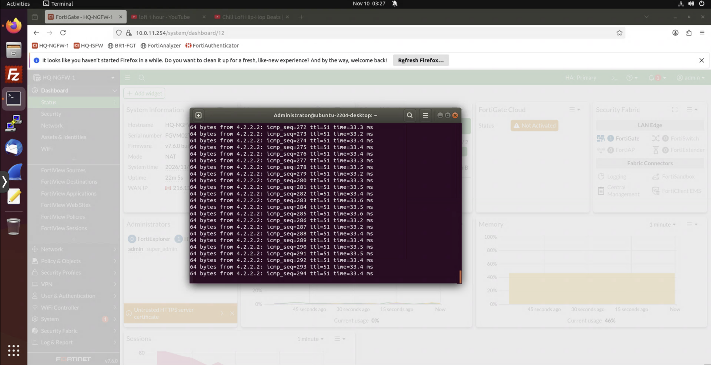

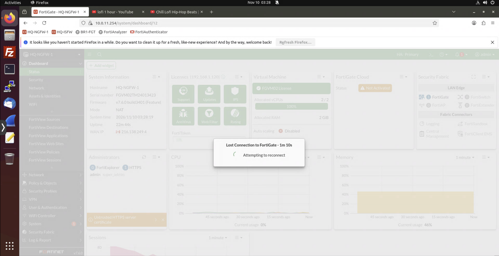

**ขั้น 4: เช็กบทบาทใหม่** — `get system ha status` ที่ NGFW-2: Primary = FGVM...3501 (NGFW-2), Secondary = FGVM...3423 (NGFW-1)

| เวลา | เหตุการณ์จาก Primary selected using |
| --- | --- |
| 03:26:51 | 3501 เป็น primary เพราะ uptime มากกว่า 3423 |
| 03:26:12 | 3501 เป็น primary เพราะเป็นสมาชิกเดียวใน cluster |
| 03:26:03 | 3501 เป็น primary เพราะ 3423 ตั้ง flag SET_AS_SECONDARY (กำลัง reboot) |
| 03:14:38 | 3423 เป็น primary เพราะ priority สูงกว่า |

NGFW-1 กลับมาเป็น secondary แม้ priority 200 เพราะ override = disable ระบบดู uptime ก่อน priority

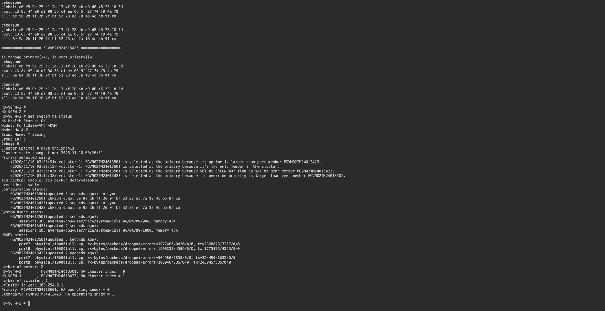

**ขั้น 5: สลับกลับด้วย reset uptime** — ที่ NGFW-2: `diagnose sys ha reset-uptime` แล้ว `get system status` ขึ้น Current HA mode: a-p, secondary

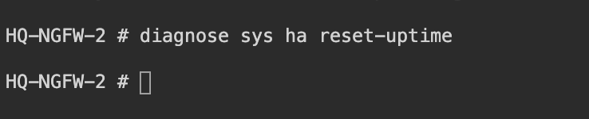

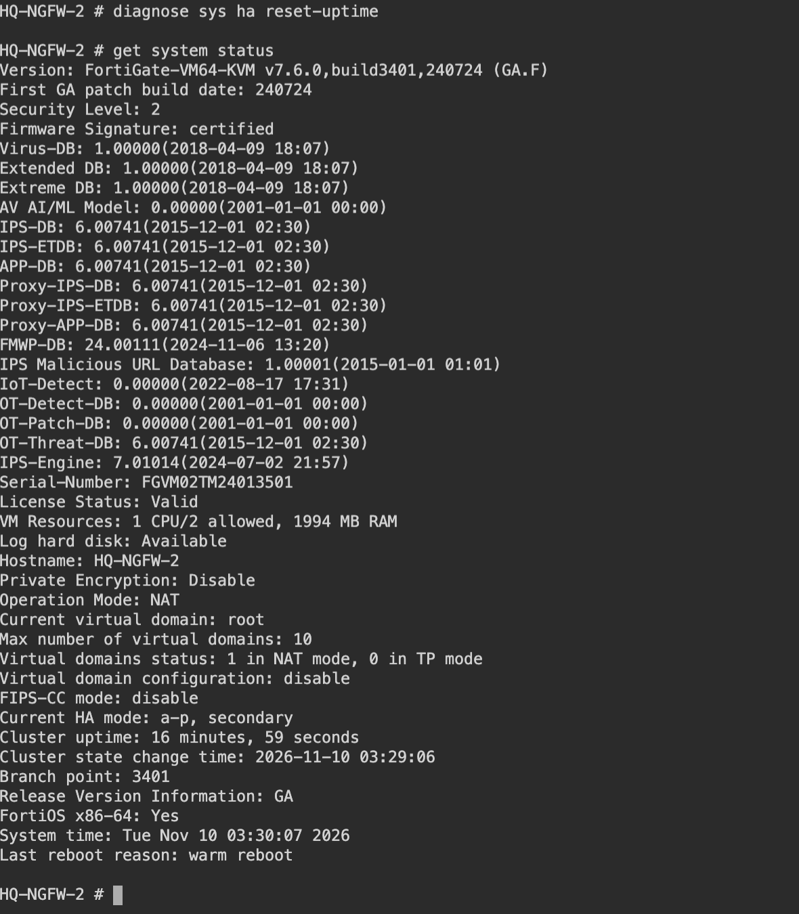

**ขั้น 6: ดู debug ตอนสมาชิกออกและกลับเข้า** — ที่ NGFW-1: `diagnose debug enable` + `diagnose debug application hatalk 255` แล้ว reboot NGFW-2

| บรรทัด debug | ความหมาย |
| --- | --- |
| new member 'FGVM...3501' is added into group | NGFW-2 กลับเข้า cluster |
| recv hb packet ... on hbdev='port7' / 'port8' | ได้ heartbeat ทั้งสองสาย |
| 'FGVM...3423' is elected as the cluster primary of 2 members | NGFW-1 ยังเป็น primary |
| 'port7' is selected as 'port_ha' | ใช้ port7 เป็นสาย sync หลัก |
| send_vip_arp ... port2 ip 100.65.0.101 | ส่ง GARP บอก switch ทำให้ failover เร็ว |

ปิด debug ด้วย `diagnose debug application hatalk 0` และ `diagnose debug disable`

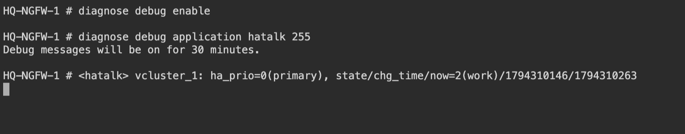

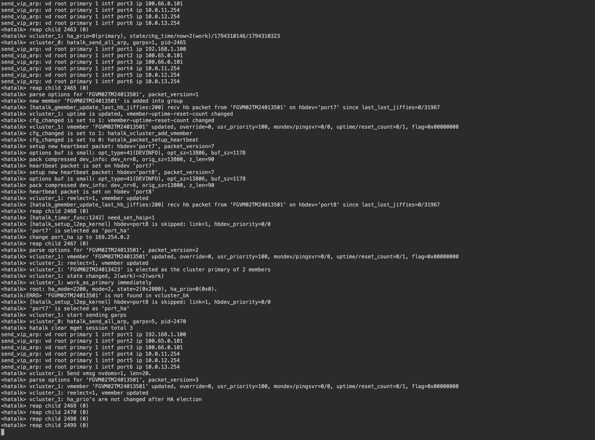

**ขั้น 7: Verify → PASSED**

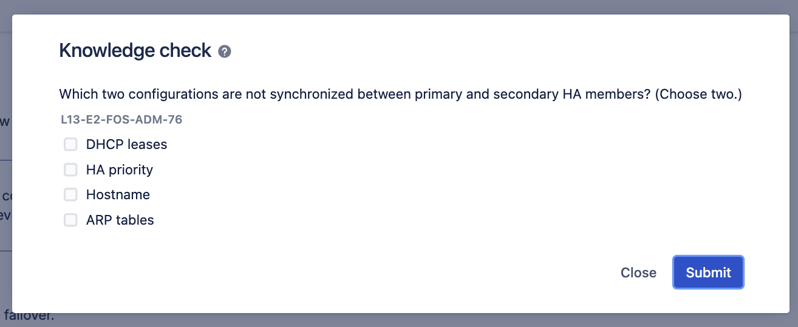

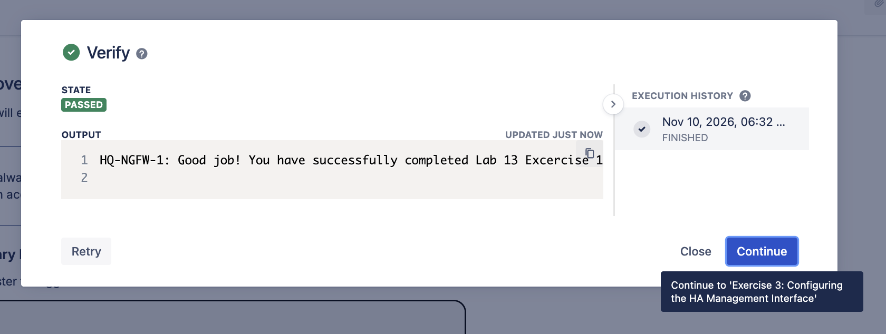

## Exercise 3: Management interface

ปกติ IP 10.0.11.254 ชี้ไปที่ primary เสมอ ถ้าอยากเข้า secondary ตรงๆ ต้องมี IP แยกให้แต่ละเครื่อง

**ขั้น 1: เข้า CLI ของ secondary ผ่าน primary** — ที่ NGFW-1: `execute ha manage 0 admin` ใส่รหัส `Fortinet1!` (เป็น SSH ไป 169.254.0.1 ผ่าน heartbeat) prompt เปลี่ยนเป็น `HQ-NGFW-2 #` แล้ว `get system status` ขึ้น a-p, secondary จากนั้น `exit`

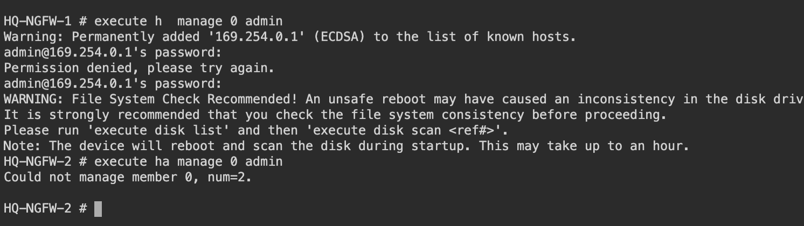

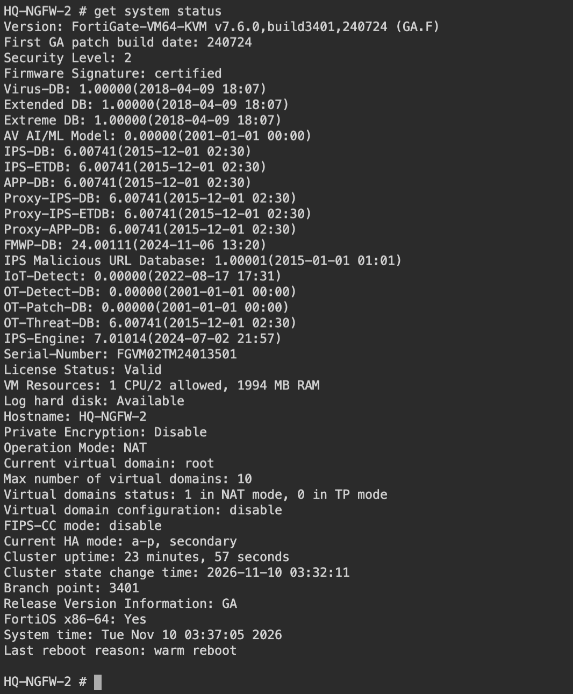

**ขั้น 2: เปิด Management Interface Reservation (GUI)** — System → HA → คลิกขวา HQ-NGFW-1 → Edit → เปิด Management Interface Reservation, Interface = port8 → OK ทั้งสองเครื่องยัง Synchronized

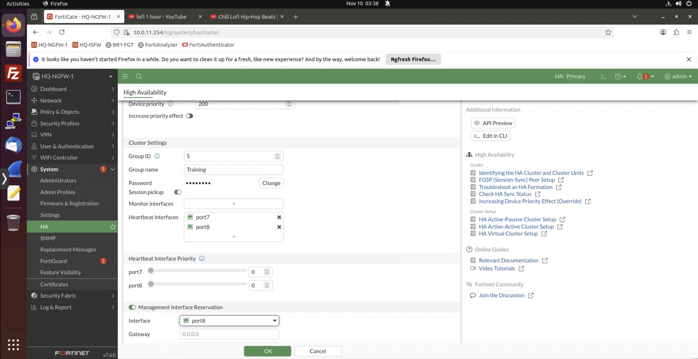


**ขั้น 3: ตั้ง IP ให้ port8 ทีละเครื่อง** (ค่านี้ไม่ sync ต้องตั้งเองทั้งสองเครื่อง)

```txt
config system interface
edit port8
set ip 10.0.11.251/24      (NGFW-1) | 10.0.11.252/24 (NGFW-2)
set allowaccess ping ssh snmp https
end
```

IP ซ้อนกับ subnet ของ port4 ได้ เพราะ route ของ management interface ถูกแยกออกจาก routing table

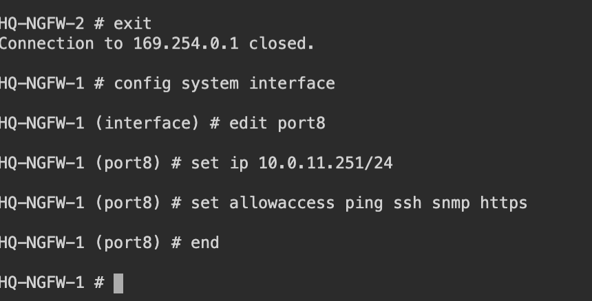

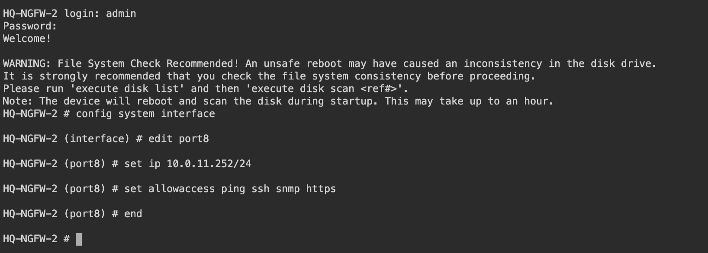

**ขั้น 4: ทดสอบ** — Firefox บน HQ-PC-1 เปิด `https://10.0.11.252` แท็บขึ้น FortiGate - HQ-NGFW-2 (หน้าเตือน File System Check ให้กด Remind me later)

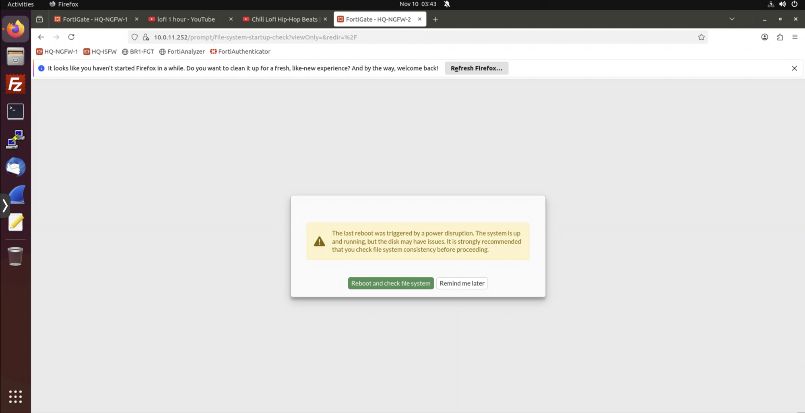

**ขั้น 5: Verify → PASSED** ก่อนขั้น Disconnect และ Revert ซึ่งข้ามไป เพราะมีไว้เตรียมเครื่องให้ lab ถัดไป

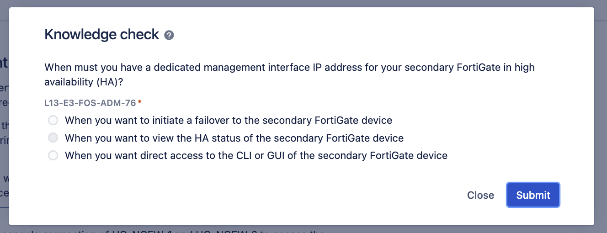

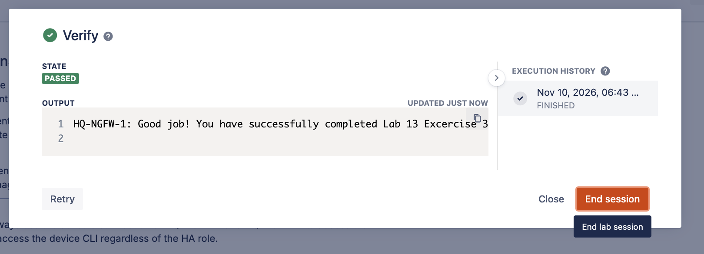

## Quiz ปัญหาที่เจอ และเทียบ cloud

| คำถาม | คำตอบ | เหตุผล |
| --- | --- | --- |
| Heartbeat interface ต้องเป็นอะไร | พอร์ตจริง (physical) | VLAN, IPsec, aggregate ใช้ไม่ได้ เสี่ยง split brain |
| สองค่าที่ไม่ sync | HA priority, Hostname | ต้องต่างกันในแต่ละเครื่อง |
| ต้องมี management IP ของ secondary เมื่อไหร่ | เมื่ออยากเข้า CLI/GUI ของ secondary ตรงๆ | ดูสถานะและสั่ง failover ทำจาก primary ได้ |

**ปัญหาที่เจอ**

| อาการ | สาเหตุ | วิธีแก้ |
| --- | --- | --- |
| `ping` ใน CLI ขึ้น Unknown action 0 | CLI ของ FortiGate ไม่ใช่ PC | ใช้ Terminal ของ HQ-PC-1 (prompt ลงท้าย `$`) |
| Login incorrect / Permission denied | พิมพ์รหัสผิด | `Fortinet1!` ตัว F ใหญ่ ตามด้วย 1 และ ! |
| `excute ha message` / `execute manage` ใช้ไม่ได้ | พิมพ์ผิดหรือขาดคำ | `execute ha manage 0 admin` กด Tab ช่วยเติมคำ |
| GUI ขึ้น Lost Connection | session admin ไม่ย้ายตามตอน failover | refresh แล้ว login ใหม่ |
| `http://10.0.11.252` ค้าง | เปิดแค่ https ใน allowaccess | ใช้ `https://` |
| หน้าเตือน File System Check | เครื่อง lab เพิ่งถูกสร้าง | กด Remind me later อย่า reboot สแกนดิสก์ |

**เทียบกับ cloud**

| FortiGate HA | AWS | Azure |
| --- | --- | --- |
| สองเครื่อง Active-Passive | EC2 2 ตัวต่าง Availability Zone (Multi-AZ) | VM 2 ตัวต่าง Availability Zone |
| Heartbeat port7/port8 | Health check ของ Elastic Load Balancer / Route 53 | Health probe ของ Azure Load Balancer |
| Session pickup | Connection draining / RDS Multi-AZ failover | Load Balancer + session persistence |
| GARP ย้าย IP ไปตัวใหม่ | ย้าย Elastic IP / route table ไปตัวสำรอง | ย้าย Public IP / UDR |
| Management interface แยก | Management subnet + Systems Manager | Azure Bastion / management NIC |

FortiGate-VM บน AWS และ Azure ทำ HA แบบเดียวกับ lab นี้ได้ แต่ใน cloud ใช้การเรียก API ย้าย IP แทน GARP เพราะ cloud network ไม่รับ ARP แบบเครือข่ายธรรมดา
