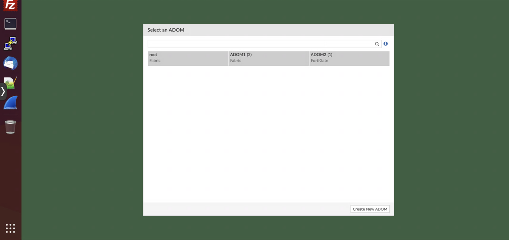
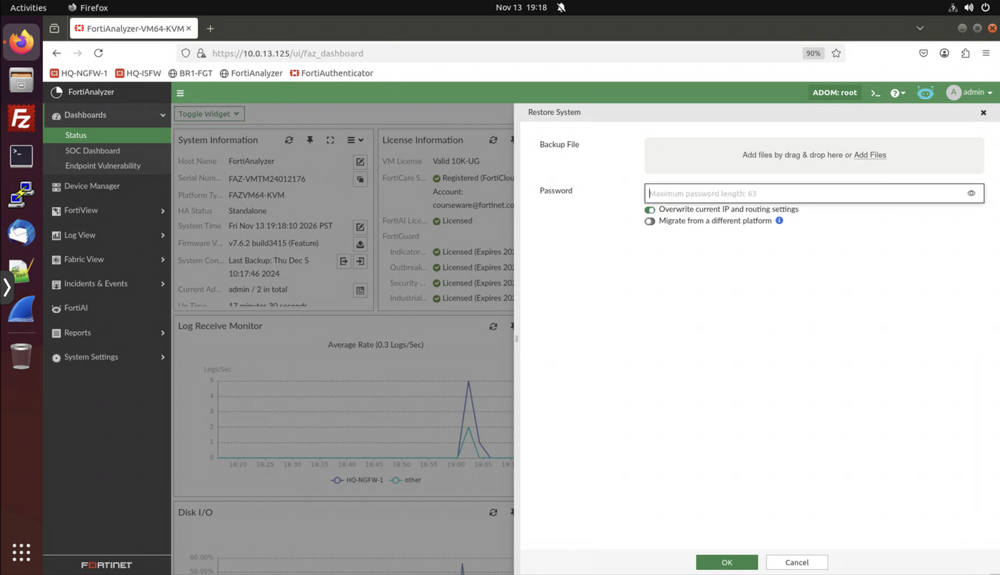
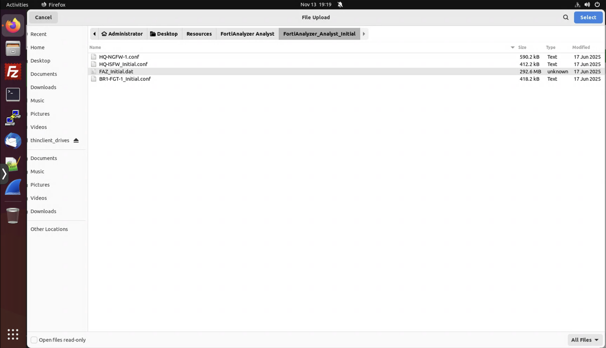
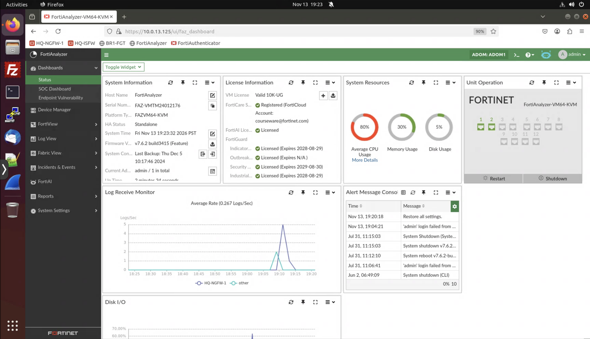
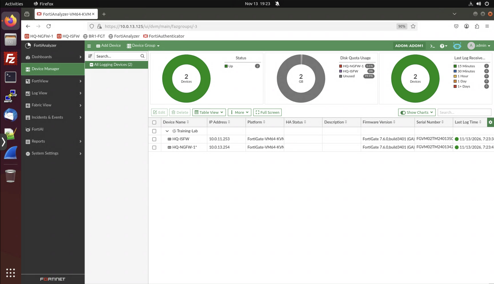
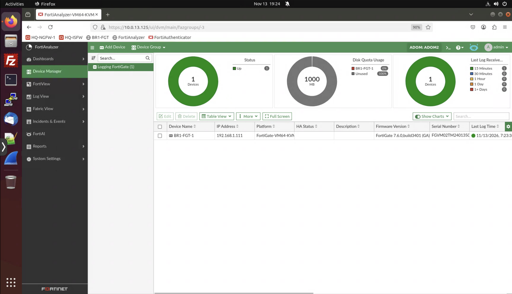
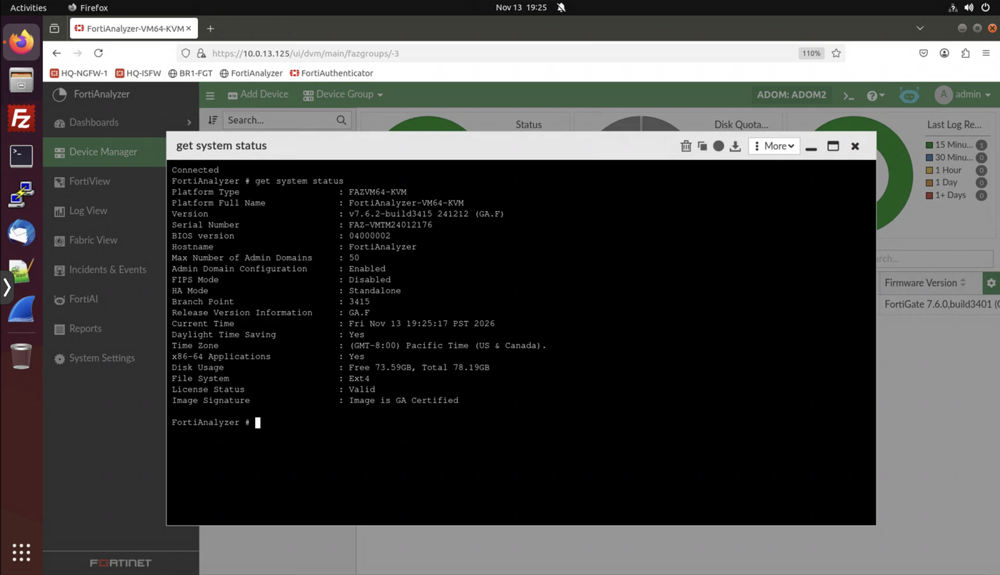

# 🔬 LAB 01 Summary: SOC Concepts and Security Fabric (Initial Configuration)

> 🇹🇭 Thai version: [LAB-01.md](LAB-01.md)
> Screenshots are in `images/lab01/`

## Lab Overview

**Goal:** restore FortiAnalyzer's initial configuration from a backup file, verify that ADOMs and FortiGate devices are registered, and check system status from the CLI. This prepares the analyzer for Labs 02–03.

**Course:** FortiAnalyzer 7.6 Analyst (FTAO) · CIPAT SOC Analyst Lab · FortiAnalyzer v7.6.2 build3415

| Device | IP | Role in the lab |
| --- | --- | --- |
| HQ-PC-1 (Ubuntu) | 10.0.11.50 | Firefox client for the FortiAnalyzer GUI |
| FortiAnalyzer (FAZ) | 10.0.13.125 | Log collection and analysis |
| HQ-NGFW-1 | 10.0.13.254 (FAZ side) | Main FortiGate (ADOM1, Security Fabric root) |
| HQ-ISFW | 10.0.11.253 | Internal segmentation FortiGate (ADOM1) |
| BR1-FGT-1 | 192.168.1.111 | Branch FortiGate (ADOM2) |

## Exercise 1 Part A: Restore the Initial Configuration

1. After logging in, the **Select an ADOM** page appears (the backup has ADOMs enabled).
2. **Dashboards > Status** → **System Information** widget → **Restore** icon on the System Configuration row (not the Backup icon next to it).
3. Turn off **Overwrite current IP and routing settings** so the lab VM keeps its own IP and routes.
4. Select `Desktop > Resources > FortiAnalyzer Analyst > FortiAnalyzer_Analyst_Initial > FAZ_Initial.dat` (292.6 MB), enter the file password, and click OK.
5. Wait 3–5 minutes for the reboot and log in again. The Alert Message Console shows *Restore all settings.*









## Exercise 1 Part B: Verify ADOMs and Devices

| ADOM | Type | Devices |
| --- | --- | --- |
| ADOM1 | **Fabric** | HQ-NGFW-1 (root of Fabric *Training-Lab*) and HQ-ISFW |
| ADOM2 | **FortiGate** | BR1-FGT-1 |

ADOM1 is a Fabric ADOM because both FortiGates belong to the same Security Fabric, so FortiAnalyzer can correlate logs across devices. ADOM2 holds a standalone device.





## Exercise 1 Part C: CLI

Open the CLI from the **>_** icon on the top bar and run `get system status`.

| Field | Value | Meaning |
| --- | --- | --- |
| Platform | FortiAnalyzer-VM64-KVM | VM running on KVM |
| Version | v7.6.2-build3415 | Firmware version |
| Admin Domain Configuration | Enabled | ADOMs enabled after restore |
| HA Mode | Standalone | No HA |
| License Status | Valid | License active |



## Issues and Fixes

- **Could not click root on the Select an ADOM page** → this lab uses ADOM1/ADOM2, and the remote display responds slowly; wait a moment.
- **"Waiting for response..." screen** → the remote session dropped briefly; wait or refresh the tab. No work is lost.
- **Forgot to turn off Overwrite current IP and routing settings** → no impact, because the backup comes from the same lab and the IP stays 10.0.13.125.

## Key Takeaways

- ADOMs are **disabled by default** and can only be enabled by a Super_User admin. Once enabled, you choose an ADOM at login.
- A **Fabric** ADOM is for Security Fabric devices; a **FortiGate** ADOM is for standalone units.
- In a Security Fabric, the traffic log for a session is generated by the first FortiGate that sees it (no duplicate logs).
- **Analyzer** mode (default) and **collector** mode are switched in the System Information widget.

```bash
get system status
```
