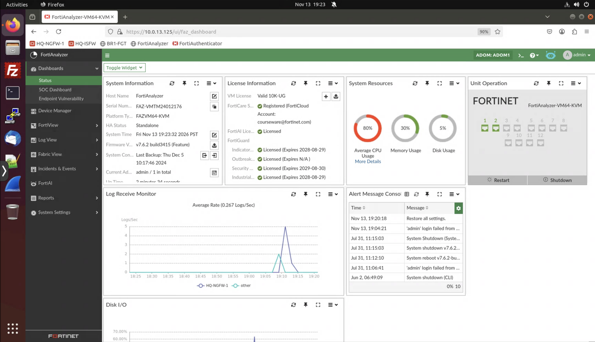
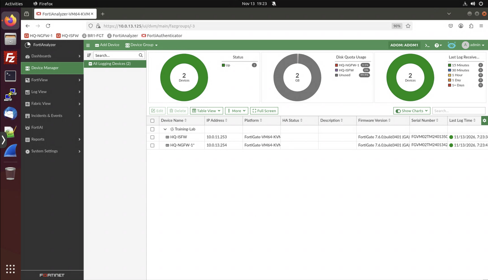
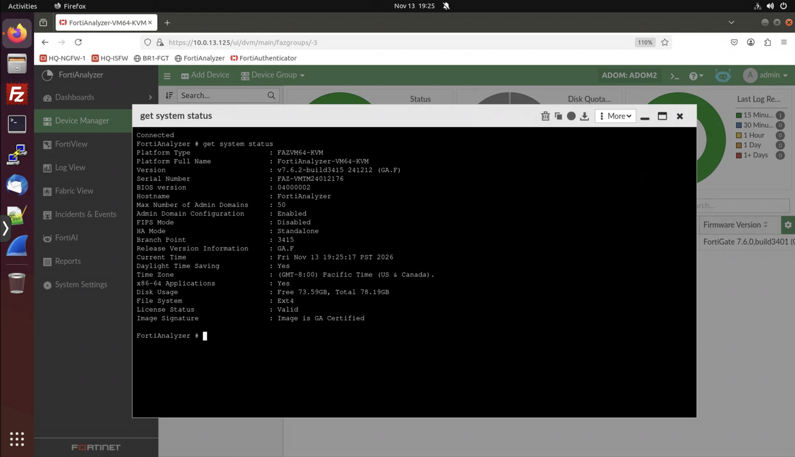

# 🔬 LAB 01 สรุป: แนวคิด SOC และ Security Fabric (การตั้งค่าเริ่มต้น)

> English version: [LAB-01-EN.md](LAB-01-EN.md)
> รูปภาพประกอบอยู่ใน `images/lab01/`

## ภาพรวมแล็บ

**เป้าหมาย:** กู้คืนค่าตั้งเริ่มต้นของ FortiAnalyzer จากไฟล์สำรอง ตรวจว่ามีโดเมนผู้ดูแล (ADOM) และไฟร์วอลล์ FortiGate ครบ แล้วดูสถานะเครื่องผ่านหน้าพิมพ์คำสั่ง เป็นการเตรียมเครื่องสำหรับแล็บ 02–03

**คอร์ส:** FortiAnalyzer 7.6 Analyst (FTAO) · แล็บนักวิเคราะห์ SOC ของ CIPAT · FortiAnalyzer รุ่น 7.6.2 build3415

| อุปกรณ์ | IP | หน้าที่ในแล็บ |
| --- | --- | --- |
| HQ-PC-1 (Ubuntu) | 10.0.11.50 | เปิดเบราว์เซอร์ Firefox เข้าหน้าเว็บจัดการของ FortiAnalyzer |
| FortiAnalyzer (FAZ) | 10.0.13.125 | เครื่องเก็บและวิเคราะห์บันทึกเหตุการณ์ (log) |
| HQ-NGFW-1 | 10.0.13.254 (ขาที่ต่อกับ FAZ) | ไฟร์วอลล์หลัก (อยู่ใน ADOM1 และเป็นเครื่องแม่ของ Security Fabric) |
| HQ-ISFW | 10.0.11.253 | ไฟร์วอลล์แบ่งเครือข่ายภายใน (อยู่ใน ADOM1) |
| BR1-FGT-1 | 192.168.1.111 | ไฟร์วอลล์สาขา (อยู่ใน ADOM2) |

## แบบฝึกหัด 1 ส่วน ก: กู้คืนค่าตั้งเริ่มต้น

1. พอเข้าสู่ระบบแล้วจะเจอหน้า **Select an ADOM** (เลือกโดเมนผู้ดูแล) เพราะไฟล์สำรองเปิดใช้ ADOM ไว้แล้ว
2. ไปที่ **Dashboards > Status** ในกล่อง **System Information** แถว System Configuration กดไอคอน **Restore** (กู้คืน) ระวังอย่ากดไอคอน Backup (สำรอง) ที่อยู่ข้างกัน
3. ปิดสวิตช์ **Overwrite current IP and routing settings** เพื่อไม่ให้ค่า IP และเส้นทางเครือข่ายของเครื่องแล็บถูกเขียนทับ
4. เลือกไฟล์ `Desktop > Resources > FortiAnalyzer Analyst > FortiAnalyzer_Analyst_Initial > FAZ_Initial.dat` (ขนาด 292.6 MB) ใส่รหัสผ่านของไฟล์ แล้วกด OK
5. รอเครื่องเริ่มระบบใหม่ 3–5 นาที แล้วเข้าสู่ระบบอีกครั้ง กล่องข้อความแจ้งเตือนจะขึ้นว่า *Restore all settings.* (กู้คืนค่าทั้งหมดแล้ว)




## แบบฝึกหัด 1 ส่วน ข: ตรวจ ADOM และอุปกรณ์

| ADOM | ประเภท | อุปกรณ์ข้างใน |
| --- | --- | --- |
| ADOM1 | **Fabric** | HQ-NGFW-1 (เครื่องแม่ของ Fabric ชื่อ *Training-Lab*) และ HQ-ISFW |
| ADOM2 | **FortiGate** | BR1-FGT-1 |

ADOM1 เป็นประเภท Fabric เพราะไฟร์วอลล์ 2 เครื่องอยู่ใน Security Fabric ชุดเดียวกัน FortiAnalyzer จึงเชื่อมโยงบันทึกข้ามอุปกรณ์ได้ ส่วน ADOM2 เป็นไฟร์วอลล์เครื่องเดี่ยว




## แบบฝึกหัด 1 ส่วน ค: หน้าพิมพ์คำสั่ง (CLI)

เปิดหน้าพิมพ์คำสั่งจากไอคอน **>_** บนแถบด้านบน แล้วพิมพ์ `get system status`

| ช่องข้อมูล | ค่าที่ได้ | ความหมาย |
| --- | --- | --- |
| Platform | FortiAnalyzer-VM64-KVM | เป็นเครื่องเสมือนที่รันบน KVM |
| Version | v7.6.2-build3415 | รุ่นซอฟต์แวร์ของเครื่อง |
| Admin Domain Configuration | Enabled | ADOM เปิดใช้งานแล้วหลังกู้คืน |
| HA Mode | Standalone | ใช้งานเครื่องเดียว ไม่ได้ทำระบบสำรองเครื่อง |
| License Status | Valid | ใบอนุญาตใช้งานได้ |



## ปัญหาที่เจอและวิธีแก้

- **คลิก root ในหน้าเลือก ADOM ไม่ได้** → แล็บนี้ใช้ ADOM1 กับ ADOM2 และหน้าจอที่ต่อจากระยะไกลตอบสนองช้า ต้องรอสักครู่
- **หน้าจอขึ้นว่า "Waiting for response..."** → การเชื่อมต่อจากระยะไกลหลุดชั่วคราว รอหรือโหลดแท็บใหม่ งานที่ทำไว้ไม่หาย
- **ลืมปิดสวิตช์ Overwrite current IP and routing settings** → ไม่มีผลเสีย เพราะไฟล์สำรองมาจากแล็บชุดเดียวกัน IP จึงยังเป็น 10.0.13.125

## บทเรียน

- ADOM **ปิดเป็นค่าเริ่มต้น** และเปิดได้เฉพาะผู้ดูแลที่มีสิทธิ์ระดับสูงสุด (Super_User) เมื่อเปิดแล้วต้องเลือก ADOM ทุกครั้งที่เข้าสู่ระบบ
- ADOM ประเภท **Fabric** ใช้กับอุปกรณ์ที่อยู่ใน Security Fabric ส่วนประเภท **FortiGate** ใช้กับไฟร์วอลล์เครื่องเดี่ยว
- ใน Security Fabric บันทึกการรับส่งข้อมูลของแต่ละการเชื่อมต่อจะถูกเขียนโดยไฟร์วอลล์ตัวแรกที่เห็นการเชื่อมต่อนั้น จึงไม่มีบันทึกซ้ำ
- โหมด**วิเคราะห์** (analyzer เป็นค่าเริ่มต้น) กับโหมด**รวบรวม** (collector) สลับได้ที่กล่อง System Information

```bash
get system status
```
