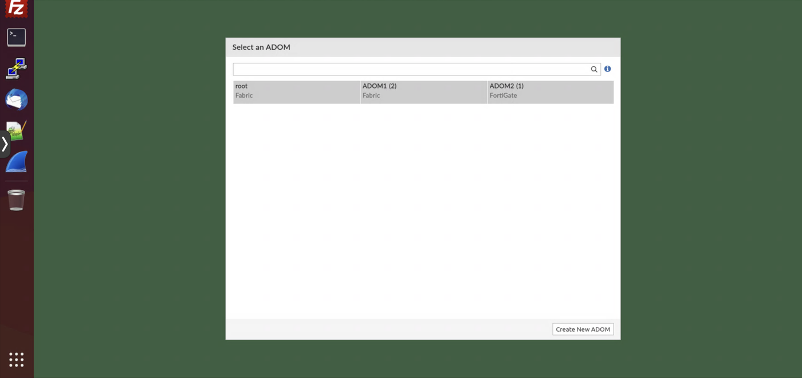
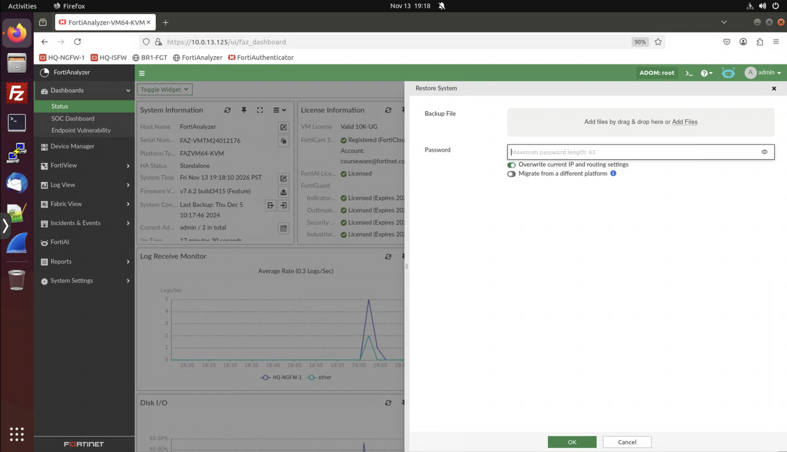
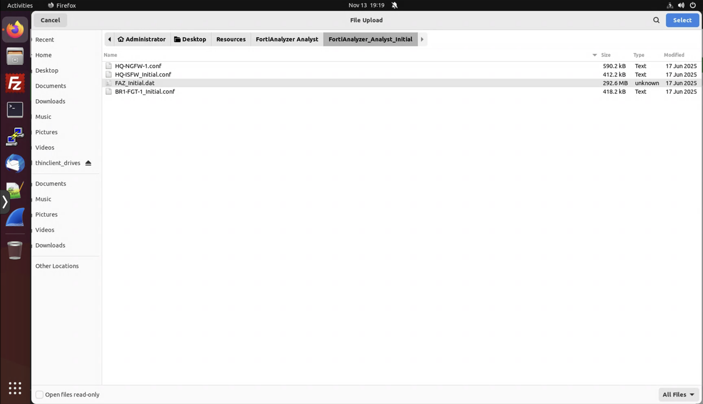
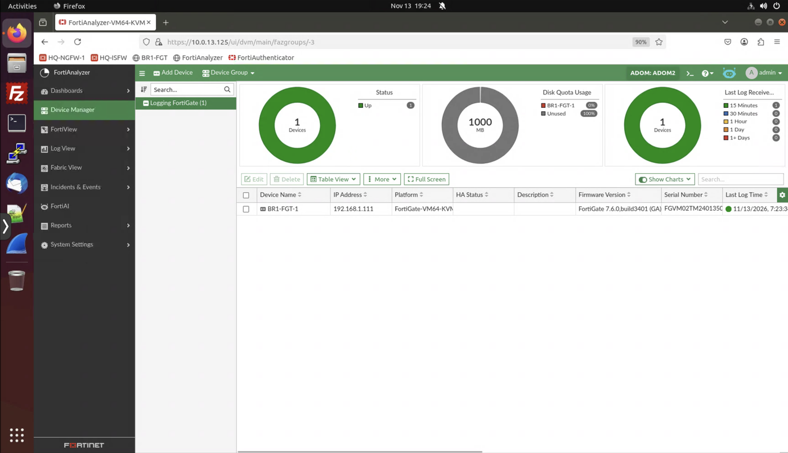

# 🔬 LAB 01 สรุป: SOC Concepts and Security Fabric (Initial Configuration)

> 🇬🇧 English version: [LAB-01-EN.md](LAB-01-EN.md)
> รูปภาพประกอบอยู่ใน `images/lab01/`

## ภาพรวมแล็บ

**เป้าหมาย:** restore config เริ่มต้นของ FortiAnalyzer จากไฟล์ backup ตรวจว่ามี ADOM และ FortiGate ครบ แล้วดูสถานะเครื่องด้วย CLI เป็นการเตรียมเครื่องสำหรับ LAB 02–03

**คอร์ส:** FortiAnalyzer 7.6 Analyst (FTAO) · CIPAT SOC Analyst Lab · FortiAnalyzer v7.6.2 build3415

| อุปกรณ์ | IP | หน้าที่ในแล็บ |
| --- | --- | --- |
| HQ-PC-1 (Ubuntu) | 10.0.11.50 | เปิด Firefox เข้า GUI ของ FortiAnalyzer |
| FortiAnalyzer (FAZ) | 10.0.13.125 | เครื่องเก็บและวิเคราะห์ log |
| HQ-NGFW-1 | 10.0.13.254 (ฝั่ง FAZ) | FortiGate หลัก (ADOM1, root ของ Security Fabric) |
| HQ-ISFW | 10.0.11.253 | FortiGate ภายใน (ADOM1) |
| BR1-FGT-1 | 192.168.1.111 | FortiGate สาขา (ADOM2) |

## Exercise 1 ส่วน A: Restore config เริ่มต้น

1. login GUI แล้วจะเจอหน้า **Select an ADOM** (เพราะไฟล์ backup เปิดใช้ ADOM ไว้)
2. **Dashboards > Status** → widget **System Information** แถว System Configuration กดไอคอน **Restore** (ระวังอย่ากด Backup ที่อยู่ข้างกัน)
3. ปิดสวิตช์ **Overwrite current IP and routing settings** เพื่อไม่ให้ IP/route ของเครื่องแล็บถูกทับ
4. เลือกไฟล์ `Desktop > Resources > FortiAnalyzer Analyst > FortiAnalyzer_Analyst_Initial > FAZ_Initial.dat` (292.6 MB) ใส่รหัสไฟล์แล้วกด OK
5. รอเครื่อง restart 3–5 นาทีแล้ว login ใหม่ Alert Message Console จะขึ้น *Restore all settings.*








## Exercise 1 ส่วน B: ตรวจ ADOM และอุปกรณ์

| ADOM | ประเภท | อุปกรณ์ |
| --- | --- | --- |
| ADOM1 | **Fabric** | HQ-NGFW-1 (root ของ Fabric *Training-Lab*) และ HQ-ISFW |
| ADOM2 | **FortiGate** | BR1-FGT-1 |

ADOM1 เป็นประเภท Fabric เพราะ FortiGate 2 ตัวอยู่ใน Security Fabric เดียวกัน FortiAnalyzer จึง correlate log ข้ามอุปกรณ์ได้ ส่วน ADOM2 เป็นเครื่องเดี่ยว




## Exercise 1 ส่วน C: CLI

เปิด CLI จากไอคอน **>_** บนแถบด้านบน แล้วรัน `get system status`

| ฟิลด์ | ค่า | ความหมาย |
| --- | --- | --- |
| Platform | FortiAnalyzer-VM64-KVM | VM บน KVM |
| Version | v7.6.2-build3415 | เวอร์ชัน firmware |
| Admin Domain Configuration | Enabled | ADOM เปิดแล้วหลัง restore |
| HA Mode | Standalone | ไม่ได้ทำ HA |
| License Status | Valid | license ใช้งานได้ |


## ปัญหาที่เจอและวิธีแก้

- **คลิก root ในหน้า Select an ADOM ไม่ได้** → แล็บนี้ใช้ ADOM1/ADOM2 และหน้าจอรีโมตตอบสนองช้า ต้องรอสักครู่
- **หน้าจอ "Waiting for response..."** → การเชื่อมต่อรีโมตหลุดชั่วคราว รอหรือ refresh แท็บ งานไม่หาย
- **ลืมปิด Overwrite current IP and routing settings** → ไม่มีผลเสีย เพราะไฟล์มาจากแล็บชุดเดียวกัน IP ยังเป็น 10.0.13.125

## บทเรียน

- ADOM **ปิดเป็นค่าเริ่มต้น** เปิดได้เฉพาะ admin ที่มี profile Super_User เมื่อเปิดแล้วต้องเลือก ADOM ตอน login
- ADOM ประเภท **Fabric** ใช้กับอุปกรณ์ใน Security Fabric ส่วนประเภท **FortiGate** ใช้กับเครื่องเดี่ยว
- ใน Security Fabric traffic log ของ session สร้างโดย FortiGate ตัวแรกที่เจอ session (ลด log ซ้ำ)
- โหมด **analyzer** (ค่าเริ่มต้น) กับ **collector** เปลี่ยนได้ที่ widget System Information

```bash
get system status
```
