# 🔬 LAB 02 Summary: Log Data Flow and Navigating Logs

> Thai version: [LAB-02.md](LAB-02.md)
> Screenshots are in `images/lab02/`

## Lab Overview

**Goal:** import historical logs, generate new traffic, search and investigate logs in Log View, simulate a web attack with Nikto so IPS detects it, drill down from FortiView to the raw log, and finish by checking log rates and ADOM storage.

| Device | IP | Role in the lab |
| --- | --- | --- |
| HQ-PC-1 | 10.0.11.50 | Runs the traffic script and PuTTY |
| FortiAnalyzer | 10.0.13.125 | ADOM1 (Fabric) |
| HQ-NGFW-1 | FGVM02TM24013423 | VIP 100.65.0.200 → 10.0.11.50 |
| HQ-ISFW | FGVM02TM24013502 | Internal FortiGate |
| LINUX-ISP | 100.65.0.254 | Internet-side attacker (Nikto) |

## Exercise 1: Importing Logs

**Log View > Log Browse > Import**, then select the files from `Resources > FortiAnalyzer Analyst > Backup Logs` (four folders of .zst and .log files from HQ-NGFW-1 and HQ-ISFW).

Leaving Device as **[Taken From Imported File]** works because the file names start with the serial number (`FGVM02TM24013502.root.tlog...`), so FortiAnalyzer maps them automatically. The result shows as larger file sizes in Log Browse (for example, HQ-NGFW-1 tlog 6,510,467 → 7,046,462).

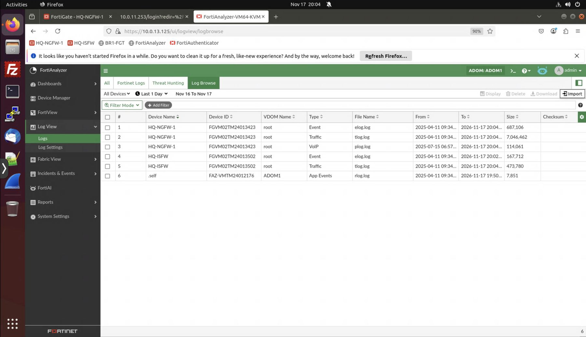

## Exercise 2: Navigating Logs

**Generate traffic:** disable Web Filter on policy Internet (1) of HQ-NGFW-1, run the script on HQ-PC-1, then re-enable Web Filter with the monitor-all profile.

```bash
cd /home/Administrator/Desktop
chmod +x traffic-generation.sh
./traffic-generation.sh
```

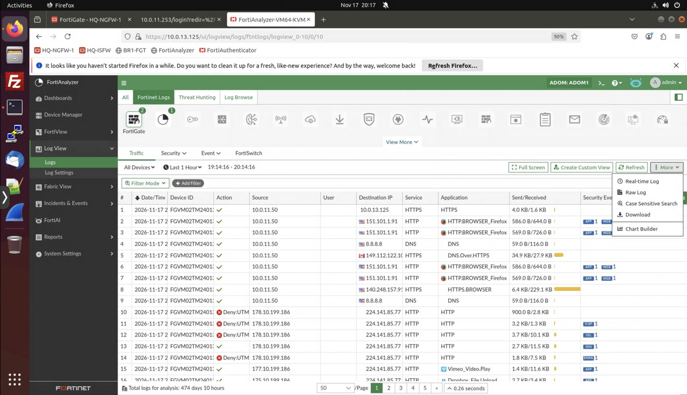

**Real-time / Historical / Raw:** real-time mode is not in the time menu; it is under **More ▾ → Real-time Log**. Raw Log shows every field as `key=value`.

| | Real-time | Historical |
| --- | --- | --- |
| Data source | Logs just received | Logs inserted into SQL |
| Time range | Continuous stream (can pause) | Selectable |

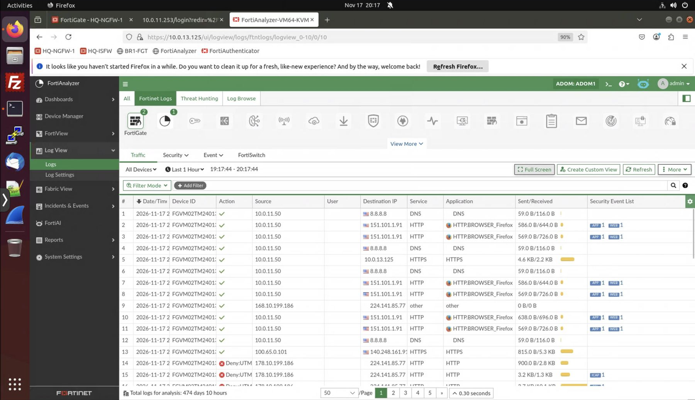

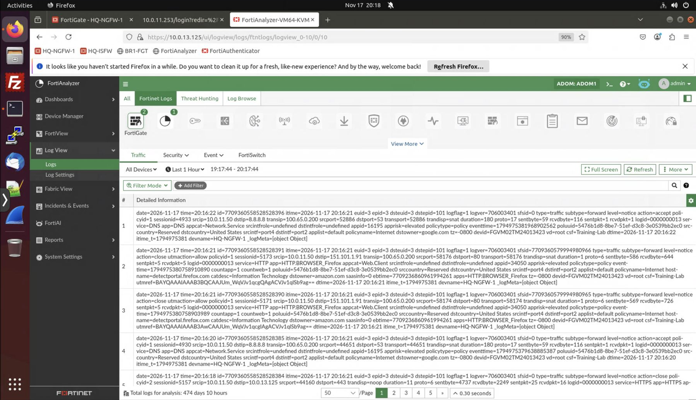

**Searching:** Text Mode needs `field=value` syntax (`*Dropbox*` alone finds nothing, `app=*Dropbox*` works). Search is **case-insensitive by default** (`app=*dropbox*` also matches); turn on **More ▾ → Case Sensitive Search** to change that.

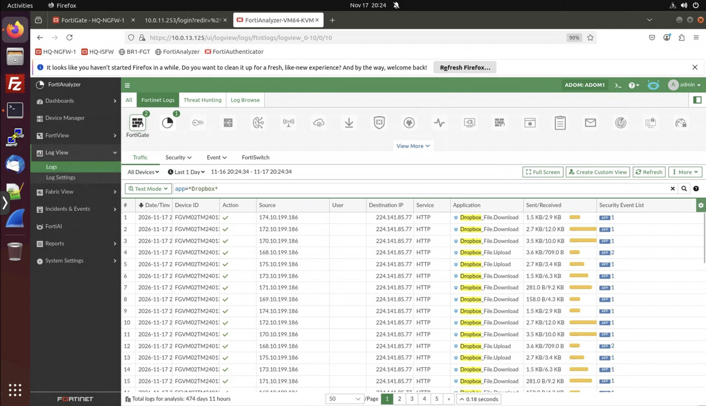

**Scenario 1 (P2P):** Security → Application Control, `appcat=P2P` → **BitTorrent** used by user2/group2, coming in over **ssl.root (SSL VPN)**, action **pass**, **Policy ID 1**. Saved as the Custom View `Application Control Logs for Last 1 Day` (the name cannot contain `=`).

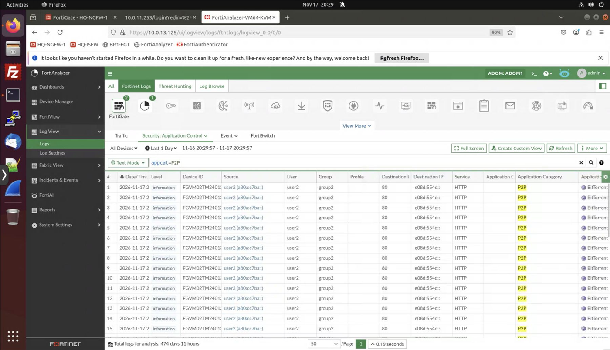


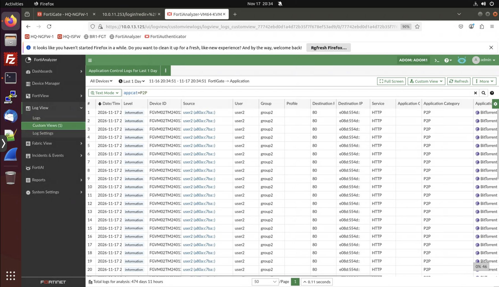

**Scenario 2 (Social media):** `catdesc=*social*` in Web Filter found nothing, because Web Filter was off while the script ran. Searching the Traffic tab with `appcat=*Social*` found **Facebook ×3 and Pinterest ×3** from 10.0.11.50, action accept.

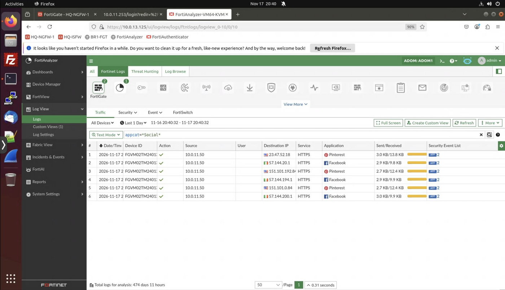

## Exercise 3: Threat Detection (IPS)

1. Edit IPS profile **WEBSERVER_Protection** on HQ-NGFW-1 to keep only **SEV: Medium** (remove TGT: Server). Matching signatures rise from 906 to 1,263.
2. Open `http://100.65.0.200` from BR1-PC-1 to confirm the web server responds.
3. In PuTTY on HQ-PC-1, open session **LINUX-ISP** and run `nikto.pl -host 100.65.0.200`.
4. **FortiView > Threats > Top Threats** lists PHPBB.Viewtopic, Apache.Expect.Header.XSS and **NetworkActiv.Web.Server.XSS** (Medium).
5. Drill down: Threat → Source → Log View → log detail.

| Field | Value |
| --- | --- |
| Source | 100.65.0.254 (in on port2) |
| Destination | 100.65.0.200 (VIP) |
| Destination NAT IP | **10.0.11.50:80** out port4 (Tran Display = dnat) |
| Policy ID | **5** |

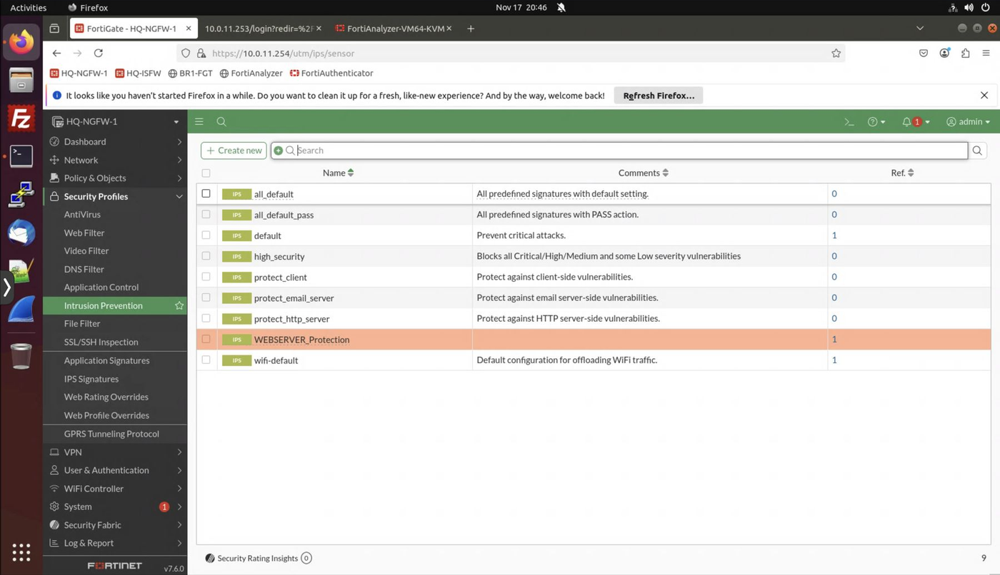

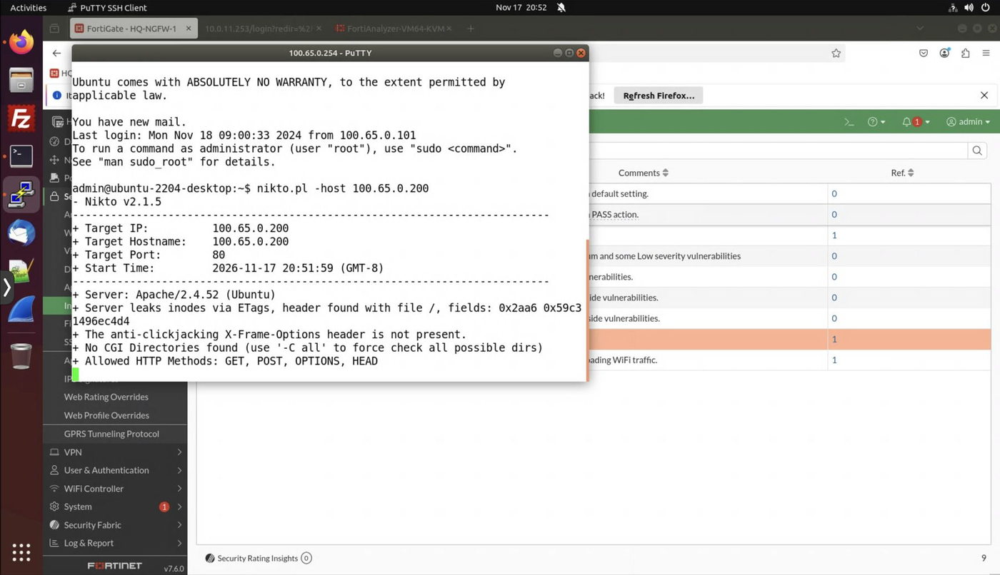

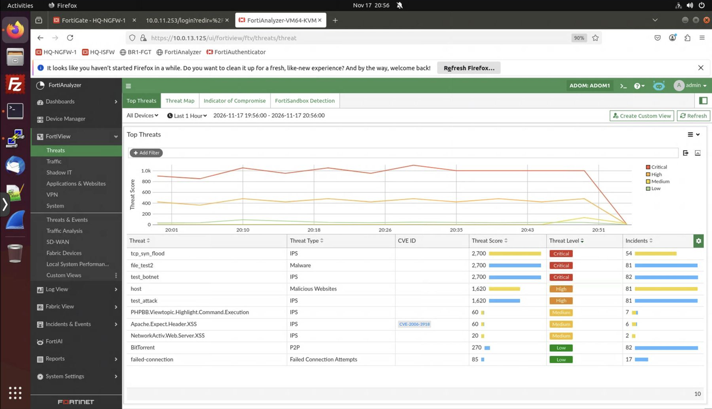

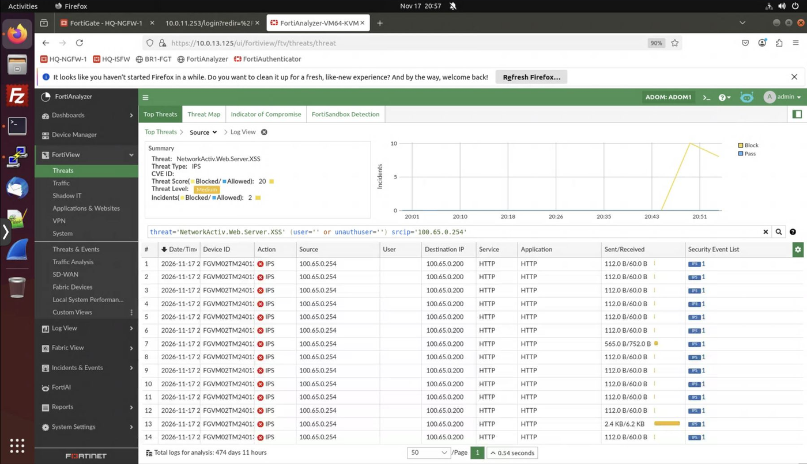

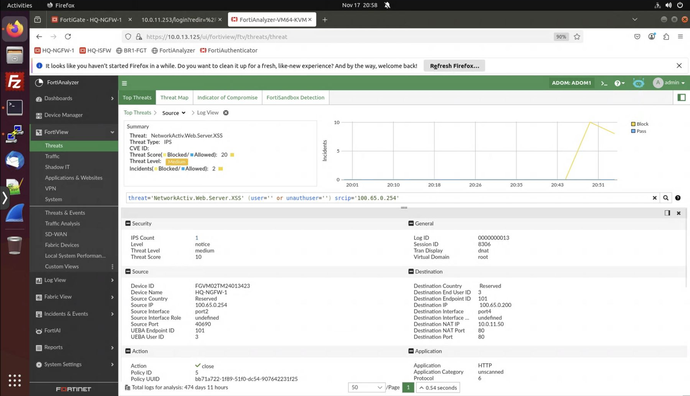

**Top Sources:** 10.0.11.50 has the most sessions (5,669), but 100.65.0.254 has only 160 sessions with Threat Score 330 → sort by **Threat Score**, not session count.

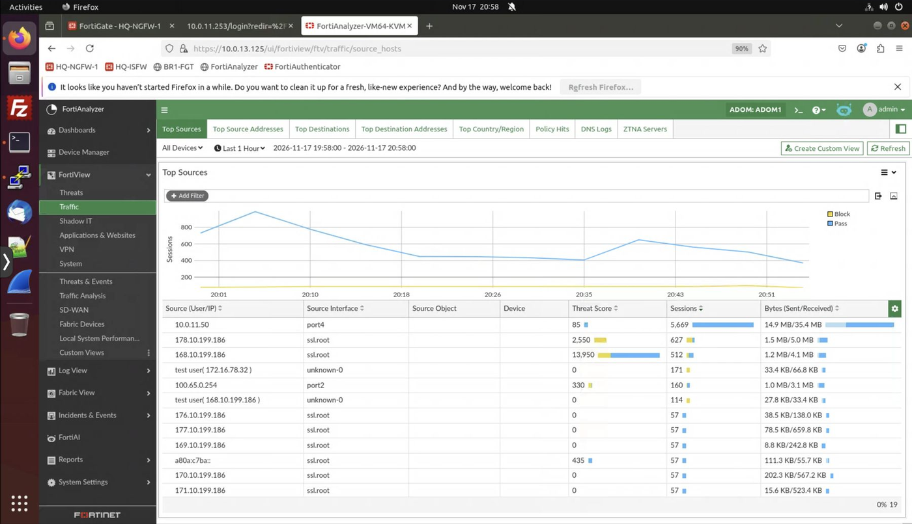

## Exercise 4: Log Statistics & Storage

```bash
diagnose fortilogd lograte
diagnose fortilogd lograte-device
diagnose fortilogd lograte-type
diagnose fortilogd msgrate
diagnose fortilogd lograte-adom all
diagnose fortilogd logvol-adom all
```

| Command | Result in the lab |
| --- | --- |
| `lograte-device` | HQ-NGFW-1 5.02/s, HQ-ISFW 0.02/s |
| `lograte-type` | Traffic 4.67, Event 0.32, Attack 0.02 |
| `lograte-adom all` | Only ADOM1 (4.70/s) |

- `lograte` = logs per second (for sizing) · `logvol` = bytes per day (for storage and GB/day licensing)
- **Log Insert Lag Time** stayed around 10–30 s with a ~55 s peak, so FortiView trails real time by about half a minute.
- ADOM1: Analytics 60 days, Archive 365 days, 2 GB quota split 70:30 (1,400 / 600 MB). Actual 474 days exceeds the config because old logs (Mar–Apr 2025) were imported.

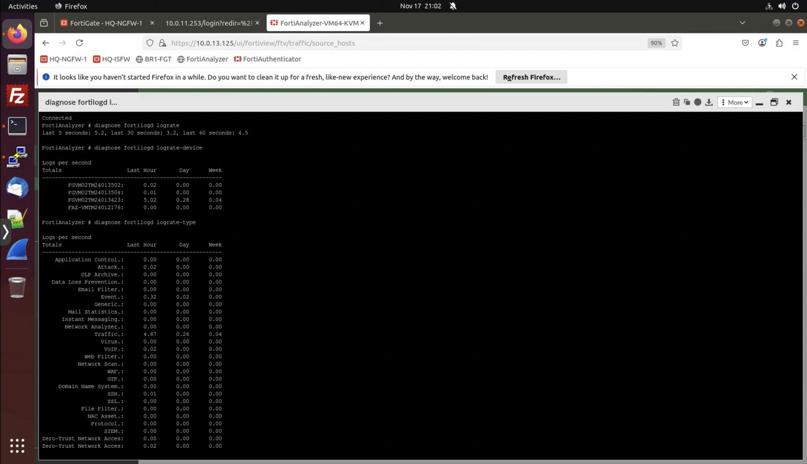

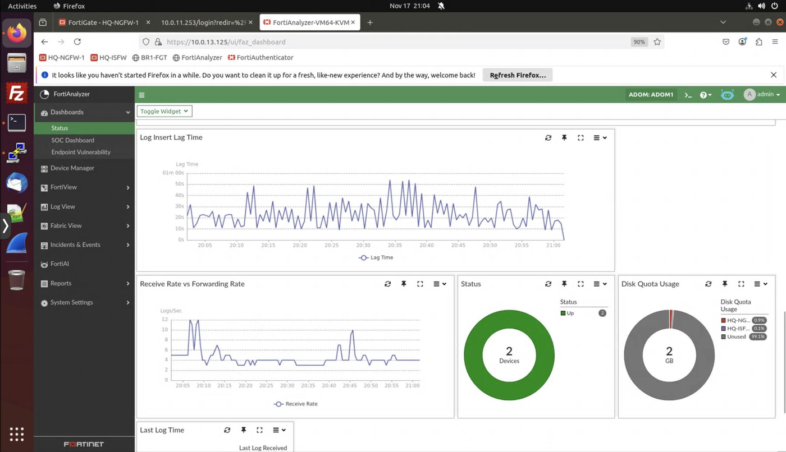

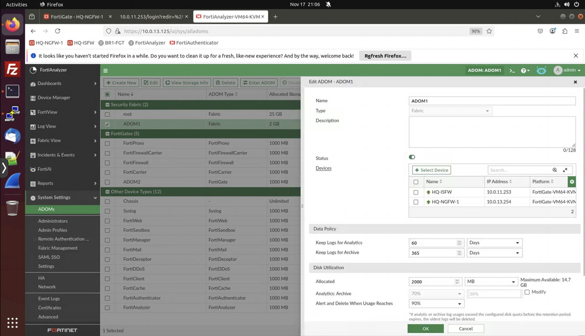

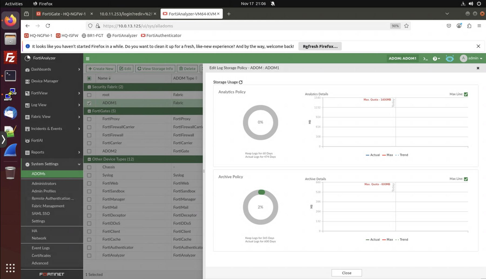

## Issues and Fixes

- Typed the search term into **Add Filter** (a field-name picker) → switch to **Text Mode**.
- `*Dropbox*` alone found nothing → specify the field: `app=*Dropbox*`.
- Typed `appcat=2P2` → should be `P2P`.
- Searched `catdesc` in the Application Control tab → that field exists only in Web Filter logs.
- The first IPS filter edit was not saved → redo it and click OK on both dialogs.
- PuTTY session LINUX-ISP missing on BR1-PC-1 → it is on HQ-PC-1.

## Key Takeaways

- Pick the **log type that contains the field**: `catdesc` = Web Filter · `appcat` = Traffic / Application Control.
- Traffic logs and security logs are separate, linked by **Session ID**.
- **Quota beats retention:** if storage fills before the retention period ends, the oldest logs are deleted.
- Analytics = SQL (online, fast queries) · Archive = .gz (offline, kept for compliance).
