# 🔬 LAB 02 สรุป: เส้นทางของบันทึกและการค้นหาบันทึก (Log)

> English version: [LAB-02-EN.md](LAB-02-EN.md)
> รูปภาพประกอบอยู่ใน `images/lab02/`

## ภาพรวมแล็บ

**เป้าหมาย:** นำเข้าบันทึกเหตุการณ์ (log) ย้อนหลัง สร้างการรับส่งข้อมูลใหม่ ค้นหาและสืบสวนบันทึกในหน้า Log View จำลองการโจมตีเว็บด้วยเครื่องมือ Nikto ให้ระบบป้องกันการบุกรุก (IPS) จับได้ แล้วไล่จากหน้าสรุปภาพรวม (FortiView) ลงไปถึงบันทึกต้นฉบับ ปิดท้ายด้วยการดูอัตราบันทึกและพื้นที่จัดเก็บ

| อุปกรณ์ | IP / หมายเลขเครื่อง | หน้าที่ในแล็บ |
| --- | --- | --- |
| HQ-PC-1 | 10.0.11.50 | รันสคริปต์สร้างการรับส่งข้อมูล และโปรแกรม PuTTY |
| FortiAnalyzer | 10.0.13.125 | ทำงานใน ADOM1 (ประเภท Fabric) |
| HQ-NGFW-1 | FGVM02TM24013423 | ไฟร์วอลล์หลัก มี IP เสมือน 100.65.0.200 ที่ชี้ไป 10.0.11.50 |
| HQ-ISFW | FGVM02TM24013502 | ไฟร์วอลล์ภายใน |
| LINUX-ISP | 100.65.0.254 | ผู้โจมตีฝั่งอินเทอร์เน็ต (รัน Nikto) |

## แบบฝึกหัด 1: นำเข้าบันทึก

ไปที่ **Log View > Log Browse > Import** แล้วเลือกไฟล์จาก `Resources > FortiAnalyzer Analyst > Backup Logs` ให้ครบ 4 โฟลเดอร์ (ไฟล์ .zst และ .log ของ HQ-NGFW-1 และ HQ-ISFW)

ช่อง Device ปล่อยเป็น **[Taken From Imported File]** ได้ เพราะชื่อไฟล์ขึ้นต้นด้วยหมายเลขเครื่อง (`FGVM02TM24013502.root.tlog...`) FortiAnalyzer จึงจับคู่ให้เอง ตรวจผลได้จากขนาดไฟล์ในหน้า Log Browse ที่เพิ่มขึ้น เช่น บันทึกการรับส่งข้อมูลของ HQ-NGFW-1 จาก 6,510,467 เป็น 7,046,462 ไบต์

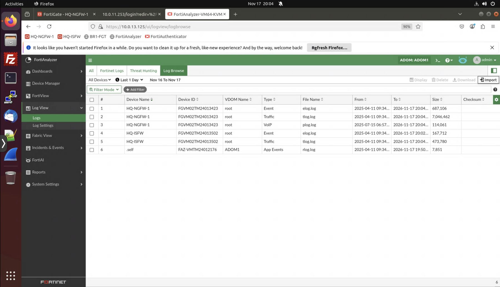

## แบบฝึกหัด 2: ค้นหาและสืบสวนบันทึก

**สร้างการรับส่งข้อมูล:** ปิดตัวกรองเว็บ (Web Filter) ในนโยบาย Internet (หมายเลข 1) ของ HQ-NGFW-1 แล้วรันสคริปต์บน HQ-PC-1 พอเสร็จค่อยเปิดตัวกรองเว็บกลับเป็นโปรไฟล์ monitor-all

```bash
cd /home/Administrator/Desktop
chmod +x traffic-generation.sh
./traffic-generation.sh
```

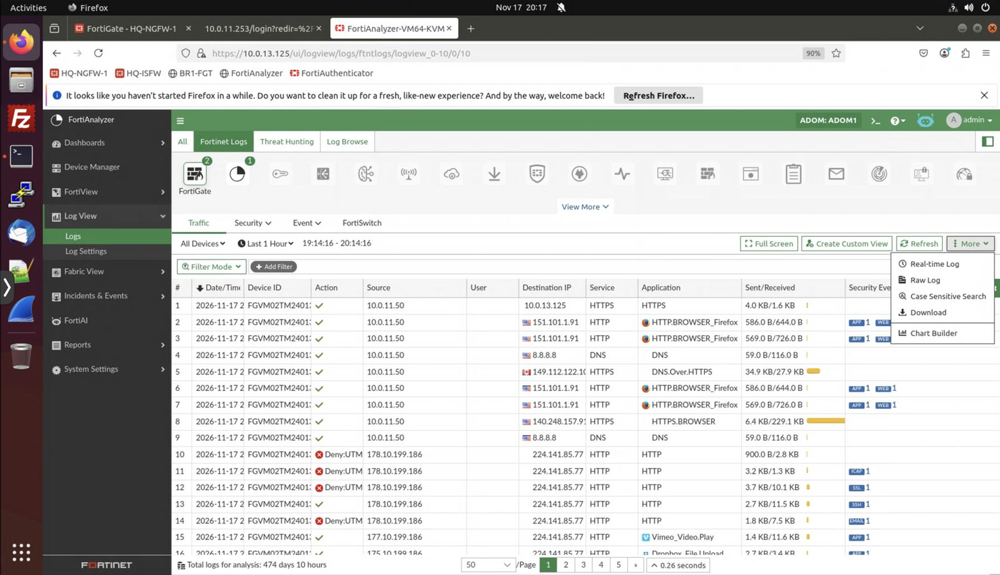

**ดูแบบสด แบบย้อนหลัง และแบบต้นฉบับ:** โหมดดูสด (Real-time) ไม่ได้อยู่ในเมนูเลือกเวลา ต้องไปที่ **More ▾ → Real-time Log** ส่วนมุมมองต้นฉบับ (Raw Log) จะแสดงทุกช่องข้อมูลในรูปแบบ `ชื่อ=ค่า`

| | ดูแบบสด | ดูแบบย้อนหลัง |
| --- | --- | --- |
| ข้อมูลมาจาก | บันทึกที่เพิ่งรับเข้ามา | บันทึกที่ถูกเขียนลงฐานข้อมูล SQL แล้ว |
| ช่วงเวลา | ไหลต่อเนื่อง (กดหยุดชั่วคราวได้) | เลือกช่วงเวลาได้ |

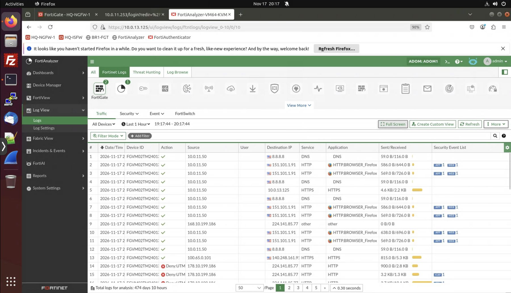


**การค้นหา:** ในโหมดพิมพ์ข้อความ (Text Mode) ต้องพิมพ์แบบ `ชื่อช่อง=ค่า` เช่น พิมพ์ `*Dropbox*` อย่างเดียวจะไม่เจอ แต่ `app=*Dropbox*` เจอ การค้นหา**ไม่แยกตัวพิมพ์เล็กใหญ่เป็นค่าเริ่มต้น** (`app=*dropbox*` ก็เจอ) ถ้าต้องการให้แยก ต้องเปิด **More ▾ → Case Sensitive Search**


**สถานการณ์ที่ 1 (โปรแกรมแชร์ไฟล์ P2P):** เลือกแท็บ Security → Application Control ค้นด้วย `appcat=P2P` เจอโปรแกรม **BitTorrent** ที่ผู้ใช้ user2 (กลุ่ม group2) ใช้งานผ่าน **ssl.root (VPN แบบ SSL)** ไฟร์วอลล์**ปล่อยผ่าน** ตาม**นโยบายหมายเลข 1** จากนั้นบันทึกเป็นมุมมองที่ตั้งเอง (Custom View) ชื่อ `Application Control Logs for Last 1 Day` (ชื่อห้ามมีเครื่องหมาย `=`)

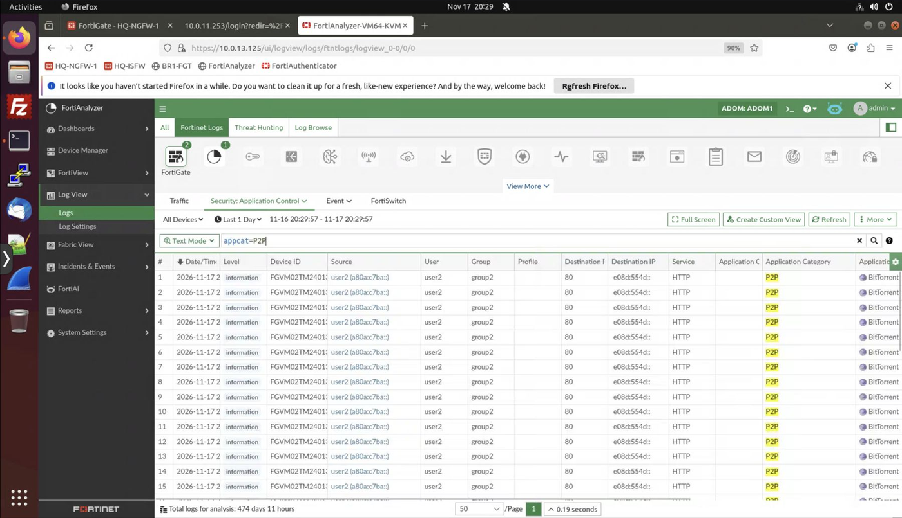


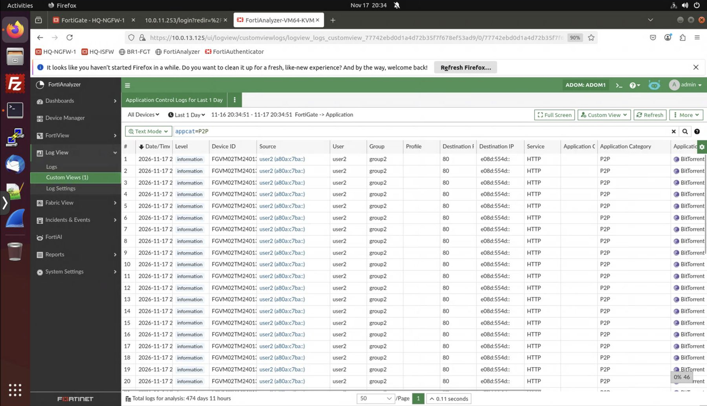

**สถานการณ์ที่ 2 (โซเชียลมีเดีย):** ค้น `catdesc=*social*` ในบันทึกของตัวกรองเว็บไม่เจอ เพราะตัวกรองเว็บปิดอยู่ตอนรันสคริปต์ จึงย้ายไปค้นในแท็บ Traffic (การรับส่งข้อมูล) ด้วย `appcat=*Social*` เจอ **Facebook 3 ครั้ง และ Pinterest 3 ครั้ง** จากเครื่อง 10.0.11.50 ไฟร์วอลล์ปล่อยผ่าน

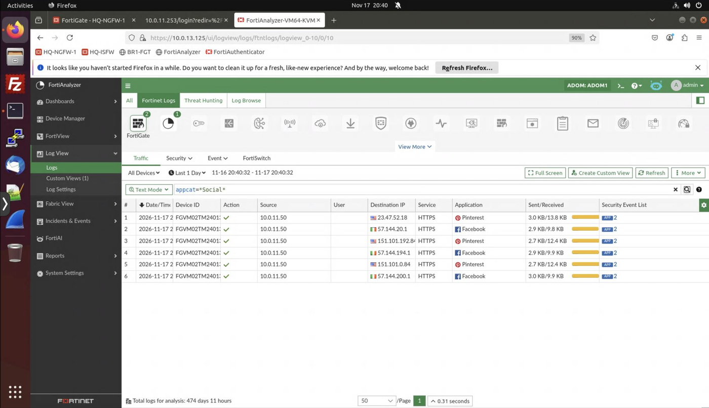

## แบบฝึกหัด 3: ตรวจจับภัยด้วยระบบป้องกันการบุกรุก (IPS)

1. แก้โปรไฟล์ IPS ชื่อ **WEBSERVER_Protection** บน HQ-NGFW-1 ให้เหลือตัวกรอง**ความรุนแรงระดับกลาง (SEV: Medium)** โดยลบเงื่อนไขเป้าหมายเซิร์ฟเวอร์ (TGT: Server) ออก จำนวนรูปแบบการโจมตีที่ตรวจจับเพิ่มจาก 906 เป็น 1,263
2. เปิด `http://100.65.0.200` จากเครื่อง BR1-PC-1 เพื่อเช็กว่าเว็บตอบกลับ
3. เปิด PuTTY ในเครื่อง HQ-PC-1 เลือก LINUX-ISP แล้วรัน `nikto.pl -host 100.65.0.200`
4. หน้า **FortiView > Threats > Top Threats** (ภัยคุกคามสูงสุด) ขึ้น PHPBB.Viewtopic, Apache.Expect.Header.XSS และ **NetworkActiv.Web.Server.XSS** ระดับกลาง
5. ไล่เจาะลงไป: ภัยคุกคาม → ต้นทาง → หน้า Log View → รายละเอียดบันทึก

| ช่องข้อมูล | ค่า |
| --- | --- |
| ต้นทาง | 100.65.0.254 (เข้ามาทางขา port2) |
| ปลายทาง | 100.65.0.200 (IP เสมือน) |
| ปลายทางหลังแปลงที่อยู่ | **10.0.11.50:80** ออกทางขา port4 (แปลงที่อยู่ปลายทาง dnat) |
| หมายเลขนโยบาย | **5** |

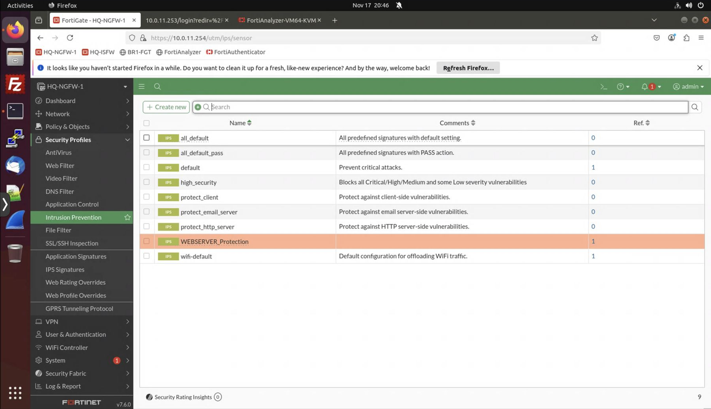

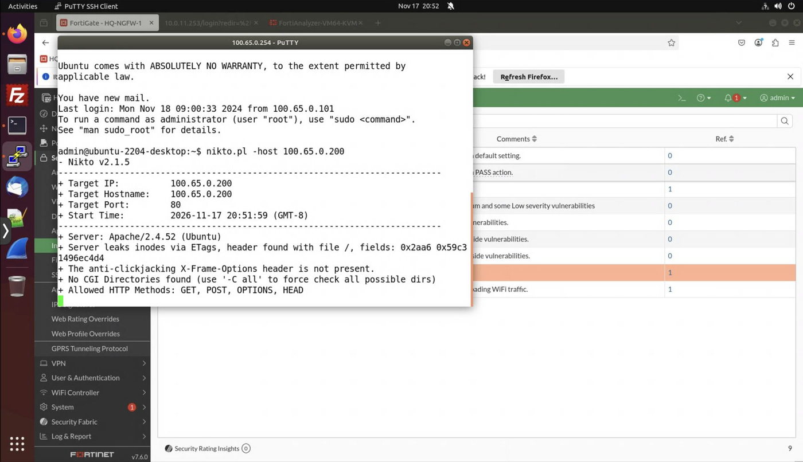

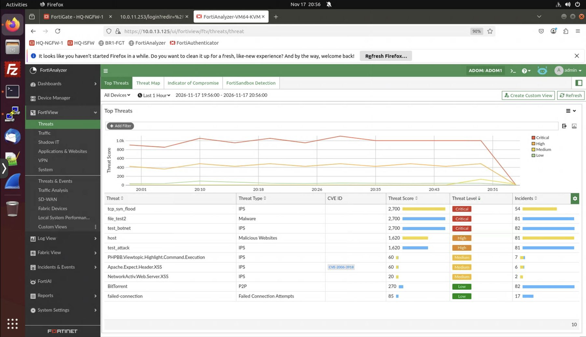

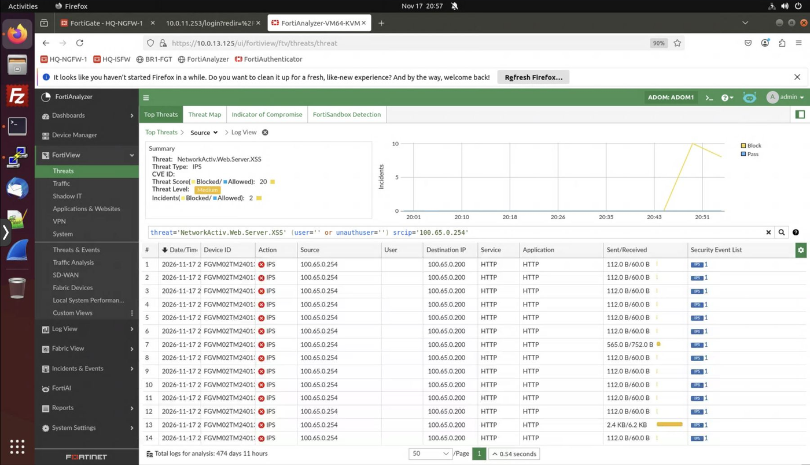


**ต้นทางสูงสุด (Top Sources):** เครื่อง 10.0.11.50 มีจำนวนการเชื่อมต่อมากที่สุด (5,669) แต่ 100.65.0.254 มีแค่ 160 การเชื่อมต่อ กลับมีคะแนนภัยคุกคาม 330 แปลว่าควรเรียงตาม**คะแนนภัยคุกคาม** ไม่ใช่จำนวนการเชื่อมต่อ

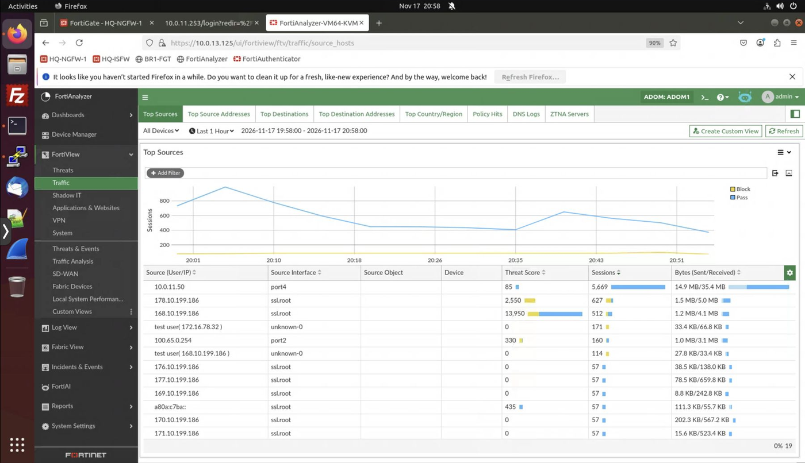

## แบบฝึกหัด 4: สถิติบันทึกและพื้นที่จัดเก็บ

```bash
diagnose fortilogd lograte
diagnose fortilogd lograte-device
diagnose fortilogd lograte-type
diagnose fortilogd msgrate
diagnose fortilogd lograte-adom all
diagnose fortilogd logvol-adom all
```

| คำสั่ง | ผลในแล็บ |
| --- | --- |
| `lograte-device` | HQ-NGFW-1 5.02 บันทึก/วินาที, HQ-ISFW 0.02 บันทึก/วินาที |
| `lograte-type` | การรับส่งข้อมูล 4.67, เหตุการณ์ระบบ 0.32, การโจมตี 0.02 |
| `lograte-adom all` | มีแค่ ADOM1 (4.70 บันทึก/วินาที) |

- `lograte` = จำนวนบันทึกต่อวินาที ใช้ประเมินขนาดเครื่อง · `logvol` = ปริมาณไบต์ต่อวัน ใช้วางแผนพื้นที่และใบอนุญาตที่คิดตาม GB ต่อวัน
- **ระยะเวลาหน่วงการเขียนบันทึก (Log Insert Lag Time)** อยู่ราว 10–30 วินาที สูงสุดประมาณ 55 วินาที หน้า FortiView จึงช้ากว่าเวลาจริงประมาณครึ่งนาที
- ADOM1: เก็บข้อมูลสำหรับวิเคราะห์ 60 วัน, เก็บถาวร 365 วัน, โควตา 2 GB แบ่ง 70:30 (1,400 / 600 MB) ค่าจริง 474 วันเกินค่าที่ตั้ง เพราะนำเข้าบันทึกเก่า (มี.ค.–เม.ย. 2025)

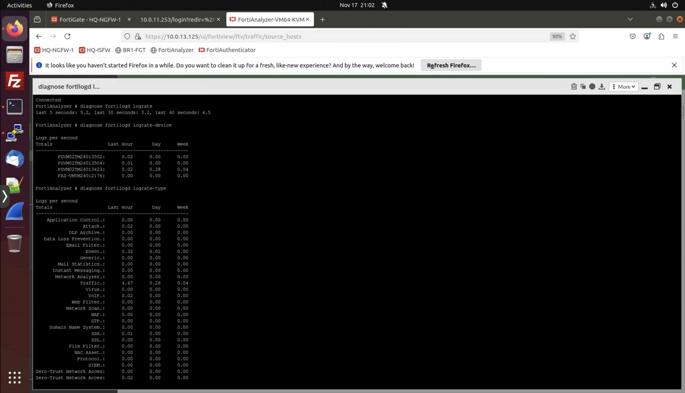

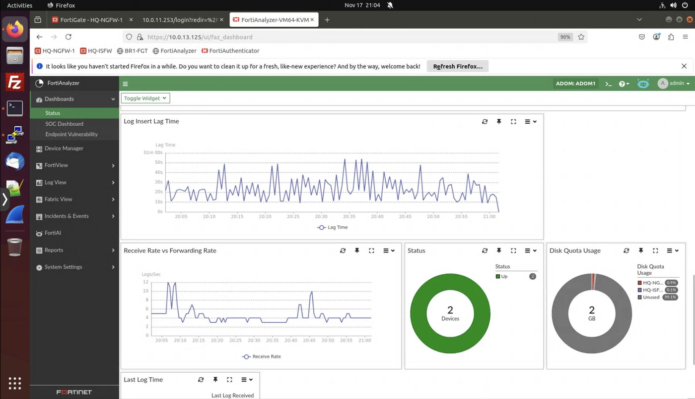

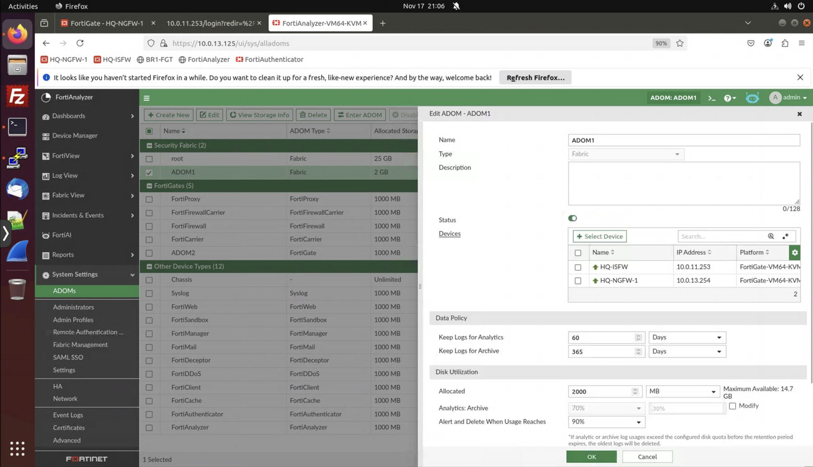

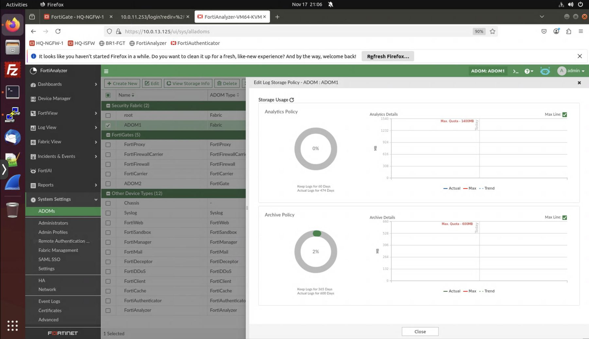

## ปัญหาที่เจอและวิธีแก้

- พิมพ์คำค้นในปุ่ม **Add Filter** ซึ่งเป็นช่องเลือกชื่อช่องข้อมูล → เปลี่ยนเป็น**โหมดพิมพ์ข้อความ**
- พิมพ์ `*Dropbox*` อย่างเดียวไม่เจอ → ต้องระบุชื่อช่อง: `app=*Dropbox*`
- พิมพ์ผิดเป็น `appcat=2P2` → ต้องเป็น `P2P`
- ค้น `catdesc` ในแท็บ Application Control → ช่องนี้มีเฉพาะในบันทึกของตัวกรองเว็บ
- แก้ตัวกรอง IPS รอบแรกแล้วไม่ถูกบันทึก → ทำใหม่และกด OK ให้ครบทั้ง 2 หน้าต่าง
- หา PuTTY ที่ตั้งค่า LINUX-ISP ไว้ในเครื่อง BR1-PC-1 ไม่เจอ → อยู่ในเครื่อง HQ-PC-1

## บทเรียน

- ต้องเลือก**ประเภทบันทึกให้ตรงกับช่องข้อมูล**: `catdesc` (หมวดเว็บ) อยู่ในบันทึกตัวกรองเว็บ · `appcat` (หมวดแอป) อยู่ในบันทึกการรับส่งข้อมูลและการควบคุมแอป
- บันทึกการรับส่งข้อมูลกับบันทึกด้านความปลอดภัยเป็นคนละรายการ เชื่อมกันด้วย**หมายเลขการเชื่อมต่อ (Session ID)**
- **โควตาสำคัญกว่าระยะเวลาเก็บ:** ถ้าพื้นที่เต็มก่อนครบกำหนด บันทึกที่เก่าที่สุดจะถูกลบทิ้ง
- ข้อมูลสำหรับวิเคราะห์ = อยู่ในฐานข้อมูล SQL ค้นได้เร็ว · ข้อมูลเก็บถาวร = ไฟล์บีบอัด .gz เก็บไว้ตามข้อกำหนดด้านกฎระเบียบ
