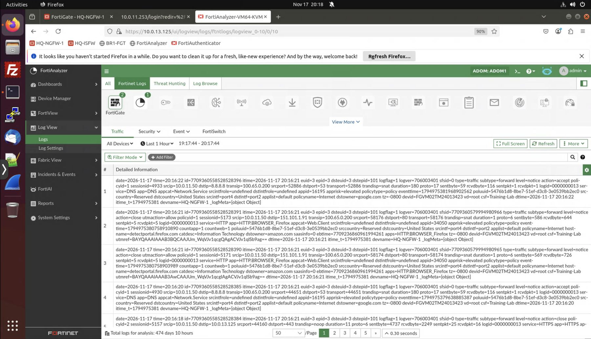
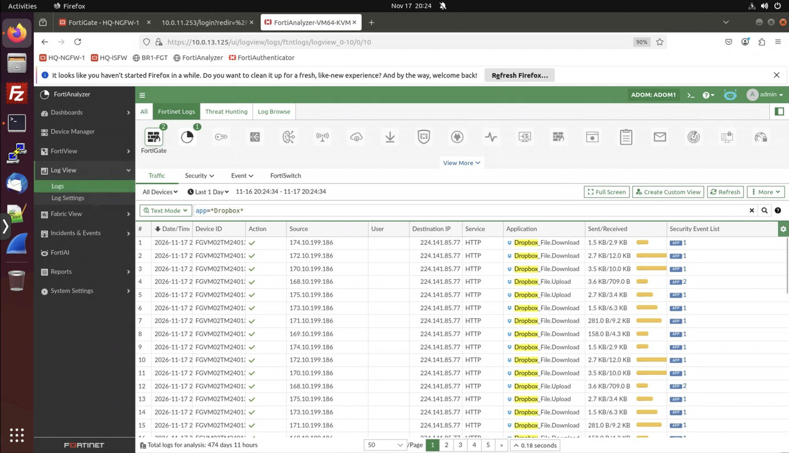
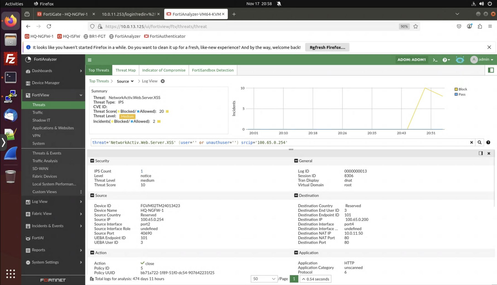

# 🔬 LAB 02 สรุป: Log Data Flow and Navigating Logs

> 🇬🇧 English version: [LAB-02-EN.md](LAB-02-EN.md)
> รูปภาพประกอบอยู่ใน `images/lab02/`

## ภาพรวมแล็บ

**เป้าหมาย:** import log ย้อนหลัง สร้าง traffic ใหม่ ค้นหาและสืบสวน log ใน Log View จำลองการโจมตีเว็บด้วย Nikto ให้ IPS จับ แล้วไล่จาก FortiView ลงไปถึง log ดิบ ปิดท้ายด้วยการดูอัตรา log และพื้นที่จัดเก็บของ ADOM

| อุปกรณ์ | IP | หน้าที่ในแล็บ |
| --- | --- | --- |
| HQ-PC-1 | 10.0.11.50 | รัน traffic script และ PuTTY |
| FortiAnalyzer | 10.0.13.125 | ADOM1 (Fabric) |
| HQ-NGFW-1 | FGVM02TM24013423 | มี VIP 100.65.0.200 → 10.0.11.50 |
| HQ-ISFW | FGVM02TM24013502 | FortiGate ภายใน |
| LINUX-ISP | 100.65.0.254 | ผู้โจมตีฝั่งอินเทอร์เน็ต (Nikto) |

## Exercise 1: Importing Logs

**Log View > Log Browse > Import** แล้วเลือกไฟล์จาก `Resources > FortiAnalyzer Analyst > Backup Logs` ครบ 4 โฟลเดอร์ (ไฟล์ .zst และ .log ของ HQ-NGFW-1 และ HQ-ISFW)

ปล่อย Device เป็น **[Taken From Imported File]** ได้ เพราะชื่อไฟล์ขึ้นต้นด้วย serial (`FGVM02TM24013502.root.tlog...`) FortiAnalyzer จึงจับคู่เครื่องให้เอง ตรวจผลได้จากขนาดไฟล์ใน Log Browse ที่เพิ่มขึ้น (เช่น HQ-NGFW-1 tlog 6,510,467 → 7,046,462)


## Exercise 2: Navigating Logs

**สร้าง traffic:** ปิด Web Filter ใน policy Internet (1) ของ HQ-NGFW-1 แล้วรัน script บน HQ-PC-1 พอเสร็จค่อยเปิด Web Filter คืนเป็น monitor-all

```bash
cd /home/Administrator/Desktop
chmod +x traffic-generation.sh
./traffic-generation.sh
```


**Real-time / Historical / Raw:** Real-time ไม่ได้อยู่ในเมนูเวลา ต้องไปที่ **More ▾ → Real-time Log** ส่วน Raw Log แสดงทุก field แบบ `key=value`

| | Real-time | Historical |
| --- | --- | --- |
| ข้อมูลมาจาก | log ที่เพิ่งรับเข้ามา | log ที่ insert ลง SQL แล้ว |
| ช่วงเวลา | ไหลต่อเนื่อง (Pause ได้) | เลือกช่วงได้ |




**การค้นหา:** ใน Text Mode ต้องพิมพ์แบบ `field=value` (`*Dropbox*` เปล่า ๆ ไม่เจอ แต่ `app=*Dropbox*` เจอ) การค้นหา**ไม่แยกตัวพิมพ์เป็นค่าเริ่มต้น** (`app=*dropbox*` ก็เจอ) ถ้าต้องการให้แยกต้องเปิด **More ▾ → Case Sensitive Search**



**Scenario 1 (P2P):** Security → Application Control, `appcat=P2P` → **BitTorrent** โดย user2/group2 เข้ามาทาง **ssl.root (SSL VPN)** action **pass** ผ่าน **Policy ID 1** จากนั้นบันทึกเป็น Custom View `Application Control Logs for Last 1 Day` (ชื่อห้ามมี `=`)


**Scenario 2 (Social media):** `catdesc=*social*` ใน Web Filter ไม่เจอ เพราะ Web Filter ปิดอยู่ตอนรัน script จึงย้ายไปค้นในแท็บ Traffic ด้วย `appcat=*Social*` เจอ **Facebook ×3, Pinterest ×3** จาก 10.0.11.50 action accept


## Exercise 3: Threat Detection (IPS)

1. แก้ IPS profile **WEBSERVER_Protection** บน HQ-NGFW-1 ให้เหลือ filter **SEV: Medium** (ลบ TGT: Server) จำนวน signature เพิ่มจาก 906 เป็น 1,263
2. เปิด `http://100.65.0.200` จาก BR1-PC-1 เพื่อเช็กว่าเว็บตอบ
3. PuTTY ใน HQ-PC-1 session **LINUX-ISP** แล้วรัน `nikto.pl -host 100.65.0.200`
4. **FortiView > Threats > Top Threats** ขึ้น PHPBB.Viewtopic, Apache.Expect.Header.XSS และ **NetworkActiv.Web.Server.XSS** (Medium)
5. drill-down: Threat → Source → Log View → log detail

| Field | ค่า |
| --- | --- |
| Source | 100.65.0.254 (เข้าทาง port2) |
| Destination | 100.65.0.200 (VIP) |
| Destination NAT IP | **10.0.11.50:80** ออก port4 (Tran Display = dnat) |
| Policy ID | **5** |




**Top Sources:** 10.0.11.50 มี session มากที่สุด (5,669) แต่ 100.65.0.254 มีแค่ 160 session กับ Threat Score 330 → ควรเรียงตาม **Threat Score** ไม่ใช่ Sessions


## Exercise 4: Log Statistics & Storage

```bash
diagnose fortilogd lograte
diagnose fortilogd lograte-device
diagnose fortilogd lograte-type
diagnose fortilogd msgrate
diagnose fortilogd lograte-adom all
diagnose fortilogd logvol-adom all
```

| คำสั่ง | ผลในแล็บ |
| --- | --- |
| `lograte-device` | HQ-NGFW-1 5.02/s, HQ-ISFW 0.02/s |
| `lograte-type` | Traffic 4.67, Event 0.32, Attack 0.02 |
| `lograte-adom all` | มีแค่ ADOM1 (4.70/s) |

- `lograte` = log ต่อวินาที (ใช้ประเมินขนาดเครื่อง) · `logvol` = ไบต์ต่อวัน (ใช้วางแผน storage และ license แบบ GB/day)
- **Log Insert Lag Time** อยู่ราว 10–30 วินาที พีคประมาณ 55 วินาที FortiView จึงแสดงช้ากว่าความจริงประมาณครึ่งนาที
- ADOM1: Analytics เก็บ 60 วัน, Archive 365 วัน, quota 2 GB แบ่ง 70:30 (1,400 / 600 MB) ค่า Actual 474 วันเกิน Config เพราะ import log เก่า (มี.ค.–เม.ย. 2025)


## ปัญหาที่เจอและวิธีแก้

- พิมพ์คำค้นใน **Add Filter** (ช่องเลือกชื่อ field) → เปลี่ยนเป็น **Text Mode**
- `*Dropbox*` เปล่า ๆ ไม่เจอ → ต้องระบุ field: `app=*Dropbox*`
- พิมพ์ `appcat=2P2` → ต้องเป็น `P2P`
- ค้น `catdesc` ในแท็บ Application Control → field นี้มีเฉพาะใน Web Filter
- แก้ IPS filter รอบแรกไม่ถูกบันทึก → ทำซ้ำแล้วกด OK ให้ครบ 2 ชั้น
- หา PuTTY session LINUX-ISP ใน BR1-PC-1 ไม่เจอ → อยู่ใน HQ-PC-1

## บทเรียน

- ต้องเลือก**ประเภท log ให้ตรงกับ field**: `catdesc` = Web Filter · `appcat` = Traffic / Application Control
- Traffic log กับ Security log เป็นคนละ log เชื่อมกันด้วย **Session ID**
- **Quota ชนะ retention:** ถ้าพื้นที่เต็มก่อนครบวัน log เก่าสุดจะถูกลบ
- Analytics = SQL (ออนไลน์ ค้นเร็ว) · Archive = .gz (ออฟไลน์ เก็บเพื่อ compliance)
