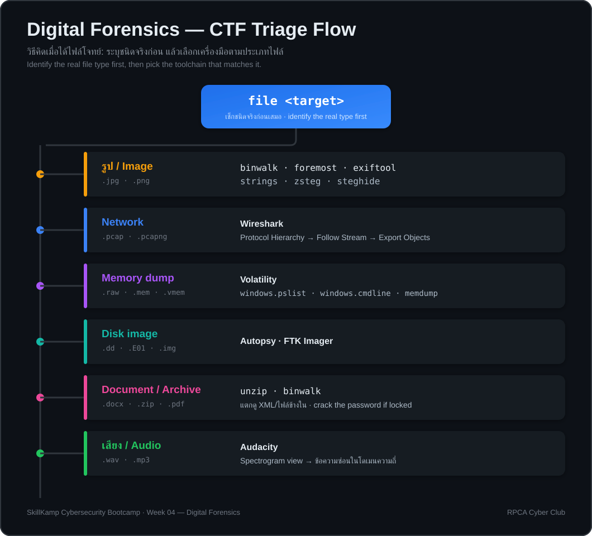

## Week 04 — Digital Forensics & Blue Team CTF

> Thai version: [README-TH.md](README-TH.md)

**Date:** November 22, 2026
**Platform:** Cyber Lab 2026 (CTFd) · Kali Linux · Windows 11 forensic tools
**Course:** Workshop 1 — Digital Forensics (RPCA Cyber Club, Faculty of Forensic Science, Royal Police Cadet Academy)

### Overview

The fourth week shifted from watching a network to examining the evidence left behind on it. The workshop covered the fundamentals of digital forensics — how evidence is identified, preserved, analyzed and presented in a legally sound way — and then applied those ideas against a live CTF platform.

The hands-on half was built around four forensic branches (File, Disk, Memory, Network) plus steganography, using free and open-source tooling on Kali Linux, with FTK Imager, Autopsy and Wireshark run on a Windows 11 ARM64 VM on Apple Silicon.

### CTF Triage Flow

The core methodology for the week — identify the real file type first, then pick the toolchain that matches it:



### Topics Covered

#### 1. Digital Forensics Fundamentals

- The five-step process with Chain of Custody: Identification → Collection → Preservation → Analysis → Presentation
- Acquisition levels: Manual, Logical, Physical (bit-by-bit)
- Evidence-handling principles: recover water-damaged devices together with the water; assume the device is already damaged to preserve its state; never upload real evidence to online services

#### 2. File Forensics

- File signatures (magic numbers): JPG `FF D8 … FF D9`, PNG `89 50 4E 47 … IEND`, PDF `%PDF … %%EOF`, ZIP/Office `50 4B 03 04 … 50 4B 05 06`, EXE `MZ`, ELF `7F 45 4C 46`
- Office files (docx/xlsx/pptx) are ZIP archives — extract and inspect the inner XML
- Metadata extraction, file carving, and detection of data hidden past a file trailer

```bash
file suspect.jpg            # identify by magic number, not extension
binwalk suspect.jpg         # find embedded files
foremost -i suspect.jpg -o out/   # carve by header/trailer
exiftool suspect.jpg        # metadata, GPS, embedded thumbnail
strings suspect.jpg | grep -i flag
```

#### 3. Disk Forensics

- Non-volatile storage vs volatile RAM; order of volatility
- Forensic imaging is bit-for-bit, so an image equals the source disk in size
- Artifacts (browser history, search terms, recent files) live on the disk — a VPN does not remove them

Tools: FTK Imager, Autopsy (The Sleuth Kit GUI), `dd`, Guymager

#### 4. Memory Forensics

- Analyzing RAM for running processes, malware and credentials left in memory

```bash
# Volatility 2 — find the profile first
volatility -f dump.raw imageinfo
volatility -f dump.raw --profile=Win10x64 pslist
volatility -f dump.raw --profile=Win10x64 memdump -p <PID> -D ./

# Volatility 3 — no profile needed
vol -f dump.raw windows.pslist
vol -f dump.raw windows.cmdline
```

Classic example (Google CTF For1): `pslist` finds `mspaint.exe` → `memdump` the process → rename `.dmp` to `.data` → open in GIMP as raw RGB → the flag was drawn in Paint and left in memory.

#### 5. Network Forensics

- Analyzing `.pcap` / `.pcapng` capture files
- Wireshark workflow: Protocol Hierarchy → Display Filter → Follow Stream → Export Objects
- HTTP / FTP / Telnet are readable in plain text; TLS traffic is encrypted

```text
http.request.method == "POST"
ip.addr == 10.0.11.50
frame contains "password"
```

Tools: Wireshark, TShark, tcpdump, NetworkMiner

#### 6. Steganography

- Hiding the *existence* of data inside ordinary files, not just its contents
- Image: Steghide, Stegseek, zsteg (PNG LSB), Stegsolve
- Audio: open in Audacity / Sonic Visualiser and switch to **Spectrogram** view to reveal hidden text in the frequency domain

### Lab Environment Notes (Apple Silicon)

| Branch | Tool | Runs on |
| --- | --- | --- |
| File | Hex Fiend, binwalk, foremost, exiftool, strings | macOS / Kali |
| Disk | FTK Imager, Autopsy 4.23.1 | Windows 11 ARM64 VM (x64 via emulation) |
| Memory | Volatility | Kali |
| Network | Wireshark 4.6.10 (arm64 native), tshark | Windows VM / Kali |
| Stego | Audacity | Windows VM / Kali |

> Takeaway: CTF forensics work is most stable on Kali Linux, where the CLI tooling is ARM-native and needs no emulation. HxD is Windows-only — Hex Fiend is the macOS equivalent.

### CTF Challenges Solved

| Challenge | Category | Technique | Tool |
| --- | --- | --- | --- |
| Hidden Text | File | Text embedded as plain bytes | `strings \| grep` |
| Comment | File | docx is ZIP — inspect inner XML | `binwalk -e` / `unzip` + `grep` |
| The Sound of Flower | Stego | Hidden image in audio spectrogram | Audacity (Spectrogram) |

---

### Hands-on Labs

Full step-by-step write-ups are in [`labs/`](labs/).

**[Lab 01 — File Forensics & CTF Practice](labs/LAB-01.md)** ([English](labs/LAB-01-EN.md))
Set up the toolchain across macOS, Kali and a Windows 11 ARM VM, then worked File-, Memory-, Network- and Stego-forensics challenges on the Cyber Lab 2026 platform — identifying file types, carving embedded images, inspecting docx XML, and reading a hidden message from an audio spectrogram.
Skills: file signature analysis, carving, metadata extraction, steganography, CTF methodology.
