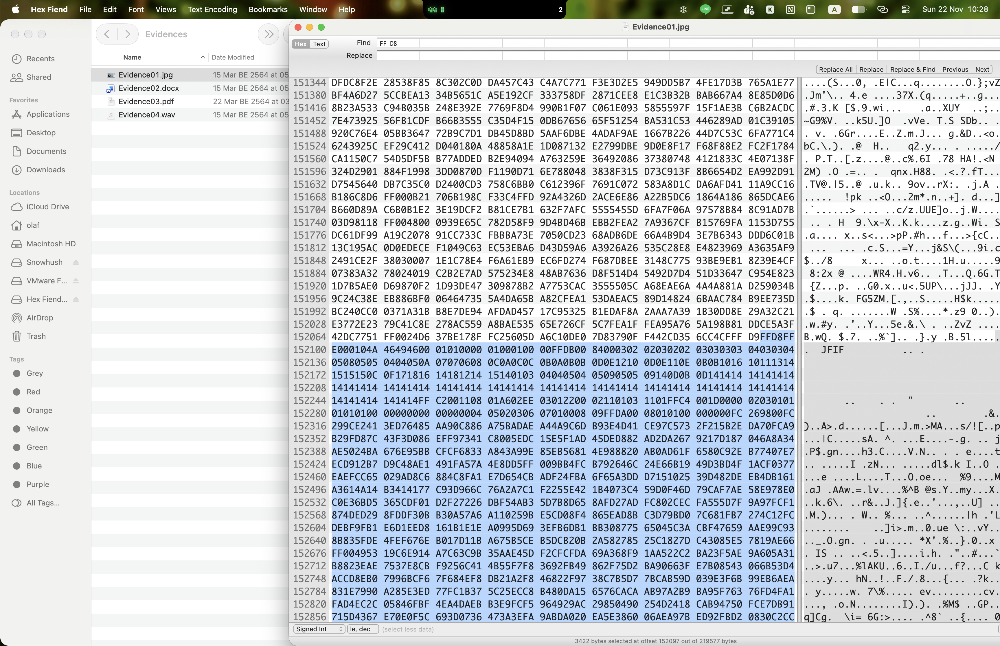
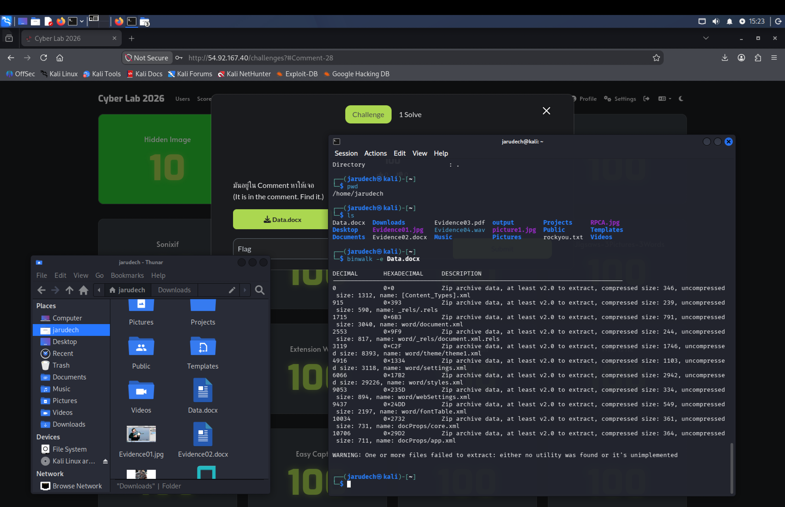
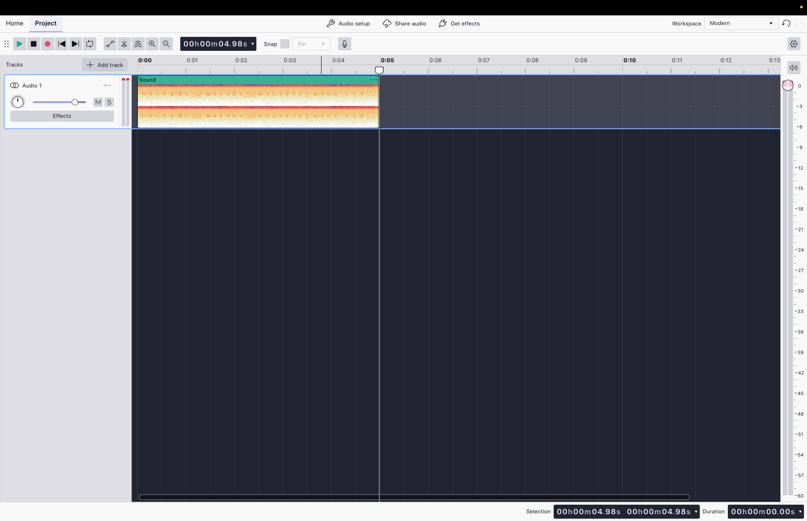
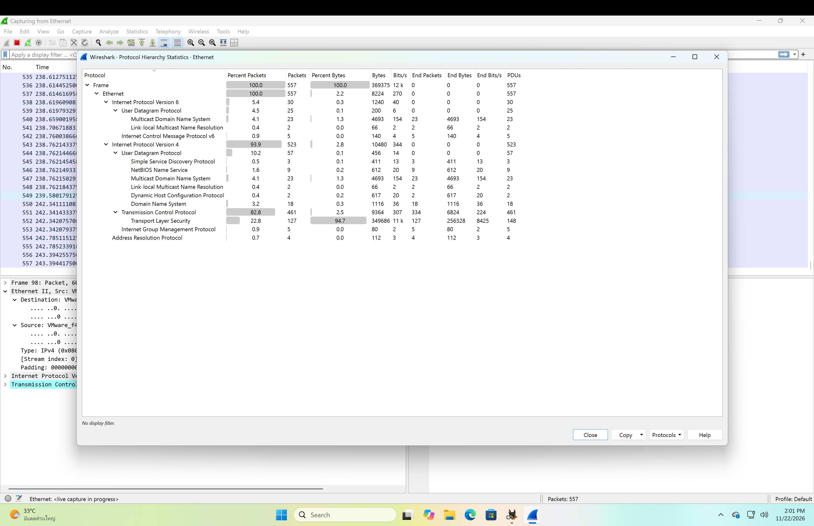
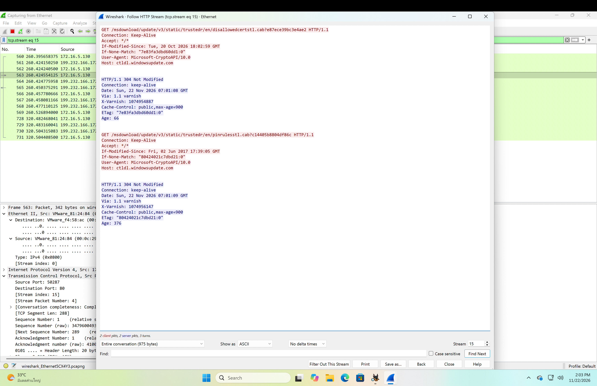

# 🔬 LAB 01 Summary: File Forensics & CTF Practice

> Thai version: [LAB-01.md](LAB-01.md)
> Screenshots go in `images/lab01/`

## Lab Overview

**Goal:** build a cross-platform forensic toolchain and use it to solve digital-forensics challenges on the Cyber Lab 2026 CTF platform, applying file-signature analysis, carving, metadata extraction and steganography.

**Environment:** MacBook (Apple Silicon M4 Pro) running:
- **macOS** — Hex Fiend for hex inspection
- **Kali Linux (ARM)** — CLI forensic tools (`file`, `binwalk`, `foremost`, `exiftool`, `strings`, Volatility)
- **Windows 11 ARM64 VM** (VMware Fusion) — FTK Imager, Autopsy, Wireshark, Audacity

**CTF platform:** Cyber Lab 2026 (CTFd) at `http://54.92.167.40`

## Exercise 1: Toolchain Setup

| Tool | Platform | Notes |
| --- | --- | --- |
| Hex Fiend | macOS | HxD is Windows-only; Hex Fiend is the macOS equivalent |
| binwalk / foremost / exiftool | Kali | ARM-native, no emulation needed |
| FTK Imager 8.3 / Autopsy 4.23.1 | Windows 11 ARM VM | x64 apps running via emulation |
| Wireshark 4.6.10 | Windows VM | arm64-native build available |
| Audacity | Windows VM / Kali | spectrogram analysis for audio stego |

> **Key lesson:** CTF forensics is most stable on Kali Linux. FTK Imager and Autopsy do not ship for ARM, so on Apple Silicon they run through a Windows ARM VM via emulation — fine for learning, but the CLI tools on Kali are faster and more reliable.

## Exercise 2: File Signature Analysis

The core idea of File Forensics — the real file type is in the magic number, not the extension.

```bash
file suspect.jpg            # identify by header bytes
xxd suspect.jpg | head      # inspect the header (FF D8 FF for JPEG)
xxd suspect.jpg | tail      # inspect the trailer (FF D9 for JPEG)
```

A hidden image concatenated after a JPEG's `FF D9` trailer shows up as a second `FF D8 … FF D9` pair — invisible to an image viewer, but recoverable.



## Exercise 3: CTF Challenges

### Hidden Text — File Forensics

The flag was embedded directly in the file as readable bytes.

```bash
strings RPCA.jpg | grep -i flag
```

**Result:** flag recovered — `strings` extracts printable text that a viewer never shows.

### Comment — File Forensics (docx)

A `.docx` file is a ZIP archive, so `strings` on the compressed file finds nothing useful. The file has to be extracted first.

```bash
file Data.docx              # Microsoft Word 2007+ / Zip archive
binwalk -e Data.docx        # or: unzip Data.docx -d extracted/
grep -r -i "flag" _Data.docx.extracted/
```

Inspected both `docProps/core.xml` (document metadata — title, subject, description) and `word/document.xml` (document body, where an XML comment `<!-- -->` can hide text).



### The Sound of Flower — Steganography (audio)

A `.wav` file with a message hidden in the audio spectrogram.

1. Open `Sound.wav` in Audacity.
2. Switch the track view from Waveform to **Spectrogram**.
3. Text appears in the frequency domain — the Thai word **"ดอกกุหลาบ"** (rose).

The challenge story hinted that an English keyboard distorted Thai input, so the flag involves Thai/English keyboard-layout substitution. Flag format: `FLAG{...}`.



## Exercise 4: Network Forensics with Wireshark

Although no network challenge was solved, the Wireshark workflow was practiced on live traffic to reinforce the method.

1. **Statistics → Protocol Hierarchy** — start here to see what protocols a capture contains and spot readable ones (HTTP/FTP) among the encrypted TLS.



2. **Right-click a packet → Follow → HTTP Stream** — read the full request/response of a conversation (here, plain-text Windows Update certificate traffic).



## Key Takeaways

- **`file` first, always.** The extension lies; the magic number does not.
- **Office documents are ZIP archives** — extract and `grep` the inner XML instead of running `strings` on the compressed file.
- **Audio challenges → spectrogram.** Open in Audacity and switch the view; hidden text lives in the frequency domain, not the waveform.
- **Match the tool to the platform.** On Apple Silicon, lean on Kali's ARM-native CLI tools and keep the Windows VM for GUI-only tools (FTK Imager, Autopsy).

## Standard Methodology

```
file <target>          # identify the real type first
  │
  ├─ image (.jpg/.png) → binwalk, foremost, exiftool, strings, zsteg, steghide
  ├─ capture (.pcap)   → Wireshark: Protocol Hierarchy → Follow Stream → Export Objects
  ├─ memory dump       → Volatility
  ├─ disk image        → Autopsy, FTK Imager
  ├─ docx / zip / pdf  → unzip/binwalk; crack the password if locked
  └─ audio (.wav/.mp3) → Audacity spectrogram
```
