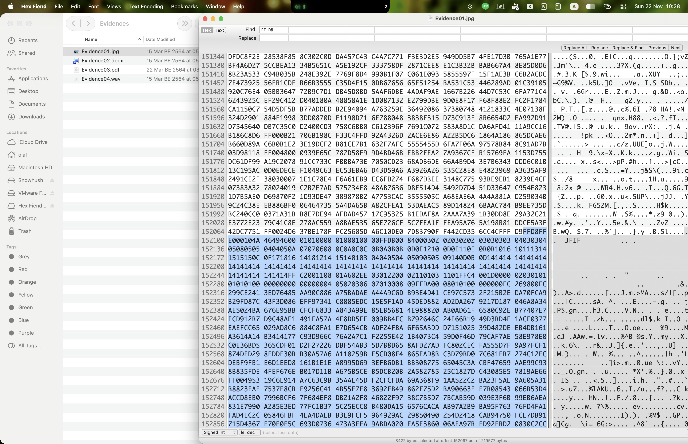
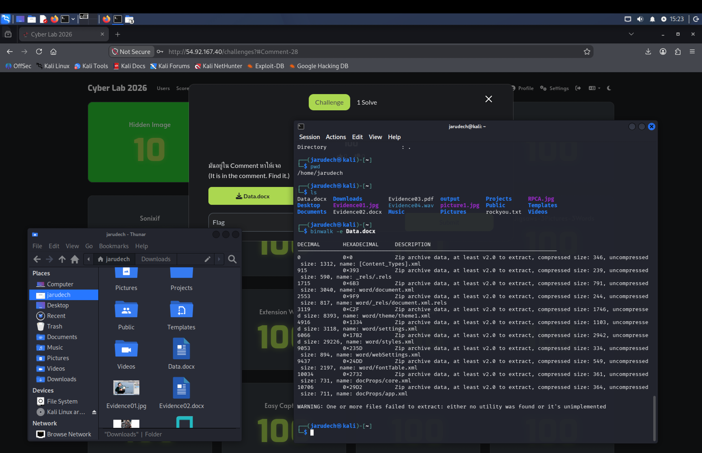
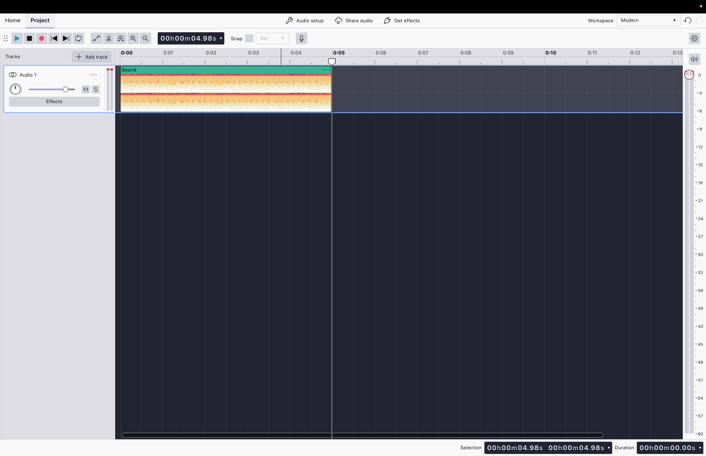
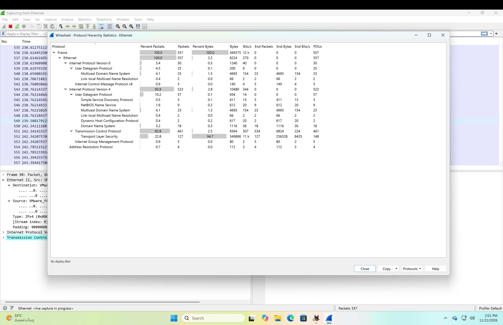
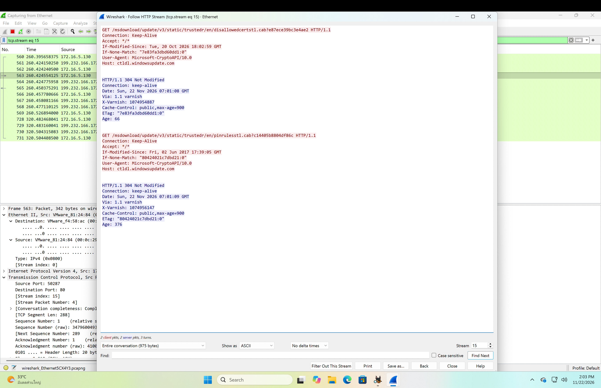

# 🔬 สรุป LAB 01: File Forensics & CTF Practice

> English version: [LAB-01-EN.md](LAB-01-EN.md)
> รูปภาพอยู่ใน `images/lab01/`

## ภาพรวมแล็บ

**เป้าหมาย:** สร้างชุดเครื่องมือ forensic ข้ามแพลตฟอร์ม แล้วใช้แก้โจทย์ digital forensics บนแพลตฟอร์ม CTF Cyber Lab 2026 โดยใช้เทคนิค file-signature analysis, carving, การอ่าน metadata และ steganography

**สภาพแวดล้อม:** MacBook (Apple Silicon M4 Pro) รัน:
- **macOS** — Hex Fiend สำหรับดู hex
- **Kali Linux (ARM)** — เครื่องมือ CLI (`file`, `binwalk`, `foremost`, `exiftool`, `strings`, Volatility)
- **Windows 11 ARM64 VM** (VMware Fusion) — FTK Imager, Autopsy, Wireshark, Audacity

**แพลตฟอร์ม CTF:** Cyber Lab 2026 (CTFd) ที่ `http://54.92.167.40`

## แบบฝึกหัดที่ 1: ติดตั้งเครื่องมือ

| เครื่องมือ | แพลตฟอร์ม | หมายเหตุ |
| --- | --- | --- |
| Hex Fiend | macOS | HxD เป็นของ Windows เท่านั้น — Mac ใช้ Hex Fiend แทน |
| binwalk / foremost / exiftool | Kali | ARM native ไม่ต้อง emulate |
| FTK Imager 8.3 / Autopsy 4.23.1 | Windows 11 ARM VM | โปรแกรม x64 รันผ่าน emulation |
| Wireshark 4.6.10 | Windows VM | มีเวอร์ชัน arm64 native |
| Audacity | Windows VM / Kali | ใช้วิเคราะห์ spectrogram ของเสียง |

> **บทเรียนสำคัญ:** งาน CTF forensics ทำบน Kali Linux เสถียรที่สุด เพราะ FTK Imager และ Autopsy ไม่มีเวอร์ชัน ARM — บน Apple Silicon ต้องรันผ่าน Windows ARM VM ด้วย emulation (พอใช้เรียนรู้ได้ แต่เครื่องมือ CLI บน Kali เร็วและชัวร์กว่า)

## แบบฝึกหัดที่ 2: File Signature Analysis

หัวใจของ File Forensics — ชนิดไฟล์จริงอยู่ที่ magic number ไม่ใช่นามสกุล

```bash
file suspect.jpg            # ระบุชนิดจาก header bytes
xxd suspect.jpg | head      # ดู header (FF D8 FF สำหรับ JPEG)
xxd suspect.jpg | tail      # ดู trailer (FF D9 สำหรับ JPEG)
```

ภาพที่ซ่อนต่อท้าย trailer `FF D9` ของ JPEG จะเจอคู่ `FF D8 … FF D9` เป็นชุดที่สอง — โปรแกรมดูรูปมองไม่เห็น แต่กู้ออกมาได้



## แบบฝึกหัดที่ 3: โจทย์ CTF

### Hidden Text — File Forensics

flag ถูกฝังในไฟล์แบบ byte ที่อ่านได้ตรง ๆ

```bash
strings RPCA.jpg | grep -i flag
```

**ผล:** กู้ flag ได้ — `strings` ดึงข้อความที่อ่านได้ซึ่งโปรแกรมดูรูปไม่แสดง

### Comment — File Forensics (docx)

ไฟล์ `.docx` เป็น ZIP archive การรัน `strings` บนไฟล์ที่ถูกบีบอัดเลยไม่เจออะไร ต้องแตกไฟล์ออกมาก่อน

```bash
file Data.docx              # Microsoft Word 2007+ / Zip archive
binwalk -e Data.docx        # หรือ: unzip Data.docx -d extracted/
grep -r -i "flag" _Data.docx.extracted/
```

ตรวจทั้ง `docProps/core.xml` (metadata ของเอกสาร — title, subject, description) และ `word/document.xml` (เนื้อหาเอกสาร ที่ XML comment `<!-- -->` ซ่อนข้อความได้)



### The Sound of Flower — Steganography (เสียง)

ไฟล์ `.wav` ที่ซ่อนข้อความไว้ใน spectrogram ของเสียง

1. เปิด `Sound.wav` ใน Audacity
2. เปลี่ยน view ของ track จาก Waveform เป็น **Spectrogram**
3. ตัวหนังสือปรากฏในโดเมนความถี่ — คำว่า **"ดอกกุหลาบ"**

โจทย์ใบ้ว่าคีย์บอร์ดอังกฤษทำให้การพิมพ์ไทยเพี้ยน → flag เกี่ยวกับการสลับแป้นไทย-อังกฤษ รูปแบบ flag: `FLAG{...}`



## แบบฝึกหัดที่ 4: Network Forensics ด้วย Wireshark

แม้จะไม่ได้แก้โจทย์สาย network แต่ได้ฝึก flow การใช้ Wireshark กับ traffic จริงเพื่อทบทวนวิธีการ

1. **Statistics → Protocol Hierarchy** — เริ่มที่นี่ก่อน เพื่อดูว่า capture มี protocol อะไรบ้าง และหาตัวที่อ่านได้ (HTTP/FTP) ท่ามกลาง TLS ที่เข้ารหัส



2. **คลิกขวาที่ packet → Follow → HTTP Stream** — อ่าน request/response เต็ม ๆ ของการเชื่อมต่อนั้น (ในที่นี้คือ traffic certificate ของ Windows Update แบบ plain text)



## สิ่งที่ได้เรียนรู้

- **`file` ก่อนเสมอ** นามสกุลโกหกได้ แต่ magic number ไม่โกหก
- **เอกสาร Office เป็น ZIP** — แตกออกมาแล้ว `grep` ใน XML ข้างใน แทนการรัน `strings` บนไฟล์ที่บีบอัด
- **โจทย์เสียง → spectrogram** เปิดใน Audacity แล้วเปลี่ยน view ข้อความซ่อนอยู่ในโดเมนความถี่ ไม่ใช่ waveform
- **เลือกเครื่องมือให้เข้ากับแพลตฟอร์ม** บน Apple Silicon ใช้เครื่องมือ CLI ARM-native บน Kali เป็นหลัก เก็บ Windows VM ไว้สำหรับโปรแกรมที่มีแต่ GUI (FTK Imager, Autopsy)

## Flow มาตรฐาน

```
file <ไฟล์>            # เช็กชนิดจริงก่อนเสมอ
  │
  ├─ รูป (.jpg/.png)   → binwalk, foremost, exiftool, strings, zsteg, steghide
  ├─ pcap (.pcap)      → Wireshark: Protocol Hierarchy → Follow Stream → Export Objects
  ├─ memory dump       → Volatility
  ├─ disk image        → Autopsy, FTK Imager
  ├─ docx / zip / pdf  → unzip/binwalk; แคร็กรหัสถ้าล็อก
  └─ เสียง (.wav/.mp3) → Audacity spectrogram
```
